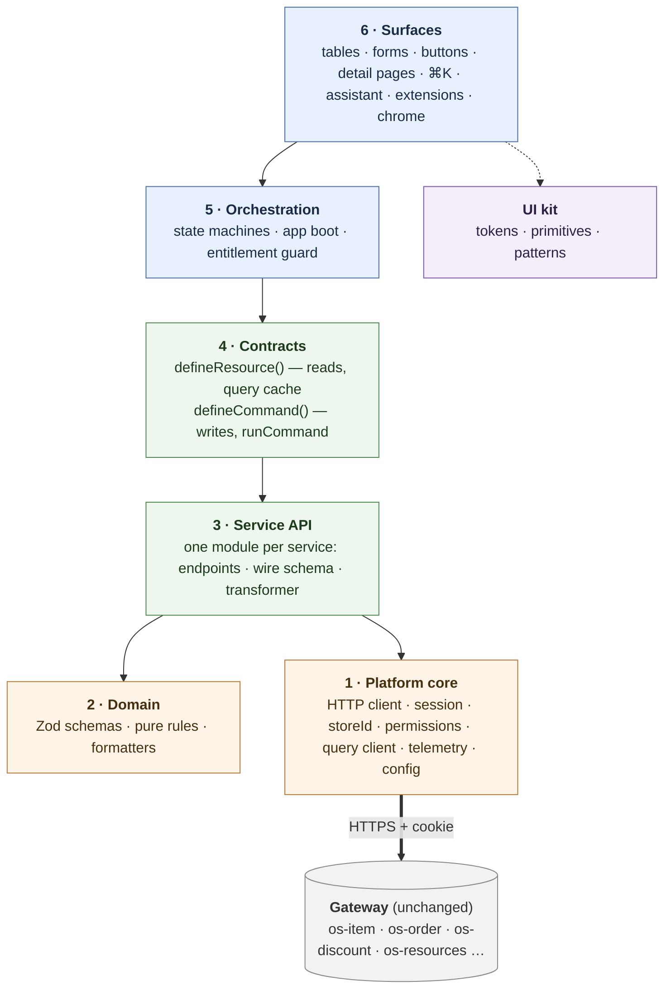

# GK Admin — Architecture

> Status: **Draft v0** · Owner: Aman Zaid · Updated: 2026-10-14

The new merchant admin, **Ratio** (products, collections, inventory, orders, customers, discounts…) built as a fresh codebase, with an AI assistant and a modern interaction layer on top of a CRUD core.

This file is the map. Each linked doc is short and covers one topic.

---

## What we are building

- **Core:** tables + forms over 11 resources (CRUD, filters, bulk actions, import/export).
- **Flows:** a handful of multi-step processes (bulk edit, CSV import, draft order → order, price schedules).
- **Assistant:** an in-app AI that can read the current screen and propose actions the user confirms.
- **Extensibility:** third-party UI extensions and embedded apps, as today.

## Layers

A layer uses only layers below it (any of them, not just the next), never one above. The UI kit is a side layer used only by surfaces. Who may import what: [structure](docs/structure.md#layers-and-imports).

State is not a layer: server data sits in the query cache (client in platform core, queries and keys in contracts), view state in the URL (router, in surfaces), UI flags in components or a small store ([state](docs/state.md)).

## Principles

1. **Define once, use everywhere.** An entity is described once (resource), an action is described once (command). Tables, menus, ⌘K, AI and extensions all consume the same definitions.
2. **Server data lives in the server cache.** Never copied into a global store. No `useEffect` decides when to fetch.
3. **View state lives in the URL.** Filters, sort, page, tab. Refresh and shared links restore the view.
4. **One schema per shape.** Zod schemas validate API responses, drive forms and become AI tool inputs.
5. **Machines for flows, hooks for rendering.** If it needs 3+ booleans or an effect chain, it is a state machine.
6. **Spec first, confirmed by real screens.** Resource and command definitions are the target spec; products and orders are built first and the contracts adjusted where real code disagrees.
7. **Parity now, change later in one place.** Business logic behaves exactly as in today's gk-pages. Known future changes (tax, channels, inventory history, new settings) are prepared as local seams: a schema field, a transformer, a command, a registered section. See [schema/deferred.md](domain/deferred.md).

## Docs

| Layer | Docs |
|---|---|
| Gateway (backend) | [gateway/](gateway/README.md): every endpoint gk-pages uses, CORS and bypass audit |
| 1 · Platform core | [platform/](platform/README.md): HTTP client, session, merchant, permissions, config |
| 2 · Domain | [domain/](domain/README.md): entities, business rules, formatters |
| 3 · Service API | [service-api/](service-api/README.md): data flow, wire schema → transformer, what transformers normalise |
| 4 · Contracts | [resources/](resources/README.md) reads · [commands/](commands/README.md) writes |
| 5 · Orchestration | [machines.md](docs/machines.md): boot, login, refund, editor, import… |
| 6 · Surfaces | [surfaces/](surfaces/README.md) routing, chrome · [assistant.md](docs/assistant.md) · [extensions.md](docs/extensions.md) · [ui-kit.md](docs/ui-kit.md) |

| Cross-cutting | Docs |
|---|---|
| State | [state.md](docs/state.md): where data lives |
| Operations | [operations/](operations/README.md): delivery, quality, contribution |
| Code | [structure.md](docs/structure.md) folders and imports · [stack.md](docs/stack.md) libraries |
| Planning | [context.md](docs/context.md) · [design-mapping.md](docs/design-mapping.md) · [build-order.md](docs/build-order.md) · [open-questions.md](docs/open-questions.md) · [adr/](adr/README.md) |

## Decisions log

Settled decisions: [`adr/`](adr/README.md).
