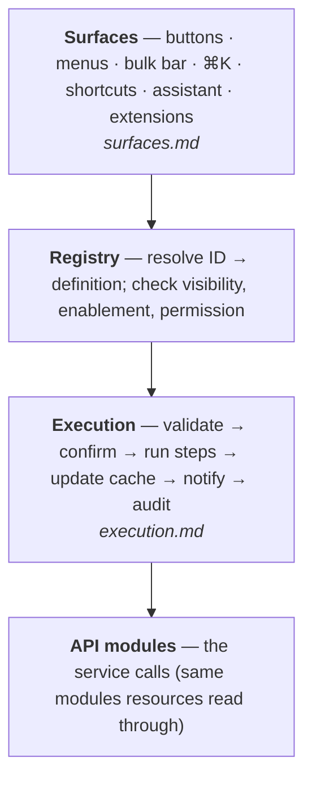

# Commands

[← Architecture](../README.md)

A **command** is every action that changes data or has an effect outside the page: update a product, cancel an order, export customers.

- Each is defined once.
- Buttons, menus, the bulk bar, ⌘K, shortcuts, the assistant and extensions all run the same definition through one execution path.

Background on the model and the products it draws from: [ADR 0001](../adr/0001-resources-and-commands.md).

## Layers

## Files

| File | Covers |
|---|---|
| [contract.md](contract.md) | The `CommandDefinition` type |
| [execution.md](execution.md) | The single execution path: availability, input, confirmation, modes, steps and compensation, cache, feedback, errors, audit |
| [bulk-and-jobs.md](bulk-and-jobs.md) | Bulk operations, partial failure, background jobs, polling |
| [surfaces.md](surfaces.md) | How each surface finds and runs commands, including the assistant and extensions |
| [registry.md](registry.md) | All v1 commands, assistant topics, permissions, shortcuts |
| [defs/catalog.md](defs/catalog.md) | Product, collection, price schedule, field definition |
| [defs/inventory.md](defs/inventory.md) | Inventory, purchase order, transfer |
| [defs/orders.md](defs/orders.md) | Order, refund, draft order |
| [defs/customers.md](defs/customers.md) | Customer, segment |
| [defs/discounts.md](defs/discounts.md) | Discount, discount set, assistant session flow |
| [defs/bulk-ops.md](defs/bulk-ops.md) | Import and export jobs |

## Rules

1. **One path.** Every surface calls `runCommand`. No component calls a write endpoint.
2. **Stable IDs.** `resource.verb` (`order.cancel`). Renaming an ID breaks shortcuts, extensions and assistant history.
3. **Availability is data.** Visibility and enablement are functions of context, not `if`s in components.
4. **The assistant gets no special path.** Same permissions, confirmation and audit as a person; it proposes, the person approves.
5. **Commands own orchestration.** Multi-call writes are steps inside the command, never sequenced in UI code.

## Defects in today's writes

Found while mapping gk-pages. Plumbing defects are fixed in the commands. Defects that change data sent to the backend need product sign-off before the fix ships; until then the command keeps today's behaviour behind one switch.

| Defect in gk-pages | Data impact | Treatment |
|---|---|---|
| Discount wizard create and edit always show success (`makeAPICall` soft failures not checked) | No | Fixed: result checks the API success flag |
| Discount delete toast says "draft"; no confirm | No | Delete not in v1 (menu disabled today) |
| Single product and collection delete without confirmation | No | Fixed: critical confirm |
| Product bulk edit converts product-level prices to paise twice | Yes (prices ×100) | Needs sign-off; high priority |
| PO "Mark as ordered" sends costs not converted to paise (close/reopen do) | Yes (costs) | Needs sign-off |
| Bulk cancel sends auto-refund without the single-cancel eligibility rule | Yes (refunds) | Needs sign-off |
| Receive drops lines with only a rejected quantity (PO, transfer) | Yes (stock) | Needs sign-off |
| Price schedule conflicts (`interferingTasks`) not shown | No | Fixed: shown in the error |
| Inventory export errors use `alert()` | No | Fixed: standard error result |

