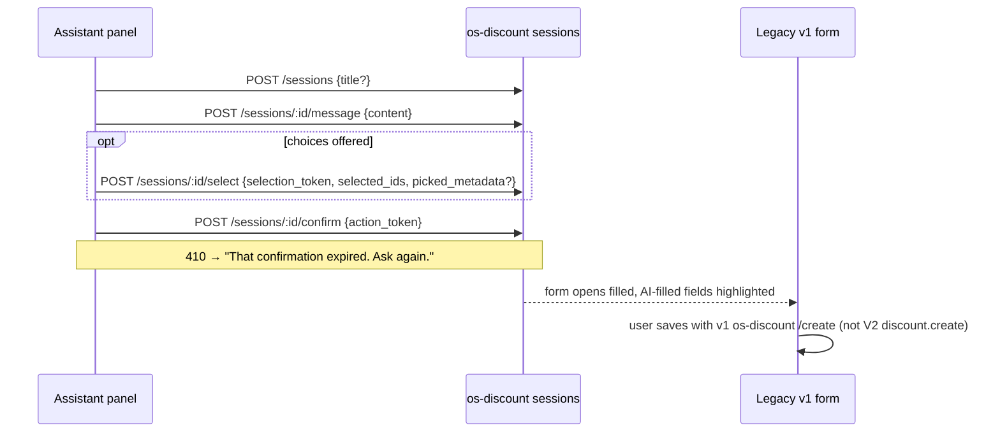

# Discount commands

[← Commands](../README.md) · Resource: [discount](../../resources/defs/discount.md) · Services: Discount Service V2 via the gateway for `discount.*` (paths relative to `{BASE}/dashboard/v2/discount`); os-discount for `discountSet.*` and the assistant session (paths relative to `{DISCOUNT}/api/v1/admin/os-discount`). Paths that start with a token are full ([base URLs](../../platform/api-client.md#base-urls)).

Permission: `write_discounts` for every command (enforcement off in v1).

Effect: R read-only · D destructive · I idempotent · X external. Mode: P pessimistic.

Payloads come from the transformer per API, exactly as today:

| API | Money | Unlimited | No end date |
|---|---|---|---|
| V2 (`formToV2Payload`) | paise | field omitted | field omitted |
| v1 (sets), rules engine | paise | 1,000,000 | `9999-12-31T23:59:59Z` |

| Command | Scope | Steps | Confirm | Effect | Mode | After |
|---|---|---|---|---|---|---|
| `discount.create` | page | `POST /create` (`status: 'draft' \| 'published'` from the finish choice) | — | — | P | toast "Discount published" / "Saved as draft"; go to list |
| `discount.update` | record | `PUT /update/:id` (full wizard payload; `mode` ignored by the engine) | published: "Changes apply to customers right away" | I | P | toast; go to list |
| `discount.publish` | record | `PUT /bulk/update {merchant_id, discount_ids: [id], status: 'published', updated_by}` | "Publish {code}? Customers can use it right away." | I X | P | toast "Discount published" |
| `discount.moveToDraft` | record | `PUT /bulk/update {…, status: 'draft'}` | — | I | P | toast |
| `discount.markInactive` | record | `PUT /bulk/update {…, status: 'inactive'}` | "Deactivate {code}?" | I X | P | toast |
| `discount.checkCode` | record | `POST /check-code {code, merchant_id}` (wizard step 2) | — | R | P | inline error when the code exists |
| `discount.createWithAssistant` | page | session flow below | — | — | P | opens the legacy form filled; saves with v1 `POST {DISCOUNT}/api/v1/admin/os-discount/create` |
| `discountSet.create` | page | `POST /create-discount-set` (base keys + `number_of_random_coupons, prefix, suffix, length, email`) | "Generate N codes?" | X | P | toast "Discount set created" |
| `discountSet.update` | record | `PUT /update/:id` (keeps `rules[0].rule_id`, `is_deleted: false`) | — | I | P | toast |
| `discountSet.downloadCodes` | record | `POST {BASE}/api/v1/admin/os-discount/bulk-discount/presigned-url {url, operation_type: 'FETCH'}` → fetch zip → CSV | — | R | P | download `discount-codes-{campaignId}.csv` |

Notes:
- **Result handling**: `discount.create` and `discount.update` check the API's success flag; a failure is shown as an error (today the wizard shows success unless the call throws, and `makeAPICall` returns soft failures; see [defects](../README.md#defects-in-todays-writes)).
- **Status commands**: each of publish, move to draft and mark inactive, except the current status ([domain rule](../../domain/discounts.md#rules)).
- **Delete**: `PUT /bulk/update {status: 'deleted'}` (the gateway has no delete route), but the menu item is disabled in gk-pages; not in v1.
- **Bulk status**: `PUT /bulk/update {merchant_id, discount_ids, status?, visibility?, updated_by}`; no bulk UI today; not in v1.
- **Global discount settings** (`/discounts/global-settings`: `GET /merchant-config`, `PUT /config/merchant/upsert`) exist in gk-pages; the entry button is hidden; not in v1.
- `discountSet.downloadCodes` enabled when the campaign job is completed.

### Create with the assistant

Uses the existing os-discount AI session API, not a second path:

In the new admin this flow runs inside the assistant panel (topic: discounts); the confirm step is the proposal card.

## Exposure

| Command | Palette | Assistant | Extensions |
|---|---|---|---|
| create, save, moveToDraft, checkCode, createWithAssistant, downloadCodes | ✓ | ✓ (topic: discounts) | — |
| publish, markInactive, discountSet.create, discountSet.update | ✓ | ✓, proposal + confirm (customer-facing) | — |
