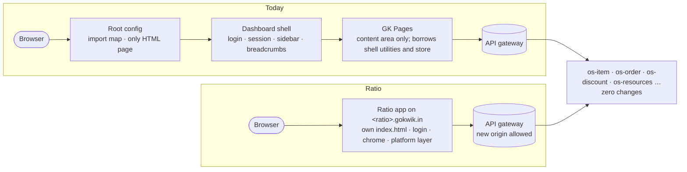

# Context — today's GK

[← Architecture](../README.md)

## Today

gk-pages is a Single SPA microfrontend inside the GoKwik dashboard. The dashboard shell owns login, session, merchant selection, sidebar and breadcrumbs; gk-pages renders only the content area.

The root config and the dashboard shell leave the path; their jobs move into Ratio. Nothing behind the gateway changes.

| Area | Today |
|---|---|
| Framework | React 18, TypeScript 4.3, Webpack (single-spa config), one bundle, no route splitting |
| Server data | Redux slices per entity + `useEffect` chains that trigger fetches |
| View state | Mostly component / Redux state; little use of the URL |
| API | `makeAPICall` borrowed from the shell (`@gokwik/utilities`), injects merchant headers, sends the auth cookie |
| Merchant/user | Read from the shell's Redux store and `sessionStorage['merchant-mid']` |
| Forms | React Hook Form + Zod |
| UI | gokwik-ui-kit (antd wrapper) + Tailwind + Radix |
| Extensions | Sandboxed UI extensions (`gokwik-ui-extensions-*`) and iframe apps via an app bridge |

## Keep

- Zod + React Hook Form.
- Module-per-domain organisation (api / transformer / types).
- The auth model: httpOnly gateway cookie, no token in JS.
- The extension model (sandboxed extensions, app bridge) — re-hosted on the new contracts.
- Backend services and gateway, unchanged.

## Drop

- Redux for server data.
- Effect-driven fetching.
- Dependency on the dashboard shell (`makeAPICall`, shell store, import map).
- Very large page components that mix rules, UI and API calls.

## Constraints

Carried from the standalone decision tracker: [platform](../platform/README.md).
