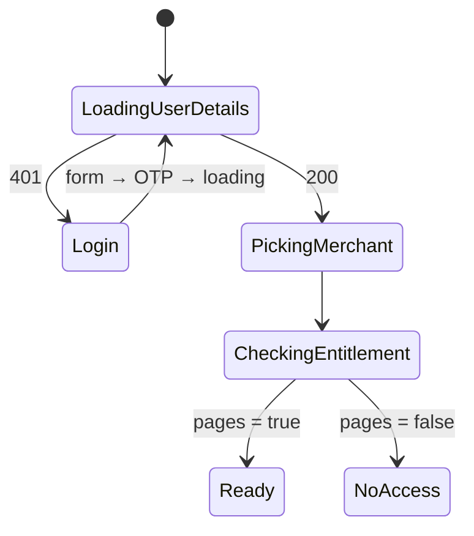

# State machines

[← Architecture](../README.md)

XState v5 for flows that have steps. Not for every screen. Two or three people author machines; everyone else uses their hooks (d41).

## Use a machine when

- the flow has 3+ distinct steps, or
- you would otherwise need 3+ booleans, or
- the next step depends on an async result, a timer, or a user decision.

Lists, records and single commands don't need one: the query cache and `runCommand` cover them.

## v1 machines

| Machine | States | Used by |
|---|---|---|
| Login | form → otp → loading; resend timer; Google | [auth-session](../platform/auth-session.md) |
| App boot | loading user details (401 → login) → picking merchant → checking entitlement → ready / no access | [below](#app-boot) |
| Record editor | loading → pristine ⇄ dirty → saving → pristine; invalid; conflict; error; navigation guard | [resources/editor](../resources/editor.md#draft-lifecycle) |
| Refund | select items ⇄ calculating → preview → submitting → polling → success / failed / still processing | [order commands](../commands/defs/orders.md#refund-flow) |
| Discount wizard | 5 steps (type → offer & code → eligibility → usage → review); code check on leaving step 2; finish dialog → publishing / saving draft | [discount](../resources/defs/discount.md#editor) |
| Order edit session | beginning → (waiting on stale collision) → active ⇄ staging → previewing → committing → committed; error; discard on leave | [order commands](../commands/defs/orders.md#order) |
| Draft payment watch | awaiting payment (poll `GET /draft-orders/:id` every 8 s; paused while hidden; ≤ 30 min; stops after 5 failures) → converted (open order) / stopped | [order commands](../commands/defs/orders.md#draftordercomplete-today) |
| Import | upload → validating (preview) → invalid / ready → importing (job) → done / failed | [bulk-ops](../commands/defs/bulk-ops.md#import-productimport-orderimport) |
| Job tracker | pending → running → completed / failed / cancelled; polls progress | [bulk-ops](../commands/defs/bulk-ops.md#job-tracking) |
| Assistant | idle → thinking → proposed → confirming → executing → done / error | [assistant](assistant.md) |

The machine drives the UI; writes inside it are still commands (`refund.create`, `order.update`, `product.import`).

## App boot



`GET /user/details` is both the session check and the user load ([auth](../platform/auth-session.md#cookie-session)).

## File layout

Every machine is a folder; `machine.ts` only orchestrates.

```
machines/refund/
  machine.ts   # states and transitions only
  actors.ts    # async work (resource queries, runCommand), replaceable in tests
  actions.ts   # pure assign helpers
  types.ts     # context and events
  index.ts
```
