# State machines

[← Architecture](../README.md)

XState v5 for flows that have steps. Not for every screen.

## Use a machine when

- the flow has 3+ distinct steps, or
- you would otherwise need 3+ booleans, or
- the next step depends on an async result, a timer, or a user decision.

Lists, records and single commands don't need one: the query cache and `runCommand` cover them.

## Rules

- **Events, not watchers.** User actions and actor results are events. What can't send events (URL, tab visibility, other tabs) is wrapped in one subscription actor that sends a named event. No `useEffect` chains for async work.
- **One state per distinct outcome.** A state exists only if it allows different events, exits or UI; failures with the same exits share a state.
- **Every async state has a way out:** a timeout (`after`) or a limit, an error state, and RETRY or CLOSE.
- **Ids, not copies.** Context holds ids and flow choices; server data stays in the query cache, form values in the form.
- **Actors call contracts only:** `runCommand` and resource queries, with the actor's `signal`; Session and Login also call platform session; Embed calls the platform token broker and bridge. The idempotency key is created on entering the submit state and reused for its retries; changed input gets a new key.
- **Flow-owned confirm.** A review state (refund review, wizard finish, assistant proposal) is the confirm: the machine runs the command with `confirmed: true` ([execution](../commands/execution.md#confirmation-policy)).
- **UI reads tags.** One hook per machine returns plain values and senders; components never import XState.
- **Lifetime.** Page machines start with their route, drawer or dialog and stop when it closes, aborting their actors. App-wide machines live at the root with a `systemId`. A store switch stops everything merchant-scoped.
- **Tests:** `createActor(machine.provide({ actors }))` with fake timers, one test per transition. Entering a failure state or abandoning a flow is a PostHog event.

## App-wide machines

One instance each, at the app root.

| Machine | Calls | Notes |
|---|---|---|
| [Session](#session) | `GET /user/details`, switch-merchant, logout ([auth-session](../platform/auth-session.md)) | The one source of `storeId` |
| [Jobs](#jobs) | `job` status query, `bulkOps.cancel` | Parent with one child per running job |
| [Assistant](#assistant) | assistant backend, read queries, `runCommand` | The os-discount AI session ([discounts](../commands/defs/discounts.md#create-with-the-assistant)) runs as its child |

### Session

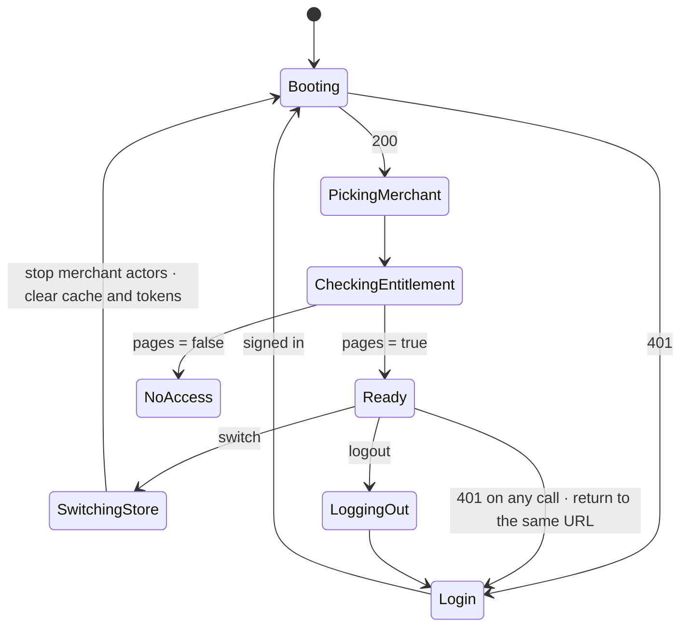

- `GET /user/details` is both the session check and the user load ([auth](../platform/auth-session.md#cookie-session)). Routes render only in Ready.
- Logout and login reach other tabs; the store stays per tab (pending [open question 21](open-questions.md)).

### Jobs

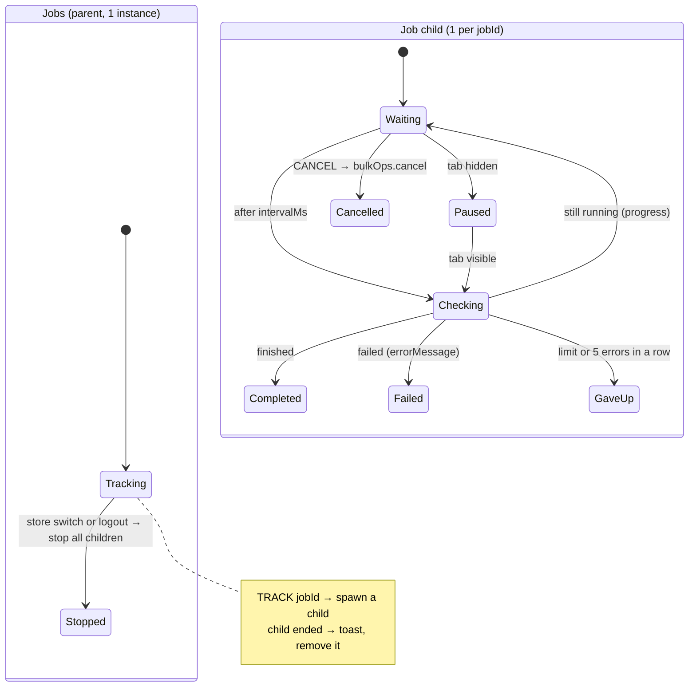

- Import and Export send `TRACK` with the `jobId` and the command's `JobSpec`; the child follows its [poll policy](#poll-policy).
- The top-bar jobs indicator reads the children. Toast when a job ends (notifications are off). Job history stays on the server.

### Assistant

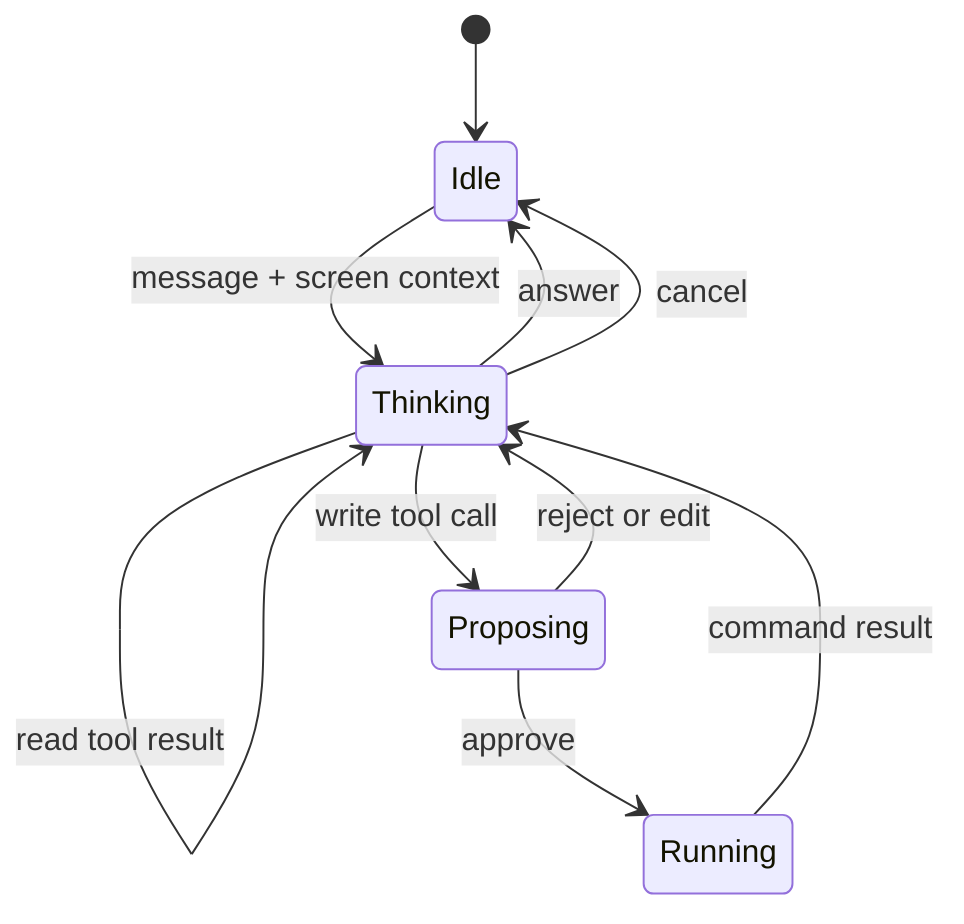

- Each reply carries its session id; a reply for an older session is dropped. Approve is blocked while a turn is in flight.
- Error replies: 409 still thinking, 429 rate limit (retry-after), 503 unavailable; an expired confirmation (410) asks again ([discounts](../commands/defs/discounts.md#create-with-the-assistant)).

## Page machines

Start with their route, drawer or dialog; stop when it closes. Where each appears: [pages](../surfaces/pages.md#machines-on-screen).

| Machine | Calls | Timers |
|---|---|---|
| [Login](#login) | platform session calls ([gateway](../gateway/dashboard.md#auth-and-session)) | resend after 30 s (design) |
| [Record save](#record-save) | the editor's `save` command | — |
| [Refund](#refund) | `refund.create` (preview = calculate) | debounce 300 ms · poll 5 s × 24 |
| [Order edit session](#order-edit-session) | `orderEdit.begin`, `stage`, `discard` · queries `orderEdit.preview`, `orderEdit.session` · `order.update` | stage debounce 500 ms · stale retry 15 s, ≤ 6 min |
| [Discount wizard](#discount-wizard) | `discount` query, `codeUnique` query, `discount.create` / `update` | — |
| [Draft payment watch](#draft-payment-watch) | draft order detail query | 8 s · ≤ 30 min · 5 errors in a row |
| [Import](#import) | `*.importPreview`, `*.import` | — |
| [Export](#export) | `*.exportPreview`, `*.export` | — |
| [Embed](#embed) | token broker, bridge | handshake 10 s |
| [Bulk action](#bulk-action) | product filter query (`bulk-operations/filter-products`), `priceSchedule.create` | preview debounced |

### Login

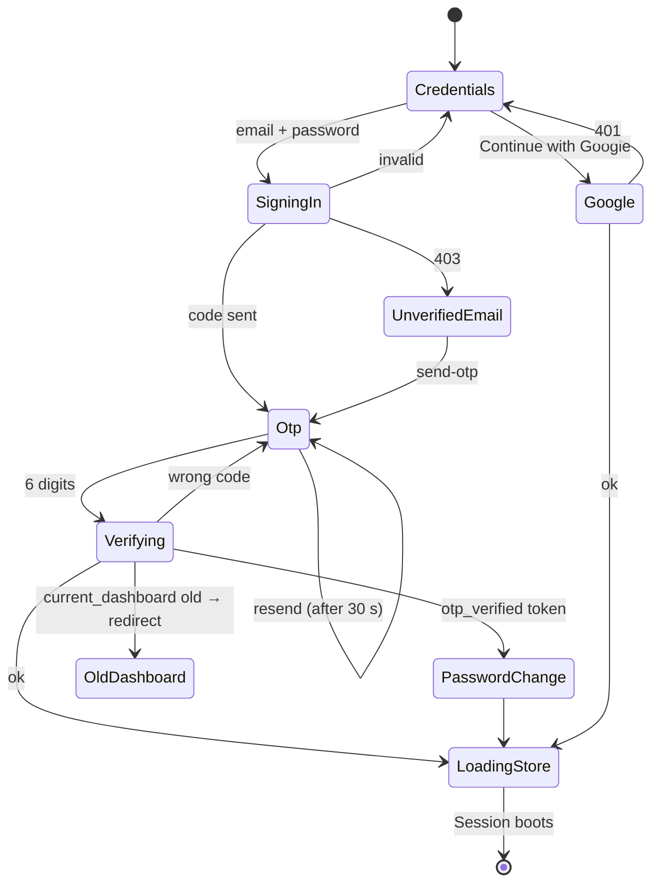

- signin `400` "otp already sent" counts as sent.

### Record save

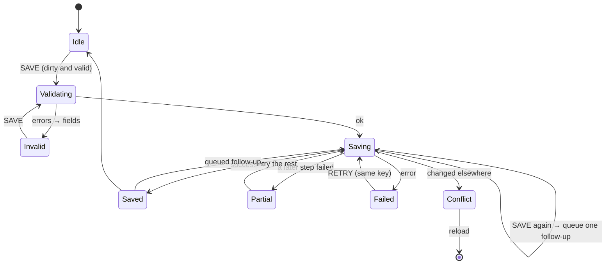

- Dirty and valid stay in the form; the machine only runs the save. The queued follow-up uses the latest values.
- Partial: [steps and compensation](../commands/execution.md#steps-and-compensation). Conflict offers reload only, no force save.

### Refund

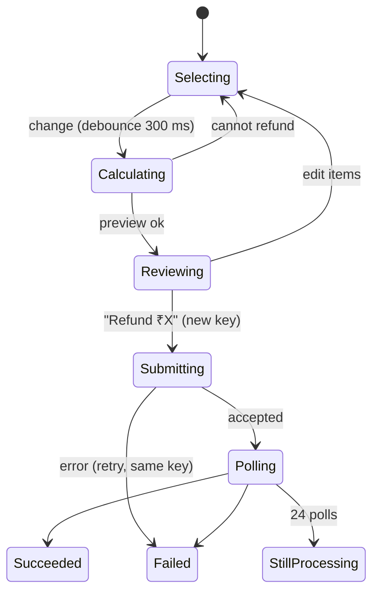

- StillProcessing says "Refund {id} is being processed… you can close this drawer and check back later" and invalidates the order. Closing leaves the refund running on the server.

### Order edit session

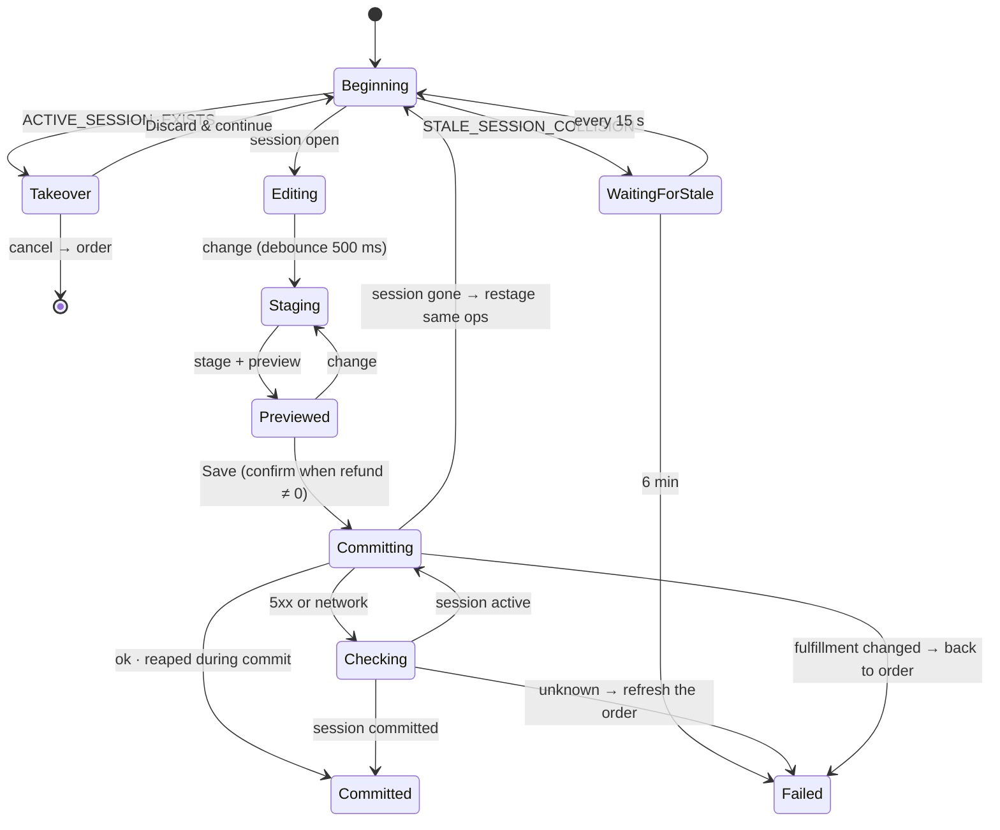

- Version stale on stage, preview or commit: re-read the session and retry once. Every code: [gateway](../gateway/os-order.md).
- Commit is refused until the preview matches the latest change. Leaving asks first ([leave guard](#other-orchestration)); page close discards with `keepalive`.

### Discount wizard

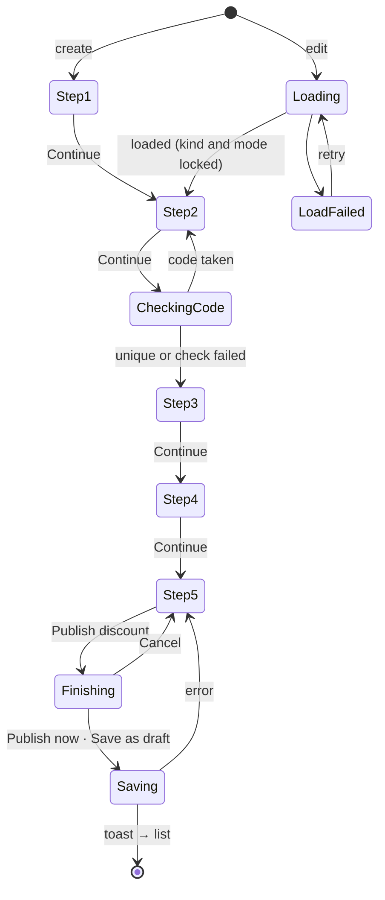

- Continue validates that step's fields; Back goes one step back; steps can't be skipped. Code rule: [domain](../domain/discounts.md#rules).
- LoadFailed never saves defaults over the discount.

### Draft payment watch

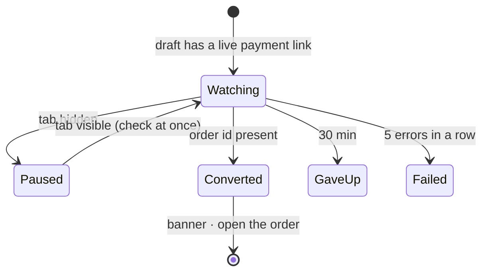

- A failed read counts as an error. With unsaved edits, Converted says "Payment received — order created. Your unsaved changes cannot be applied."

### Import

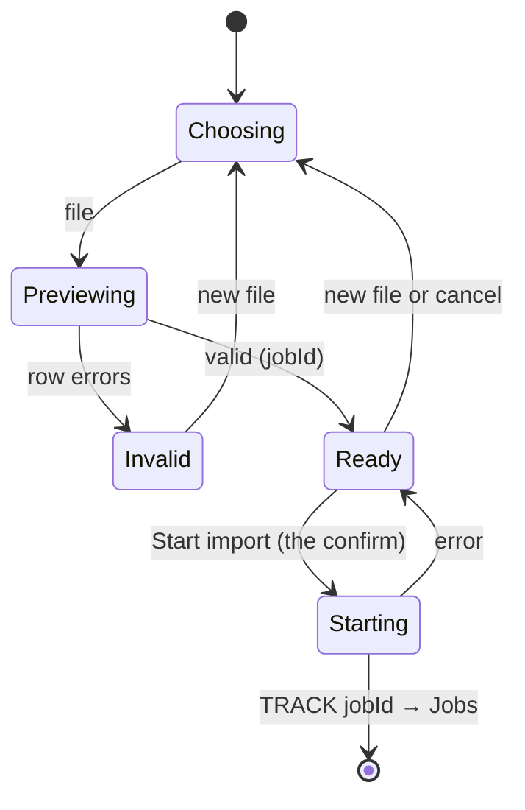

- One machine for every import, configured by the command's `JobSpec`. A previewed job that is never started stays on the server: bulk-ops cancels only running jobs.

### Export

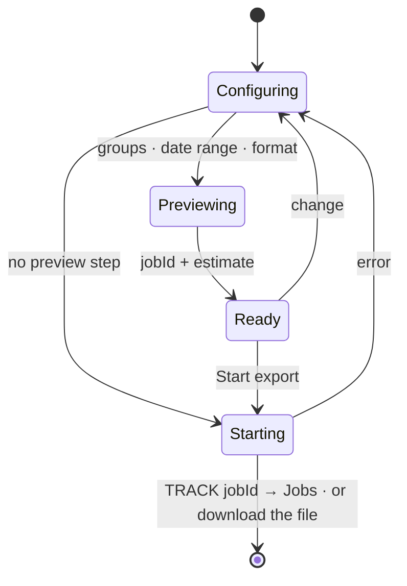

- One machine for every export. Page-scope exports are built in the browser; customer "all" is a job; inventory "all" is a file download.

### Embed

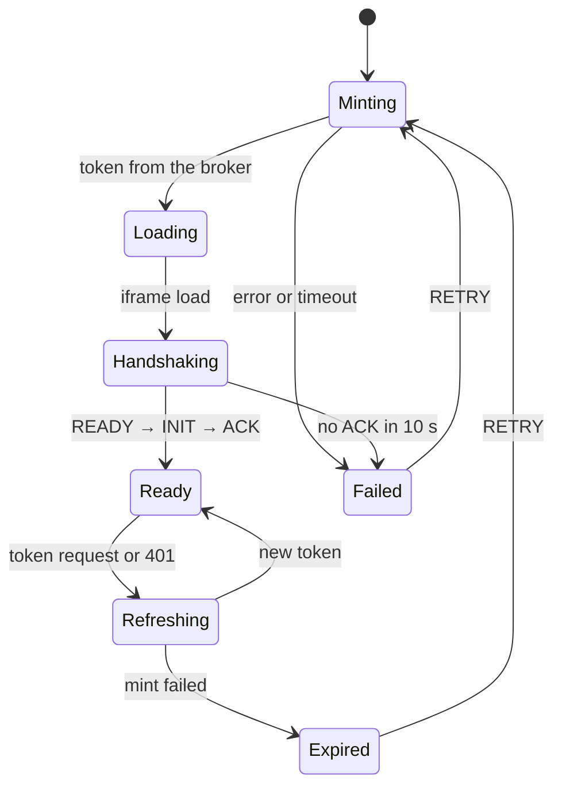

- One per mounted embed. The token stays in the broker, never in context or a URL query; the visual editor's first-load `#token=` is read and cleared by the editor. Requests in Ready (toast, save bar, navigate, picker) follow the [bridge](extensions.md#bridge) rules.

### Bulk action

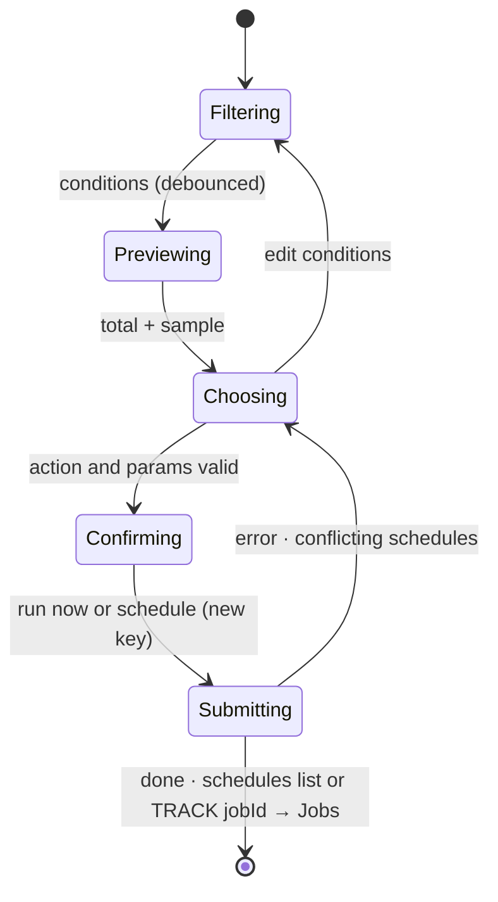

- Preview shows the server's total, not the sample size (gk-pages counts the first 100 rows). A scheduled run re-evaluates the filter when it runs; times are in the store time zone (gk-pages sends browser-local hours). Conflicting schedules (`interferingTasks`) are shown, not dropped.

## Other orchestration

| Piece | Does |
|---|---|
| Leave guard | Every editor, order edit, the wizard and an embedded app's save bar: router blocker plus `beforeunload` while the form is dirty or the machine has tag `unsaved`. "Discard unsaved changes?" / "Your unsaved changes will be lost." / Discard · Keep editing |
| Save bar | One bar for the page: Save / Discard and `mod+s`, from form state and Record save tags |
| Poll policy | [below](#poll-policy) |
| Toast queue | Ordered, deduplicated by key, with Retry where the result is retryable |
| Assistant bridge | Sends screen context ([assistant](assistant.md#screen-context)); an approved proposal runs as `runCommand(…, { surface: 'assistant', confirmed: true })` |

## Poll policy

```ts
interface PollPolicy {
  intervalMs: number;
  maxAttempts?: number;
  maxDurationMs?: number;
  maxConsecutiveErrors: number;   // default 5
  pauseWhenHidden: boolean;       // default true; checks at once on return
}
```

The rules for asking the server "done yet?", not the job's data. Used by command `poll` and `JobSpec`. Running out ends in a state that tells the user, never silently.

| Poll | Interval | Limit |
|---|---|---|
| Refund status | 5 s | 24 attempts |
| Bulk-ops job progress | 5 s | none today |
| Customer export | 3 s | 20 attempts |
| Draft payment | 8 s | 30 min |
| Order edit stale session | 15 s | 6 min |

## File layout

Every machine is a folder; `machine.ts` only orchestrates.

```
machines/refund/
  machine.ts   # states and transitions only
  actors.ts    # async work (resource queries, runCommand), replaceable in tests
  actions.ts   # pure assign helpers
  types.ts     # context and events
  index.ts     # useRefund(): plain values and senders
machines/jobs/
  machine.ts   # parent: spawns one jobMachine per TRACK
  jobMachine.ts
```
