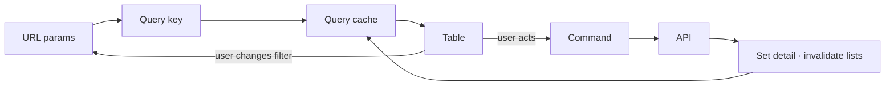

# State

[← Architecture](../README.md)

State has three homes. It is not a layer of its own; where each home sits in the stack is in the [README](../README.md#layers).

| Kind | Home | Examples |
|---|---|---|
| **Server data** | TanStack Query cache | product list, order detail, user details |
| **View state** | URL search params | `?view=unfulfilled&q=rahul&financial_status=paid&sort=created_at:desc&page=2`, `?settings=apps` |
| **UI state** | Component state, or a small Zustand store when global | modal open, assistant panel open, row selection |

Flow state (multi-step processes) lives in a state machine; see [machines.md](machines.md). URL format and list params: [../resources/list.md](../resources/list.md#url-state).

## The table loop

## Query keys

Defined per resource as `[domain, storeId, …]`; see [../resources/data-access.md](../resources/data-access.md#query-keys).

Rules: [principles](../README.md#principles), [data flow](../service-api/README.md#data-flow-transform-once-never-mutate), [selection](../resources/list.md#selection-and-bulk).
