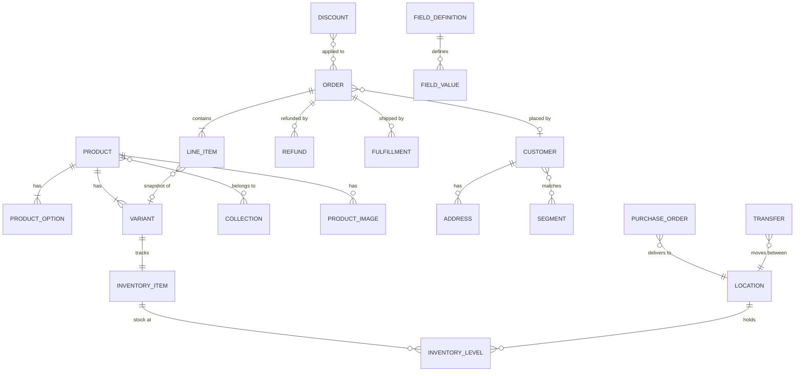

# Domain (layer 2)

[← Architecture](../README.md)

What each entity is and the business rules about it. React-free, network-free; imports nothing outside `domain/` ([structure](../docs/structure.md#layers-and-imports)).

- Common commerce shape (Shopify Admin API, commercetools, Medusa) plus Indian needs (MRP, GST, HSN, COD).
- Fields come from the [gateway](../gateway/README.md) wire shapes through a transformer ([service API](../service-api/README.md)); types here are TypeScript for readability, Zod in code.

## Per entity

```
domain/order/
  schema.ts   # Zod: Order, inputs
  rules.ts    # pure functions from the Rules table of the entity's page
  format.ts   # display helpers: labels, money, dates
```

The domain schema drives forms (Zod resolver) and becomes the command / AI tool input. Responses are parsed by the wire schema in layer 3, not here.

Rules are plain functions; components, commands and the assistant call the same one, so "can I refund this?" has one answer:

```ts
// as today (OrderDetails.tsx:546)
export const refundBlockReason = (o: Order): string | undefined =>
  isCod(o) ? 'COD orders cannot be refunded — no payment was captured.'
  : o.financialStatus === 'refunded' ? 'This order has already been fully refunded.'
  : o.financialStatus === 'partially_refunded' ? 'This order has already been partially refunded.'
  : o.financialStatus === 'refund_pending' ? 'A refund for this order is already pending. Wait for it to settle before issuing another.'
  : undefined;
```

Rules are unit-tested against gk-pages behaviour; they are the cheapest tests we have.

## Entity map



## Files

| File | Covers |
|---|---|
| [conventions.md](conventions.md) | Ids, naming, money, dates, `Entity`, `Page<T>`, references vs snapshots, shared value types |
| [catalog.md](catalog.md) | Product, option, variant, images, collection, taxonomy |
| [pricing-tax.md](pricing-tax.md) | Tax, price schedules |
| [inventory.md](inventory.md) | Location, item, level, adjustments, suppliers, POs, transfers |
| [orders.md](orders.md) | Order, line item, totals, payment, refund, edit, draft, fulfillment, timeline |
| [customers.md](customers.md) | Customer, address, segment |
| [discounts.md](discounts.md) | Discount kinds, conditions, limits, bulk codes |
| [custom-fields.md](custom-fields.md) | Field definitions, values, metaobjects, runtime schema |
| [store.md](store.md) | Store, channels, apps, media |
| [deferred.md](deferred.md) | What v1 defers and the seam for each |

## Five rules that shape everything

1. **Every product has at least one variant.** Price, SKU and stock live on the variant. A product without options has one default variant.
2. **Orders snapshot, they don't reference.** A line item copies title, SKU and price at purchase time.
3. **Status is more than one field.** An order has a payment and a fulfillment status; a product has a lifecycle status and channel visibility.
4. **Money is never a float.** Integer paise plus currency.
5. **Stock is per location, in named states.** Not one `quantity` number.

**Parity rule:** today's backend and gk-pages behaviour are the source of truth for business logic (tax, totals, discounts, pricing, inventory). The revamp may rearrange screens, rename fields and wrap calls; it does not change what is calculated or how without product sign-off ([deferred](deferred.md)).

## Verification

Status: **v1 draft**, inferred from gk-pages client code. Freeze an entity only when its wire schema parses a real sandbox response (list and detail) and its write payload matches what gk-pages sends. Order: product, variant, collection, inventory, orders.
