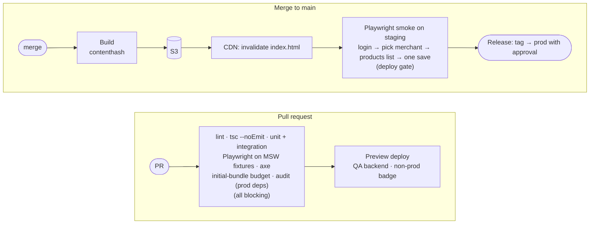

# Delivery

[← Operations](README.md)

| # | Decision |
|---|---|
| d19 | Real SPA hosting: own `index.html` on S3 + CloudFront, all routes fall back to it. Detailed process with platform near launch. |
| d20 | A separate PostHog project for Ratio. |
| d21 | Cutover: new domain live → dashboard link redirects → import-map entry removed. |
| d32 | PR previews, git-tag versioning, cache rules. |
| d34 | Renovate weekly, audit gate, committed lockfile, browser-support matrix. |

## Pipeline

| Concern | Rule |
|---|---|
| Versioning | Git tag is the source of truth; stamped into the bundle (`__APP_VERSION__`), Sentry release, GitHub release |
| Cache | Hashed assets cached for a year and kept for the previous releases; `index.html` never cached; CDN invalidation on deploy. A failed chunk load or a newer version prompts a reload; nobody is asked to hard-refresh |
| Rollback | Repoint to the previous version |
| Env | Build-time or runtime config: [open question 8](../docs/open-questions.md); public keys only, by allowlist ([security](quality.md#security-v1)); previews use the QA backend |
| Branches | `main` protected; changes through pull requests |
| SPA fallback | Only extensionless paths fall back to `index.html`; a missing `.js` stays a 404 |
| Audit | Prod dependencies; an advisory without a fix can be ignored with an expiry date |

## Cutover

Before step 1: cookie family and domain confirmed ([open question 2](../docs/open-questions.md)); gateway CORS live with `x-request-id` exposed; bypass audit done; smoke green; browser matrix passed, including iOS Safari and Chrome Incognito; alerts verified into OpsGuard; parity checklist signed by product; rollback rehearsed on staging.

| Step | Rollback |
|---|---|
| 1. Ratio live on its domain; smoke test | Take the domain down |
| 2. Dashboard sidebar link and `/gk-pages/*` redirect to Ratio ([routing](../surfaces/routing.md#old-urls)): 302 until step 3 has held, then 301 | Remove the redirect |
| 3. Remove the `@gokwik/gk-pages` import-map entry | Restore the entry |

Both stay deployable until step 3 has held. Phased rollout (d03): [open question 24](../docs/open-questions.md).
