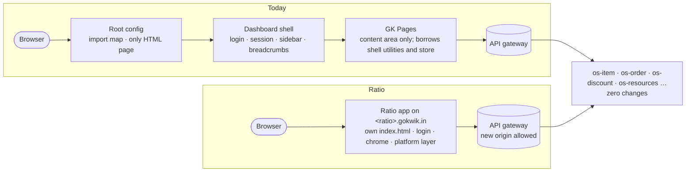

# Platform

[← Architecture](../README.md)

Everything the GoKwik dashboard shell provides today, now owned by Ratio: HTML, login, session, merchant context, chrome, API access, delivery and quality. No feature code lives here.

These are topics; in code they span [layers](../README.md#layers):

| Topic | Layer | Folder |
|---|---|---|
| HTTP client, session, permissions, telemetry | Platform core | `platform/` |
| Login, boot | Orchestration | `machines/` |
| Chrome | Surfaces | `routes/`, `ui/` shell |

Decisions are from the standalone decision tracker (`d01`–`d36`, all closed); each page cites the ones it carries. Counts and code facts were re-checked against gk-pages `main` on 2026-10-14.

## Before and after

The root config and the dashboard shell leave the path. Their jobs become this folder. Nothing behind the gateway changes.

What GK Pages borrows from the shell today (gk-pages `main`, 2026-10-14):

| Borrowed | Usage | Replaced by |
|---|---|---|
| `@gokwik/utilities` (import-mapped at runtime) | 9 exports: `makeAPICall` (44 imports), `dashboardStore` (18), `updateBreadcrumbs` (11 calls), `validatePermission` (2), `filterStore` (2), date helpers (3), `logUserEvent`, `downloadFromURL` | [API client](api-client.md), [merchant context](auth-session.md#merchant-context), [chrome](chrome.md) |
| `sessionStorage['merchant-mid']` | 79 reads and writes | Same key, written by the merchant picker |
| Import-map entry `@gokwik/gk-pages` | 1 | Removed at cutover ([delivery](delivery.md#cutover)) |
| Single-spa error boundary | `return null` on crash | Route error boundaries ([quality](quality.md#error-boundaries)) |

## Pages

| Page | Covers | Decisions |
|---|---|---|
| [identity-access.md](identity-access.md) | Product name, domain rule, who gets it, entitlement guard, permissions, staff | d01–d04, d08, d36 |
| [auth-session.md](auth-session.md) | Cookie session, login, boot flow, merchant selection | d05–d07, d12 |
| [routing.md](routing.md) | URL structure, old-URL redirects | d09, d10 |
| [api-client.md](api-client.md) | Services and base URLs, API client, query keys, validation at the boundary | d11, d31 |
| [chrome.md](chrome.md) | Navigation, top bar, search, store switcher, UI kit, breadcrumbs | d13–d16 |
| [gateway.md](gateway.md) | CORS for the new origin, gateway-bypass audit | d17, d18 |
| [delivery.md](delivery.md) | Hosting, CI, previews, versioning, cache, cutover, analytics project | d19–d21, d32, d34 |
| [quality.md](quality.md) | Errors, boundaries, security headers, uptime, flags, performance, UX baseline, docs | d22–d30, d33, d35 |

Still open from the tracker: exact subdomain (d02, [open questions](../docs/open-questions.md) #2), phased rollout (d03, at cutover), detailed deploy process (d19, near launch).
