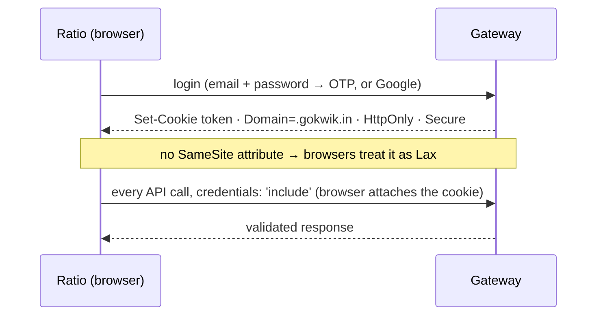
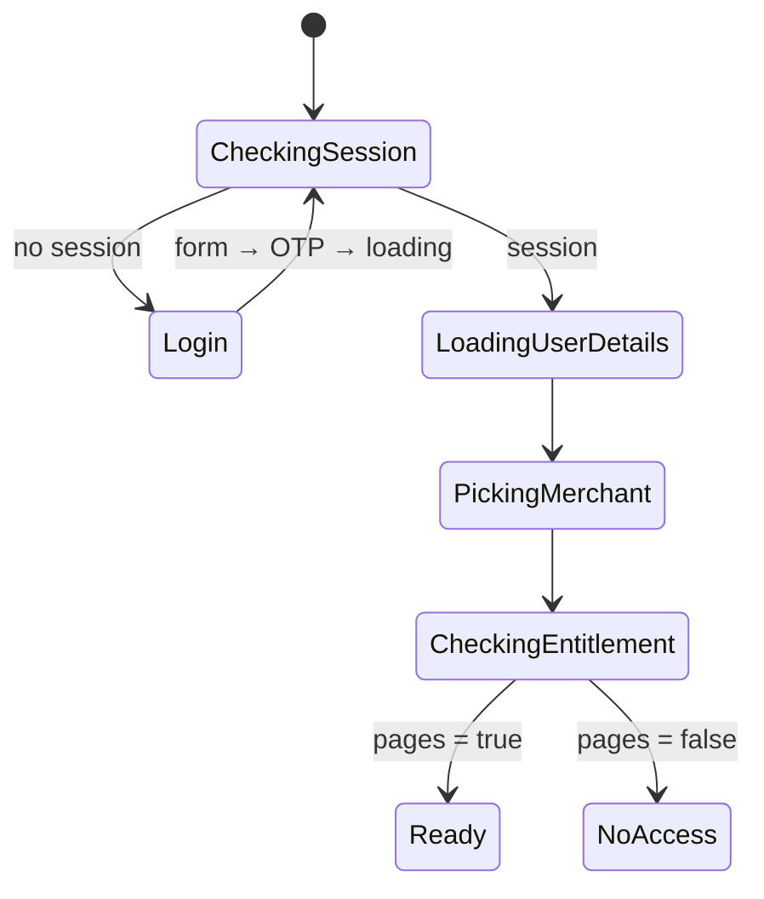

# Auth and session

[← Platform](README.md)

| # | Decision |
|---|---|
| d05 | Login and OTP APIs allow the new origin (backend team; confirmed). |
| d06 | The token is stored nowhere in the frontend: an httpOnly, Secure cookie set by the gateway. |
| d07 | Merchant selection: user details via React Query; the picker writes `merchant-mid` (same key as today) and `user-details` to sessionStorage. No Redux. |
| d12 | User and merchant data: React Query is the source of truth; sessionStorage mirrors it for synchronous code. `dashboardStore` imports are replaced by one small util. |

## Cookie session



- JavaScript never reads or sends the token (`document.cookie` shows nothing; checked in prod DevTools by the tracker).
- Session state comes from a "who am I" check at boot (an `is_logged_in` / `me` call), not from reading a cookie.
- Logout: gateway logout endpoint, then clear the query cache and the sessionStorage keys.

### Why a gokwik.in subdomain

The cookie is effectively `SameSite=Lax`: the browser attaches it only when the page and the gateway are the same site.

| Origin | Cookie | Auth |
|---|---|---|
| `<ratio>.gokwik.in` | attached (cookie `Domain=.gokwik.in` already valid) | works, zero backend change |
| any other domain | withheld | broken in every browser |

## Boot flow

Runs as the app boot machine ([machines](../docs/machines.md)):



## Merchant context

```ts
useUserDetails()          // React Query: GET /api/dashboard/user/details
useMerchant()             // selected merchant; storeId from the route
getMerchantId()           // synchronous read for non-React code
```

- Picking a store writes `sessionStorage['merchant-mid']` and `sessionStorage['user-details']`; the API client reads the merchant ID from there for headers.
- The route's `storeId` ([routing](routing.md)) and the selected merchant must agree; opening a link for another store switches the merchant first.
- Switching store clears the query cache and merchant-scoped UI state.
