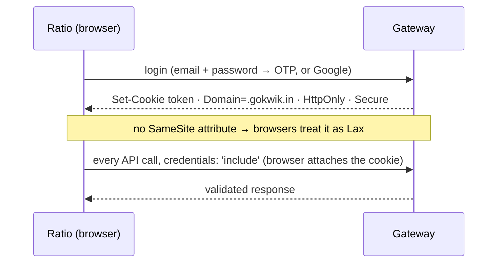

# Auth and session

[← Platform](README.md)

| # | Decision |
|---|---|
| d05 | Login and OTP APIs allow the new origin (backend team; confirmed). |
| d06 | The token is stored nowhere in the frontend: an httpOnly, Secure cookie set by the gateway. |
| d07 | Merchant selection: user details via React Query; the picker writes `merchant-mid` (same key as today) and `user-details` to sessionStorage. No Redux. Switching also calls the server ([merchant context](#merchant-context)). |
| d12 | User and merchant data: React Query is the source of truth; sessionStorage mirrors it for synchronous code. `dashboardStore` imports are replaced by one small util. |

## Cookie session



- JavaScript never reads or sends the token (`document.cookie` shows nothing; checked in prod DevTools by the tracker).
- Session check: `GET /user/details`; `401` = logged out. The dashboard's `is_logged_in` cookie is set by JavaScript and proves nothing; `/user/auth/me` exists but is unused.
- Login: `signin` → OTP → `verify-otp`, or Google. The password is AES-encrypted client-side (`REACT_APP_PUBLIC_CRYPTO_KEY`). Branches (unverified email, forced password change, old-dashboard redirect): [gateway › dashboard](../gateway/dashboard.md#auth-and-session).
- Logout: `GET /user/logout`, then clear the query cache and the sessionStorage keys.

### Why a gokwik.in subdomain

The cookie is effectively `SameSite=Lax`: the browser attaches it only when the page and the gateway are the same site.

| Origin | Cookie | Auth |
|---|---|---|
| `<ratio>.gokwik.in` | attached (cookie `Domain=.gokwik.in` already valid) | works, zero backend change |
| any other domain | withheld | broken in every browser |

## Merchant context

```ts
useUserDetails()          // React Query: GET /api/dashboard/user/details
useMerchant()             // selected merchant; storeId from the route
getMerchantId()           // synchronous read for non-React code
```

| Id | Type | Used for |
|---|---|---|
| `storeId` = `merchant_details.m_id` | string | URL, query keys, `merchant-mid` / `gk-merchant-id` headers |
| `merchant_details.id` | number | `POST /team/switch-merchant` only |

- Switching store: `POST /team/switch-merchant { merchant_id: id }` → refetch `user/details` → write `sessionStorage['merchant-mid']` and `['user-details']` → clear the query cache and merchant-scoped UI state.
- The route's `storeId` ([routing](../surfaces/routing.md)) and the selected merchant must agree; opening a link for another store switches first.
- Store list: `user_details.allowed_merchants`; internal users search with `GET /user/merchant-search?q=`.
