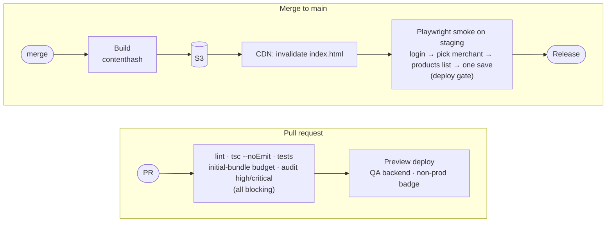

# Delivery

[← Platform](README.md)

| # | Decision |
|---|---|
| d19 | Real SPA hosting: own `index.html` on S3 + CloudFront, all routes fall back to it. Detailed process with platform near launch. |
| d20 | A separate PostHog project for Ratio. |
| d21 | Cutover: new domain live → dashboard link redirects → import-map entry removed. |
| d32 | PR previews, git-tag versioning, cache rules. |
| d34 | Renovate weekly, audit gate, committed lockfile, browser-support matrix. |

## Pipeline

| Concern | Rule |
|---|---|
| Versioning | Git tag is the source of truth; stamped into the bundle (`__APP_VERSION__`), Sentry release, GitHub release |
| Cache | Hashed assets cached for a year; `index.html` never cached; CDN invalidation on deploy. Nobody is asked to hard-refresh |
| Rollback | Repoint to the previous version |
| Env | Baked at build time per environment; previews always use the QA backend |
| Branches | `main` protected; changes through pull requests |

## Cutover

| Step | Rollback |
|---|---|
| 1. Ratio live on its domain; smoke test | Take the domain down |
| 2. Dashboard sidebar link and `/gk-pages/*` redirect to Ratio ([routing](routing.md#old-urls)) | Remove the redirect |
| 3. Remove the `@gokwik/gk-pages` import-map entry | Restore the entry |

Both stay deployable until step 3 has held. Phased rollout (d03) can use a PostHog flag on the redirect.
