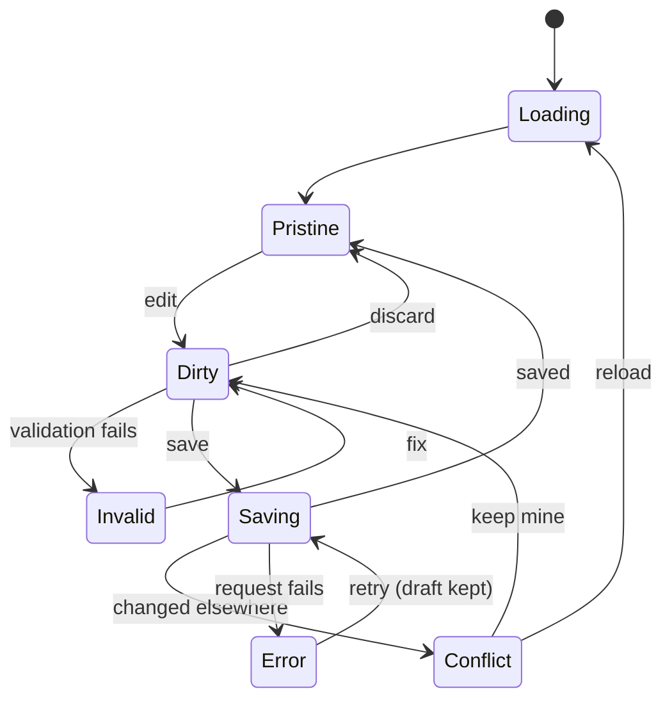

# Editor

[← Resources](README.md)

The record page for resources edited in place: product, collection, PO, transfer, draft order, customer, segment, discount. Orders use a read view with a separate edit route (see [defs/order.md](defs/order.md)).

## Config

```ts
interface EditorConfig<T, TInput> {
  toInput: (record: T) => TInput;
  layout: { main: Section<TInput>[]; aside?: Section<TInput>[] };   // 65/35 on desktop, as today
  readOnlyWhen?: (r: T) => boolean;          // draft order completed
  header?: { status?: (d: TInput) => StatusSpec };
  save: CommandId;
  create?: { route: string; initial: (ctx: CreateContext) => TInput; command: CommandId };
  calculate?: {                              // server-side totals
    query: (d: TInput) => Promise<unknown>;  // /draft-orders/calculate; order edit uses the os-order edit session (stage → preview)
    debounceMs: number;                      // 500 as today
    skipWhen?: (d: TInput) => boolean;       // no line items
  };
  children?: Record<string, ChildConfig>;
}

type Section<TInput> =
  | { id: string; title: string; fields: FieldSpec<TInput>[]; visibleWhen?: (d: TInput) => boolean; collapsible?: boolean }
  | { id: string; title?: string; component: ComponentType<SectionProps<TInput>>; visibleWhen?: (d: TInput) => boolean };

interface FieldSpec<TInput> {
  path: Path<TInput>;
  label: string;
  type: 'text' | 'textarea' | 'rich_text' | 'number' | 'money' | 'percent' | 'select'
      | 'multi_select' | 'tags' | 'boolean' | 'date' | 'image' | 'media_list' | 'reference' | 'phone';
  help?: string;
  readOnly?: boolean | ((d: TInput) => boolean);
  visibleWhen?: (d: TInput) => boolean;
}
```

## Draft lifecycle

Driven by the record editor machine ([../docs/machines.md](../docs/machines.md)):



- Save is enabled only when dirty and valid. Validation is the input schema plus runtime custom-field schemas, always run before save.
- Save bar with Discard / Save (design). Leaving with a dirty draft asks to discard or stay.
- With `calculate`, totals shown come from the server response, never computed locally (today's tax fallback is the one exception, kept as is).

## Children

```ts
interface ChildConfig {
  path: string;                              // "variants", "lineItems", "addresses"
  columns: Column<unknown>[];
  editable?: string[];
  preview?: number;                          // rows before "View all" (design: 4 variants)
  subRoute?: string;                         // full list view
  pageSize?: number;                         // server-paged children (collection products: 50)
  blockPagingWhenDirty?: boolean;            // as today in collection products
}
```

When a child is saved through its own endpoint (customer addresses), the save command orchestrates the calls in today's order. The UI never calls child endpoints directly.

## Create

A create route uses the same editor with `create.initial`. Prefill sources are part of `CreateContext`: duplicate (`sourceId`), selected inventory rows (transfer/PO from inventory), customer (order from customer page). On success, navigate to the new record.

## Sub-routes

Flows that are their own page today stay their own route: receive (PO, transfer), edit order, customers in segment, variants full list.
