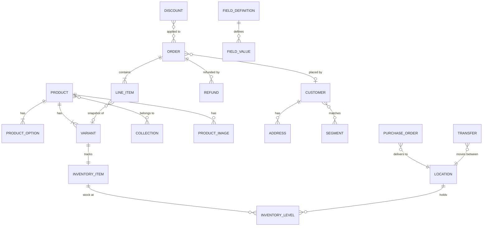

# Schema

[← Architecture](../README.md)

The data model for the admin: the common commerce shape (Shopify Admin API, commercetools, Medusa) plus Indian needs (MRP, GST, HSN, COD), aligned with what the services return to gk-pages today. Design gaps are in [deferred.md](deferred.md). Types are TypeScript for readability; the Zod schemas in code follow them.

## Entity map

## Files

| File | Covers |
|---|---|
| [conventions.md](conventions.md) | IDs, money, dates, statuses, lists, references vs snapshots |
| [catalog.md](catalog.md) | Product, option, variant, images, collection, taxonomy |
| [pricing-tax.md](pricing-tax.md) | Price, compare-at, cost, tax, HSN, price schedules (parity with today) |
| [inventory.md](inventory.md) | Location, inventory item, stock per location, inventory row, suppliers, POs, transfers |
| [orders.md](orders.md) | Order, line item, totals, payment, refund, draft order, cancel, timeline |
| [customers.md](customers.md) | Customer, address, segment |
| [discounts.md](discounts.md) | Discount kinds, eligibility, limits, bulk codes |
| [custom-fields.md](custom-fields.md) | Field definitions, values, metaobjects |
| [store.md](store.md) | Store, channels, shipping, domains, apps, media, notifications |
| [endpoints.md](endpoints.md) | Backend endpoints per entity → resources and commands |
| [deferred.md](deferred.md) | What v1 defers (product decisions, features without backend) and the seam for each |

## Five rules that shape everything

1. **Every product has at least one variant.** Price, SKU and stock live on the variant, never the product. A product without options has one default variant.
2. **Orders snapshot, they don't reference.** A line item copies title, SKU and price at purchase time. Editing the product later never changes a past order.
3. **Status is more than one field.** An order has a payment status and a fulfilment status; a product has a lifecycle status and per-channel visibility.
4. **Money is never a float.** Integer paise plus currency (matches most of the backend).
5. **Stock is per location, in named states.** Not one `quantity` number.

**Parity rule:** today's backend and gk-pages behaviour are the source of truth for business logic (tax, totals, discounts, pricing, inventory). The revamp may rearrange screens, rename fields in code and wrap existing calls; it does not change what is calculated or how. Any such change needs product sign-off. Deferred items: [deferred.md](deferred.md).

## Verification

Status: v1 draft. Shapes are inferred from gk-pages client code (interfaces, transformers, payload builders), not backend specs. Freeze an entity only after its schema parses a real sandbox response (list and detail) without errors, and its write payload matches what today's gk-pages sends. Order of checks follows the build order: product, variant, collection, inventory, then orders.
