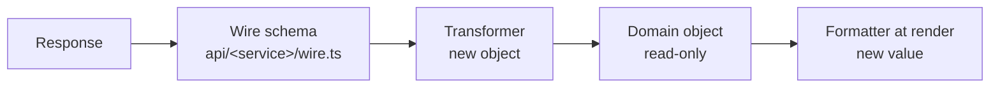

# Service API (layer 3)

[← Architecture](../README.md)

One module per backend service, `api/<service>/`: the anti-corruption layer (DDD) between backend shapes and the domain. The only place that knows them. Per-service details: [gateway](../gateway/README.md).

## Data flow: transform once, never mutate

1. **Boundary:** parse the response with its wire schema ([ADR 0004](../adr/0004-validate-every-response.md)); the transformer builds a **new** domain object. The only place backend shapes change, and only for consistency.
2. **Above:** domain objects are read-only. Never mutated, reshaped in hooks or copied into state.
3. **Display:** labels, formatted money, grouped rows come from pure `domain/<entity>/format.ts` functions at render time.

Writes go the other way: the command passes domain input; the module's `toWire` builds the request (wire names, units, scoping params, staff fields). Commands never see wire names.

| | Wire schema | Domain schema |
|---|---|---|
| Describes | What one service sends | What the app means by the entity |
| Lives in | `api/<service>/wire.ts` | `domain/<entity>/schema.ts` |
| Changes when | The backend changes | The business meaning changes |

## Module contract

| File | Holds |
|---|---|
| `client.ts` | One exported function per endpoint: typed input in domain names → domain output; options `{ signal, idempotencyKey }`. List functions take a typed query and return `Page<T>` |
| `wire.ts` | Wire schemas, generated from OpenAPI when the service has one ([open question #20](../docs/open-questions.md)) |
| `transformer.ts` | `toDomain` and `toWire`, pure |
| `errors.ts` | `ApiError` bodies (`code`, `error_code`, v3 `errors[]`, `status_code` + `message`) and any 2xx `success: false` → the [command result](../commands/execution.md#errors-from-the-server), field paths in domain names. gk-pages' soft failures were mostly `makeAPICall` swallowing non-2xx |
| `fixtures/` | Recorded responses; tests parse each with its wire schema, and MSW serves the same files |

- No React, caching, retries or UI text here: the query client and commands own those.
- An endpoint is called from one function only; a backend change is a one-module change.

## What transformers normalise

The domain sees one shape; every row below is fixed in the service's transformer.

| Concern | Wire today |
|---|---|
| Case | snake_case: dashboard, os-order orders / fulfilment / edit / refund requests, item reads, inventory, discounts. camelCase: os-customer, media, apps, bulk-ops, os-order drafts / refund responses / tags, item collections. PascalCase keys in bulk-ops import preview |
| Envelope | dashboard `{ status_code, data }`; os-customer, discount, media `{ success, …, data }`; inventory v3 `{ data, errors, api_version, request_id }`; os-order `{ orders \| draft_orders, pagination }`; others per endpoint (bare arrays, `{ data, meta }`, `{ assets, pagination }`) |
| Pagination | Mostly page + limit; v3 levels by offset; totals as `total`, `total_pages`, `pages` / `current_page` or `hasNextPage` |
| Money | Paise as integers or decimal strings (`"600000.00"`). Rupees: customer amounts, draft `shippingLine.price`, edit-commit `refund_amount`, PO line tax |
| Numbers | Weights, quantities and some ids arrive as strings |
| Status | lowercase; PascalCase (PO, transfer); UPPER_SNAKE (refunds, hold reasons, Discount V2); display strings (cancel reasons, collection rule fields) |
| Sentinels | end date `9999-12-31T23:59:59Z`; unlimited `1000000` (v1) or int64-max (V2) → `undefined` |
| Booleans | `boolean \| 0 \| 1` (custom fields) |
| Tenant | `storeId` ↔ `merchant_id`, `merchantId`, `store_id`, `storeId`, `store-id`, `?merchantId=`; numeric merchant id only for switch-merchant ([auth](../platform/auth-session.md#merchant-context)) |
| Staff | os-order `staff_id`, `staff_name`; os-customer `staffId`, `staffName`; bulk-ops `user-email`, `user-name` query |
