# Ratio: GK Pages as a standalone product

## Technical Requirements and Design Document, v1.1

**Document ID:** TRD-RATIO-001 · **Status:** Draft for review · **Date:** 21 October 2026 · **Author:** Ashish Kumar (Frontend, Primathon) · **Companion architecture draft:** Aman Zaid · **Jira:** INFN-3338 (discovery), INFN-3457 (this review)

**Who this is for.** The technical manager, the engineering leads for frontend, backend and platform, and product. It is written so that someone who was not in any of the discussions can read it start to finish and understand what Ratio is, what we found when we looked at the code, what we decided, why we decided it that way, what we rejected, and what is still open. Every part first explains the concept in plain language for readers who do not live in frontend code every day, then states the decision, then the reasoning.

**How this document is organised.** It is split into parts by topic rather than by document convention. Part 1 is the story and the summary. Part 2 is authentication, session and the domain question. Part 3 is the gateway and how the application talks to APIs. Part 4 is the code structure and the engine inside it. Part 5 is the UI kit. Part 6 is quality and operations, including what Sentry, OpsGuard, error boundaries and source maps are. Part 7 is delivery: CI, environments, releases. Part 8 is the contributor model and the AI-native repository. Part 9 is how bugs travel from a screenshot to a merged fix. Part 10 is MCP and the assistant. Part 11 is migration and cutover. Part 12 is how this work converged with Aman Zaid's draft. Part 13 is the registers: every decision, every risk, every gap, every ask. Part 14 is the roadmap. Diagrams are Mermaid and render directly on GitHub and in Notion.

**Labels used.** A *verified fact* was proven in code or in browser developer tools; it is a constraint, not an opinion. A *ratified* decision was discussed openly and called. A *bulk-closed* decision was accepted in a batch on the author's recommendation. *Adopted from draft* means taken from Aman Zaid's architecture after asking why. *Proposed* means suggested by the author and not yet ratified by the team. *Pending* means discussed, with the final call still due.

---

## Part 1. The story and the summary

### 1.1 What exists today

The GoKwik merchant dashboard is not one application. It is three repositories composed in the browser at runtime by a technique called Single-SPA. The first repository, dashboard-ui-configuration, is the root configuration: it owns the HTML page, an "import map" that says which JavaScript bundle to load for which name, and a layout that says which application mounts at which URL. The second, dashboard-ui, is the shell: login and OTP, merchant selection, the sidebar and top bar, a Redux store holding the user and merchant, and the breadcrumbs. It mounts at the root path. The third, gk-pages, is the product we care about: products, collections, inventory, orders, customers, discounts, analytics, the content library, settings and the visual editor. It mounts under the path /gk-pages.

The important consequence is that gk-pages owns almost nothing around itself. It has no HTML document, no login, no navigation. It reads the merchant from the browser's sessionStorage, calls APIs through a shared utilities package, and relies on the shell for everything else. We counted that borrowing precisely: the shared API function is imported in 39 places, the shell's Redux store in 17, the breadcrumb updater in 11, and the merchant identifier is read from sessionStorage in 77 places. These numbers matter because they say the separation is bounded and estimable, not open-ended.

### 1.2 What Ratio is

Ratio is the same product rebuilt as a standalone application in the style of a Shopify admin: its own domain, its own login page, its own navigation and UI kit, its own release pipeline, on a fresh codebase. What does not change is the backend. The same API gateway, the same services, the same cookie-based session. This is the single most important framing in the document: Ratio is a frontend project with one gateway configuration change, not a platform migration.

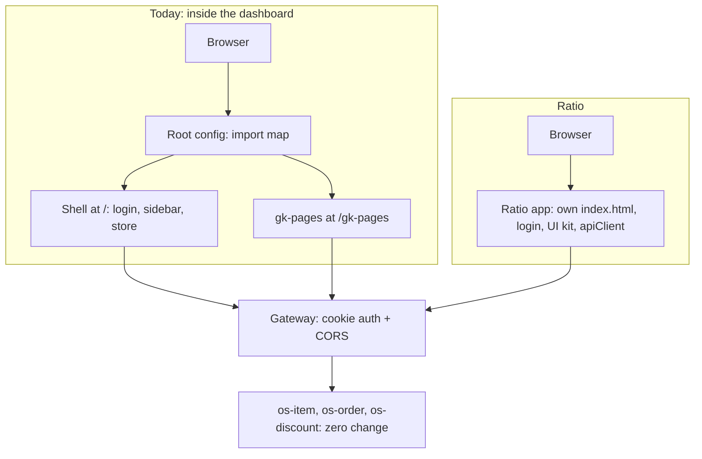

### 1.3 How the work was done

Two workstreams ran independently in October 2026. One was a code-level discovery of the current system: reading the shipped utilities bundle that production actually runs, the dashboard-ui source, the root configuration, and cookie and header evidence captured in browser developer tools against sandbox and production. The other was a draft architecture for the new product written by Aman Zaid, covering registries, state machines, the build tool and the router. When the two were compared they agreed on roughly 85 percent of the design; the differences were argued out and resolved explicitly, and Part 12 records how.

The working method was problem-first. A concrete problem was stated in the team's own words ("backend engineers write frontend code however they like and then say the frontend doesn't support it"; "a product manager hands a ticket to an AI and says fix it"), a solution was designed for that problem, and the solution became structure. No pattern was adopted because it is fashionable; each one was challenged with "why" and "how far" before it was accepted, and where the author's own suggestions were accepted in bulk without individual discussion, they are listed separately in Part 13 as proposals rather than presented as decisions.

### 1.4 The summary in one paragraph

Forty-four decisions are closed and one is pending. Authentication is reused unchanged because the frontend never touched a token in the first place; the one constraint this creates is that Ratio's page and its API must be first-party to each other, which gives two safe domain options and one tempting option that must be rejected. The gateway is the only backend component that changes, and only its configuration. The code is organised around registries in which every entity and every action is defined exactly once, which is also what absorbs the backend's instability and what makes the product ready for an AI assistant. A production quality bar, a contributor model that works for humans and AI assistants alike, and a bug workflow in which the application supplies its own evidence complete the design. The first increment, the API client and the platform shell, can start today.

---

## Part 2. Authentication, session and the domain

### 2.1 What we had to understand first

Before deciding where Ratio should live, we had to understand how a merchant's session actually works today, because the two questions are the same question. Four browser mechanisms are involved, and confusing any two of them leads to the wrong domain decision, so they are spelled out here.

A **cookie** is a small value the server asks the browser to store and send back with later requests. It belongs to the site that set it, not to the page that happened to be open. An **httpOnly** cookie is one that JavaScript on the page cannot read; the browser still sends it with requests. This attribute is about theft by scripts, not about which requests carry the cookie, and it plays no role in the domain decision. **CORS**, cross-origin resource sharing, is the server's permission for a page on one origin to read responses from another origin; it is configured entirely on the server, with the exact allowed origin, a flag allowing credentials, and the list of request headers the server will accept and response headers it will expose. **SameSite** is a rule written on the cookie that tells the browser whether to attach it to requests coming from a different site. With SameSite Lax, the browser withholds the cookie from cross-site API calls. With SameSite None, it sends it, provided the cookie is also marked Secure. The server sets the attribute, but the browser enforces it, and no server configuration can override the browser. Finally, **third-party cookie blocking** is a separate browser policy: when a cookie's site differs from the page's site, Safari (including every browser on iOS), Chrome in Incognito mode and Brave refuse it regardless of SameSite. Chrome's plan to block third-party cookies everywhere was halted in 2025, so normal Chrome windows still allow them.

Think of the cookie as a gym membership card kept in the gym's locker. The browser is the friend who decides whether to carry the card for you. Anywhere on the gym's campus the card comes along. In another neighbourhood the friend refuses, even if the gym itself says "let them in". CORS is the gym saying "let them in"; SameSite and third-party blocking are the friend's own rules.

### 2.2 What we verified in code

Three facts came out of the shipped code and developer tools, and they are the foundation of this part. First, the frontend never handles an authentication token. The shipped utilities bundle configures its HTTP client to send credentials on every call; no code path reads a token into a header. The only place the token cookie is read at all is a leftover console.log that prints null on every load because the cookie is httpOnly. Second, in sandbox, the cookie is set on the gateway's own host with SameSite None; this is why development on localhost can log in at all. Third, in production, the cookie was observed on the domain .gokwik.in with the SameSite attribute blank, which Chromium treats as Lax. (A later request trace showed production hosts under gokwik.co, so the exact production family must be re-confirmed before the first staging deploy; see gap GAP-01.)

The entitlement mechanism was also traced end to end. The endpoint GET /api/dashboard/user/details returns, per merchant, a map of purchased products called selected_products. The dashboard shows or hides the GK Pages menu entry on selected_products.pages, in one line of the sidebar component. Nothing else checks it: the application still mounts for anyone who knows the URL. Inside the dashboard that was tolerable because nobody knew the URL. In a standalone product the URL is public, so a real guard is needed.

### 2.3 The decisions on authentication

**The token is stored nowhere (d06, ratified).** The question began as "sessionStorage like today, or an httpOnly cookie?" and the first finding was that the premise was wrong: there is no token in sessionStorage today. Ratio reuses the gateway-cookie design exactly as it is. The client sends credentials and nothing else; session state is learned from a "who am I" call. Storing a token in web storage was rejected as a downgrade from today's security; a new token-based design was rejected as unnecessary work for v1.

**Login from the new origin (d05, ratified).** The only genuinely new piece of authentication work is that the login and OTP-verification endpoints must accept requests from the Ratio origin. Backend confirmed this is a configuration change and not a blocker.

**Merchant selection without Redux (d07 and d12, ratified).** After login, Ratio fetches user details through React Query, shows a merchant picker when the user has more than one store, and on selection writes the merchant identifier to sessionStorage under the key merchant-mid, which is the same key the existing code reads in 77 places. A mirror of the user details is kept in sessionStorage only for synchronous reads; the source of truth is the query cache. The shell's Redux store, imported in 17 places, becomes one small hook. The reason for a single source is that a second copy of server data is where staleness bugs come from; a page-size incident in the collections screen came from exactly that family.

**Entitlement and the route guard (d03 and d04, ratified).** Which merchants get Ratio is already answered by the selected_products.pages flag, so nothing new is built on the backend. What is new is a frontend route guard: when the flag is false, every product route is blocked and a clean screen says the merchant does not have access and whom to contact. What had been listed as a backend blocker ("backend must build an entitlement system") closed as pure frontend work once the code was read.

**Permissions and staff (d08 and d36).** The existing roles and permissions model is reused unchanged. A Ratio-native screen for managing staff is out of scope for v1; the command registry (Part 4) makes it cheap to add later.

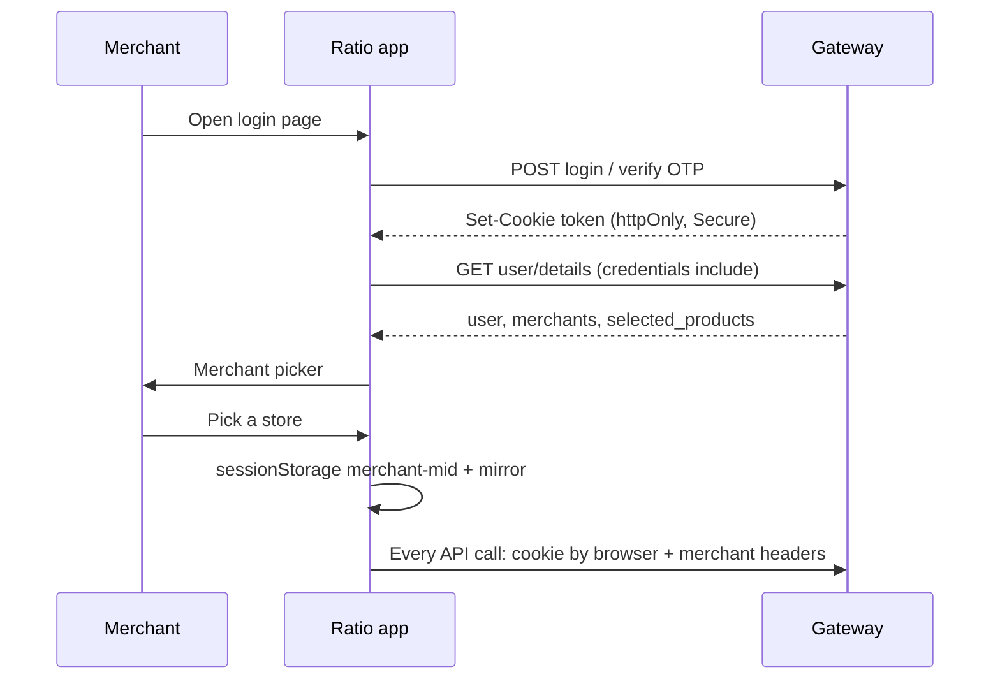

### 2.4 The domain question, answered fully

The question "can Ratio run on an entirely separate domain such as ratio.in if backend allows it?" was raised more than once and deserves a complete answer rather than a rule, because the honest answer is "yes, but only one way".

If Ratio's page and the cookie's site are the same family, for example ratio.gokwik.in with the gokwik.in cookie, the cookie is first-party and every browser sends it. That is option A. It requires no authentication change at all, only a CORS allow-list entry at the gateway, and it keeps SameSite Lax as a lock against cross-site request forgery.

If Ratio's page is ratio.in and the cookie belongs to gokwik.in, the cookie is third-party on that page. Backend can relax it to SameSite None and allow the origin in CORS, and in a normal Chrome window this works; the sandbox already runs this way for localhost. That is option B, and it is a trap: Safari, every iOS browser, Chrome Incognito and Brave block third-party cookies regardless of SameSite, so login fails for exactly the merchants who use phones. It would also weaken the old dashboard's forgery protection, because the same cookie serves both applications. Option B passes a demo and fails a launch, and the failure cannot be fixed from our side.

If a separate brand domain is a real product requirement, the correct route is option C: serve the API first-party under the new domain, for example api.ratio.in, by giving the gateway a second hostname and having it set the cookie with Domain .ratio.in for requests arriving on that host. The cookie is then first-party again, every browser works, and Lax can stay. This is gateway and infrastructure work (hostname, TLS, cookie domain per host, possibly a separate session scope) and must be scheduled with platform before the first staging deploy. Option D, a token-based design with the token held in memory and a refresh flow, works everywhere but changes the security model and is not justified by v1 needs.

The recommendation is option A by default, option C if product requires the brand domain, never option B. The proof is ten minutes away: because sandbox already uses SameSite None, running the local gk-pages against sandbox in Safari or in Chrome Incognito shows option B's production behaviour today. Nothing else in this document depends on the choice; the API client, the registries, the quality bar and the bug workflow are identical under A and C.

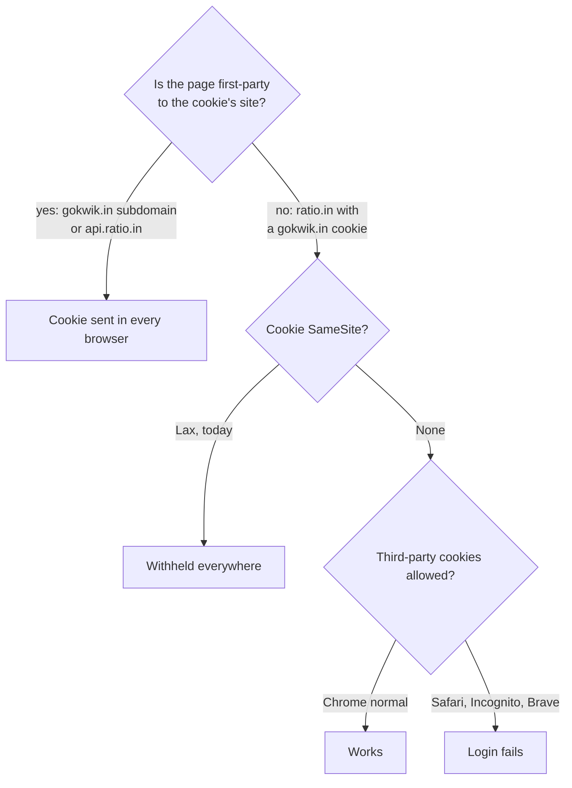

### 2.5 Security of the cookie model

We also pressure-tested the model against the question "can someone take the token and hit our APIs from their own site?" Three independent locks answer it. The cookie is httpOnly, so a script cannot read it. It is SameSite Lax, so a request from another site does not carry it. Our custom merchant headers force a CORS preflight, so a cross-site call dies before it is sent. Outside a browser, with a stolen value and curl, no cookie scheme helps; that is what expiry and server-side validation are for, and it is true of every authentication design.

---

## Part 3. The gateway and how the application talks to APIs

### 3.1 What the gateway is and why it matters

Every API request from the browser goes to a single edge service, an Envoy gateway behind Cloudflare, which checks the session cookie, enforces CORS, and forwards the request to the internal service that owns the data: os-item for products, os-order for orders, os-discount for discounts, and so on. We observed this directly in the response headers, which include Envoy's own markers and a request identifier it generates for every call. The gateway is the single point where authentication and CORS are enforced; the services behind it trust the context the gateway hands them and never see the browser.

This answers a worry that was raised early: "if I send the token to the APIs, won't every API have to support the new application?" No. Because enforcement happens once at the gateway, supporting Ratio collapses to one gateway configuration (d17): the exact new origin in the allow-list, because a wildcard is not permitted when credentials are sent; the Allow-Credentials flag, without which the cookie never flows; and the two merchant headers, gk-merchant-id and merchant-mid, in the list of allowed request headers. That last line is the direct lesson of an earlier incident in which a discount endpoint was called on a direct service host that did not allow the merchant header. One more entry now joins the same configuration (from Part 9): the request identifier X-Request-Id must be added to the exposed response headers, because today the gateway returns it but does not let browser JavaScript read it.

The free pass covers only calls that go through the gateway. Some calls in the current code bypass it: direct service hosts, upload calls made with fetch and hand-set headers, and third-party endpoints. Each of those carries its own CORS configuration and none has ever been tested from a new origin. Decision d18 is therefore an audit: every call is tagged as gateway-routed or bypass, the bypass list is smoke-tested from the new origin on staging, and backend fixes whatever breaks.

### 3.2 What the current API client actually does

Because Ratio will have its own API client, we took the shipped utilities bundle apart to see exactly what the current one does, so that nothing useful is lost and nothing harmful is copied. The base URL comes from a build-time environment variable. The client sends credentials on every call. It attaches the merchant header from sessionStorage, and because gk-pages wraps it with its own header injection, the header is actually sent twice. It also sends five headers on every request, X-Content-Type-Options, Referrer-Policy, X-XSS-Protection, Content-Security-Policy and Strict-Transport-Security, which are response headers by definition: in a request the server ignores them, and their only effect is to force extra entries into the CORS allow-list. If the user's role is "internal user" and the call is not a GET, the client refuses the call unless the URL is on a small allow-list; whether the server enforces the same rule is unknown and is one of the questions for backend. A parameter called mode is added from localStorage for non-internal users; its meaning is also unknown and must be answered before go-live. On a 401 the client clears state and navigates to the login page. It fires a global loader event on every call. Most consequentially, it never throws: errors are caught and returned as an object with an error flag, which is incompatible with how React Query and error boundaries work. Finally, the whole build environment, 69 keys including Jenkins paths and the git commit, is inlined into the public bundle; no secret was found by name, but the pattern is unsafe and the utilities team should be told.

### 3.3 Ratio's API client

The replacement is deliberately small (d11). It is built on fetch with credentials included, so the browser carries the cookie and the client never touches a token. The base URL comes from a build-time allow-list of public variables, which Vite enforces by only inlining variables with a VITE_ prefix. The two merchant headers are set in exactly one place, so a header rename is a one-line change. Query parameters go through a params option rather than string concatenation. The five response headers, the global loader and the environment dump are not carried over. The client reads X-Request-Id from every response and records a breadcrumb with the method, path, status and request identifier. On a 4xx or 5xx it throws a typed error carrying the status, the request identifier and the body, which is what lets React Query show error states, retry, and let an error boundary catch failures. On a 401 it stores the return path and redirects to login.

Every API is named in exactly one endpoint file inside the resource that owns it. Screens never import endpoints; they use React Query hooks over them. This is what makes the whole application resilient to an unstable backend, and it is explained further in Part 4.

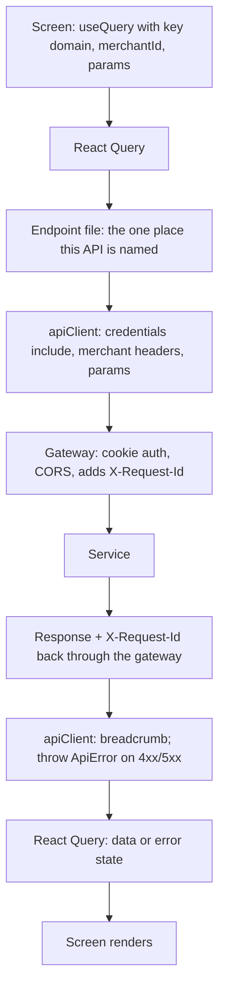

### 3.4 URLs

The URL scheme becomes /store/:storeId/… (d09). The old /gk-pages prefix existed only so the Single-SPA root configuration knew when to mount the application; it was a constraint, not a design. The store identifier stays in the path so that deep links work, two stores can be open in two tabs, and a shared link opens the same screen for the recipient. Filters, pagination and sort live in the URL's search parameters, typed and validated with Zod through TanStack Router, so that a URL reproduces a screen exactly; this is also why, in Part 9, a bug report's page link is sufficient to reproduce the state. At cutover a small redirect in the old dashboard maps old paths to the new domain (d10), so launch day is not a rain of broken bookmarks.

---

## Part 4. Code structure and the engine

### 4.1 The stack and why each piece earned its place

The stack was adopted from Aman Zaid's draft, but each piece was adopted after a "why", not as a package deal (d40). The build tool is Vite: this is an admin behind a login, so it needs neither search-engine indexing nor server-side rendering, and Next.js was rejected both for that reason and because its server rendering complicates the cookie story. The router is TanStack Router, because our view state lives in the URL and the router gives typed routes and Zod-validated search parameters; a typo in a path becomes a compile error rather than a runtime 404, and a malformed parameter never reaches a component. Server data lives in TanStack Query. Forms use React Hook Form with Zod schemas. Multi-step flows use XState v5. UI flags use Zustand. Entities and actions are defined in registries.

Two of these were challenged hard. Zustand looked like a contradiction of the "no Redux" rule until the rule was restated precisely: what was banned was server data in a global store, and that remains banned in Zustand too. Zustand is a zero-boilerplate global useState for interface flags such as whether the sidebar is open, which modal is showing, and what is selected for a bulk action; nothing from the server ever goes in it. React Query was challenged with "I do not want to cache anything; this is a dashboard, it must show the updated value every second." The resolution was about what caching means here. React Query's model is stale-while-revalidate: it shows the cached result instantly while fetching a fresh one in the background, so the cache removes loading flashes without ever serving old data as final. The counter-intuitive part is that a plain useEffect fetch is staler, because it fetches once on mount and never again, so a tab left open for twenty minutes shows twenty-minute-old data; React Query refetches on focus and can poll. The freshness numbers were settled later (section 4.5).

### 4.2 Layers

Ratio has five layers with strict rules between them. The platform shell owns everything cross-cutting: boot, login, merchant picker, route guard, navigation, the API client, observability wiring and error boundaries; feature code never re-implements any of these. The registry engine owns the mechanics: defineResource, defineCommand, runCommand, the record-editor state machine, query-key helpers and the Zod boundaries. Resources are one folder per entity, generated by the scaffolder, each holding a definition, one endpoint file per API, transformers, schemas, any bespoke components and tests. The UI kit is a set of closed-API components with design tokens and a playground. Bespoke experiences, the visual editor, analytics and onboarding, are ordinary feature code, but even their writes go through commands.

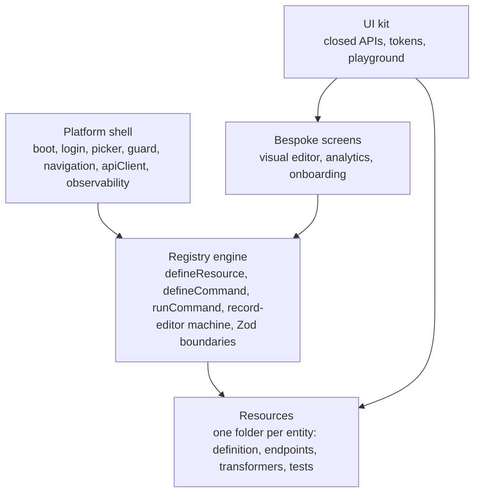

### 4.3 Registries: define once, run everywhere

The heart of the architecture was best described during the discussion in one sentence: "the function is written in one file, and that same function is used everywhere." A **resource** declares an entity once: its identifier and labels, its list columns, filters and default sort, its form fields and Zod schema, its endpoints for list, get, create, update and delete plus any custom ones, its transformers in and out, its freshness setting, its permissions and its invariants. From that one declaration the engine renders the list screen and the form screen and registers the standard commands. A **command** declares an action once: an identifier such as order.refund, an input schema, the confirmation text, the permission required, the endpoint it calls, what to invalidate on success, how to map errors, and three effect flags, readOnly, destructive and idempotent. Those flags are the same annotations the Model Context Protocol uses to describe tools, which is why commands are AI-ready without extra work (Part 10).

**runCommand** is the single execution path. It checks permission, asks for confirmation when the definition requires it, validates the outgoing payload with Zod, calls the endpoint through the API client, records a breadcrumb we call the passbook entry, invalidates the affected queries, and shows the toast or the error. A row button, a context menu item, the bulk action bar, the command palette and the assistant all call runCommand with the same command. There is no second way to write.

The restaurant analogy made this click. Today every waiter cooks at the table: the product delete action exists three times in the current code, each copy slightly different. The registry puts one menu card (the definition) in front of one kitchen (runCommand). Whether the order comes from the dining room or from a delivery app, the dish is cooked the same way, and a new dish is one menu entry that appears at every counter.

The strongest objection raised was that the backend is unstable: the order API and the product API disagree on conventions, and endpoints change. That objection turned into the pattern's best argument. When every endpoint is named in exactly one file, a backend change is a one-file edit and all five surfaces are fixed at once. Per-service transformers clean the inconsistencies at the door, snake_case versus camelCase, staff_id versus staffId. Zod validation logs drift to Sentry before merchants notice. The more unstable the backend, the more a single choke point pays. We also asked whether any of this is standard, and it is: commands are the command pattern used by CQRS systems and by VS Code; resources are React-Admin's model; bulk jobs follow Shopify; AI tools follow MCP. The parts are standard; only the assembly is ours. The honest counter is also recorded: for a three-screen tool this would be overkill; at eleven entities, five surfaces, outside contributors and an AI assistant, it pays.

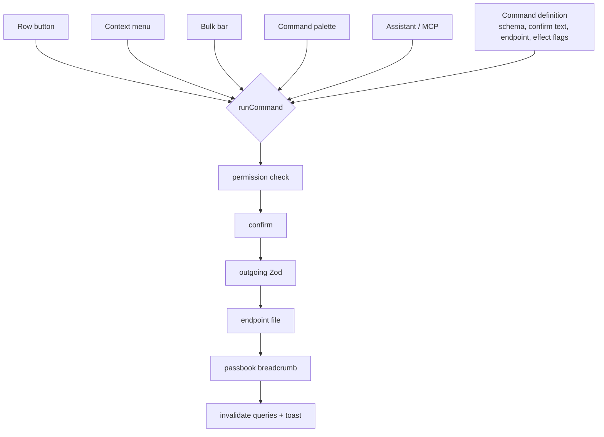

### 4.4 How far the registry goes

The hardest question in the whole discussion was "to what extent?", asked three times in different words until the answer was concrete (d41). The answer has four rules. First, every data-changing action is a command, with no exceptions; screens never call a write API directly, because one bypassed write is an unsafe path for the assistant. Second, the roughly eleven table-plus-form entity screens are built from resource definitions. Third, the different-experience screens, the visual editor, analytics and onboarding, are normal code; the registry has no role in their interface, but their writes still go through commands. Fourth, the registry is a plumber, not a UI designer: a complex interactive component such as the variant matrix cannot come from a definition, so it is hand-built and plugged into the definition, which carries the fetching, saving, error handling and caching underneath it so the component only carries the experience. The screen-by-screen walkthrough of today's pages is what produced this rulebook: the products list and form come from a definition, the variant matrix is hand-built, the visual editor and analytics stay as ordinary code, and orders are a definition with bespoke sections.

The command palette (the Cmd-K style launcher) is kept in a reduced form. Record search was cut because the backend has no search service. Navigation and actions need no backend and come free from the registry, so they stay. The same constraint shaped global search: it calls the list endpoints of two or three entities in parallel using their existing search parameters rather than asking backend for a new service.

### 4.5 State and freshness

Each kind of state has one home. Server data lives in React Query, with cache keys of the form [domain, merchantId, params]: the merchant identifier is mandatory and comes first, and the cache is cleared on merchant switch, because two merchants' data mixing in a cache is not a usability bug but a security bug, and putting the merchant first in the key makes a collision structurally impossible. View state, filters, page, sort and the selected tab, lives in the URL. Form state lives in React Hook Form. Interface flags live in Zustand. Multi-step flow state lives in a state machine. Merchant context lives in React Query with a sessionStorage mirror for synchronous reads.

Freshness follows Aman Zaid's defaults, lists at 30 seconds, detail views at 60 seconds, lookups at 10 minutes, with explicit staleTime zero wherever freshness genuinely matters (d42). This formulation came from the team: "we choose his defaults, and where we need it we put zero explicitly." It works, with one asymmetry worth naming: forgetting to override fails as silent stale data, whereas the other direction fails as one harmless extra request. Two safety nets close the gap. Refetch on window focus is on globally, so returning to a tab is always fresh, and the scaffolder requires an explicit staleTime on every resource, so omission is an error rather than a default.

Zod validation is applied pragmatically. Critical reads are parsed with safeParse and a Sentry log on mismatch, so the page keeps rendering and the team learns about drift. Money is parsed hard: a wrongly parsed price must stop rendering rather than show a wrong number, a rule learned from an incident in which rupees and paise were confused. Outgoing payloads are validated too (Part 9). Writing a schema for every endpoint is explicitly not a goal.

### 4.6 Flows and state machines

A state machine is used only for flows with three or more steps: login with OTP, application boot, the record editor, refund, import and job tracking. The reason is a class of bugs everyone has seen. A form-save flow written with three yes-or-no flags, saving, error and confirm, has eight possible combinations, five of which are nonsense ("saving and failed both true?"), and those nonsense states are where double-save bugs come from: the user clicks Save again during loading and two requests go out. A washing machine does not have five switches; it has one dial, and the dial is in exactly one position at a time. A state machine is that dial. While the flow is in the saving state there is simply no transition for Save, so a second click is ignored by design rather than by a guard someone remembered to write.

One record-editor machine, with states pristine, dirty, saving, done and error and transitions for save, retry and discard, drives every entity form, so every form gets the same dirty check, conflict handling and unsaved-changes guard. Two or three engineers write machines; everyone else consumes hooks and never sees XState. The threshold is enforced in review so that a modal or a toggle stays on plain component state.

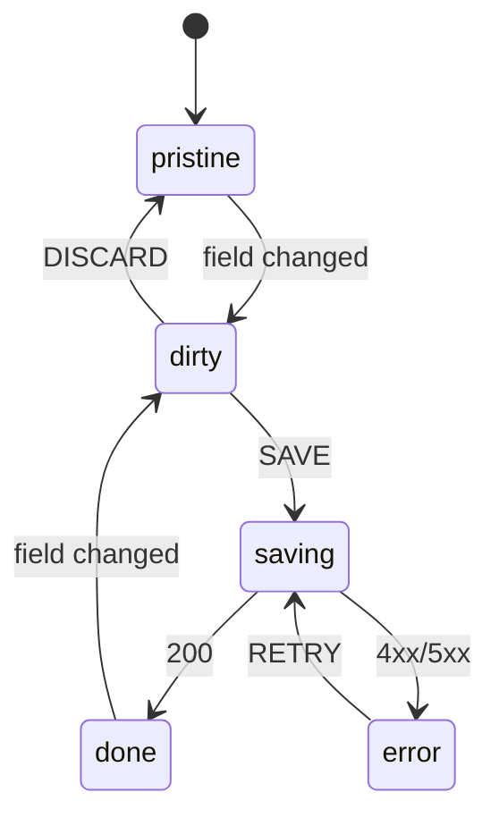

---

## Part 5. The UI kit

Ratio gets its own component kit built on Radix primitives, Tailwind and design tokens (d15). The gokwik-ui-kit wrapper over antd does not come along. The reasons are brand independence for a new product and the end of a long series of override conflicts with antd, of which the gk-ant class-prefix saga, where styles silently matched nothing, was the most painful. This is honestly the single biggest piece of work in the project, which is why its governance was designed alongside it (Part 8).

The kit exposes closed APIs. Each component has a fixed list of variants and no style or className passthrough. This is a deliberate lock: if a Tag component accepted an arbitrary class, a new colour could appear inside a feature without touching the kit and without anyone noticing; with a closed variant list, the new colour cannot be expressed in feature code at all, so introducing it means changing the kit, which triggers the owners. The kit lives at /src/ui inside the repository rather than as an npm package (d38): a publish-bump-install cycle would kill velocity during the build phase, and the triggers for revisiting are written down, a second consuming application or repeated bypass attempts. A playground route in non-production builds catalogues every component with all of its variants, a lighter alternative to full Storybook while the kit is young; this is also what replaces the breadcrumbs that were dropped (d13), since the real need behind them was discovering what exists.

The shell supports two levels of navigation nesting (d14) so that it can be built now while product finalises the information architecture. The v1 shell ships global search, a store switcher and profile and logout (d16); notifications come later.

---

## Part 6. Quality and operations

### 6.1 Why this part exists

The best dashboards do not differ from average ones by their features; they differ by their standard. Errors reach the team before merchants report them. A crash never leaves a blank screen. The security basics are enforced at the CDN, not remembered by developers. The current gk-pages has none of this: there is no error tracker on the frontend, and the microfrontend wrapper literally returns nothing when a section crashes, so the section disappears silently. This part explains each tool and practice first, because several were new to the team when the discussion started, and then states what was decided.

### 6.2 Error tracking with Sentry, and what source maps are

An error tracker is a service that receives every JavaScript error from every merchant's browser, groups identical errors together, tags them with the release they came from and the user they affected, and alerts when a new kind of error appears or an existing one spikes. Without one, the team learns about production errors from support tickets. Sentry is the tracker chosen (d22), because it is already in the organisation and is the strongest tool for this job.

A production error on its own is nearly useless, because production JavaScript is minified: a stack trace points at something like x.js, line 1, column 482917. A source map is a translation file produced by the build that maps those positions back to the original source, so the same error reads ProductForm.tsx, line 142. The maps are generated in hidden mode, uploaded privately to Sentry by the CI pipeline, and stripped from the deployed assets, so the team gets readable traces and the public CDN discloses nothing about the source.

The first recommendation had been PostHog's error tracking, purely to avoid a new vendor; it flipped when it emerged that both tools are already in use, and the tools were split by strength: Sentry for what broke, PostHog for what users do. Releases are tagged ratio@version so that every event names the build it came from; merchant identifier and route are attached as context; personal information is never sent; Sentry's own session replay stays off.

### 6.3 Error boundaries

An error boundary is a React component that catches a rendering crash in the part of the tree below it and shows something else instead of letting the whole application go white. Ratio puts one on every route (d26). On a crash the merchant sees a card saying something went wrong with a Retry button, while the rest of the application stays alive, and the boundary reports the error to Sentry. There is also one global crash page as the last line of defence. Blank screens are banned; the return-nothing pattern of the current wrapper dies here. In Part 9 the error card gains a support box that turns every crash into evidence.

### 6.4 Alerting through OpsGuard

OpsGuard is the organisation's on-call and alerting destination; it is where backend alerts already go. The question "can I get alerts on OpsGuard?" had a cheap answer: backend already runs a pipe from Sentry to OpsGuard, so Ratio's Sentry project is simply added to that pipe rather than anyone building new plumbing. Alert rules fire only on new issues and on spikes or affected-user thresholds, never on every event, because noisy alerts train people to ignore alerts.

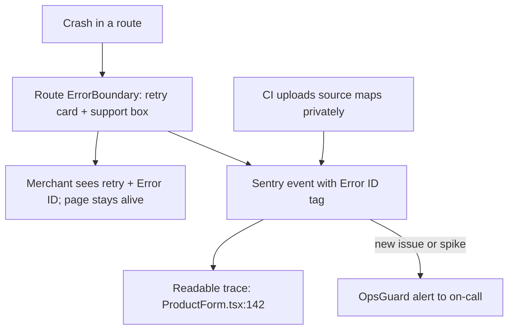

### 6.5 Uptime, latency and Web Vitals

The scoping input from the team was precise: backend owns API latency, with its own service-level objectives and on-call; the frontend does not need p95 and p75 dashboards. That is correct, with one carve-out. Backend monitoring ends at the server; the half of the experience that happens inside the browser, bundle parsing, rendering, interaction latency, is invisible to it. So Ratio keeps no frontend latency dashboards and no latency alerts (d25, d30), but turns on PostHog's automatic Web Vitals capture so that the numbers exist on the day someone says "it feels slow", and it runs one synthetic check that loads the login page and makes one API round-trip, with CDN alarms, into the same OpsGuard pipe, because backend's on-call does not watch our domain.

### 6.6 Security headers and the Content Security Policy

A browser can be told, by headers on every response, to refuse certain dangerous things. Ratio ships five of them from one CloudFront response-headers policy (d24): Strict-Transport-Security to force HTTPS; a Content-Security-Policy containing only the frame-ancestors directive set to none, plus X-Frame-Options DENY, so that no other site can embed the admin in an invisible frame and farm clicks; Referrer-Policy to limit what URLs leak to other sites; and Permissions-Policy denying camera, microphone and geolocation. These live in CDN configuration, not in code, and frame-ancestors restricts who may embed Ratio, not what Ratio embeds, so the visual editor's own frame is unaffected. No secret goes into the bundle, enforced by the build-time allow-list, and no source map is public.

A full Content Security Policy, which whitelists every script and connection origin, is deliberately deferred, not deleted. The team pushed back on its cost, and the honest answer is that a full policy applied blind breaks something on launch day. The old dashboard has one today, so shipping Ratio with no plan would be an audit finding; the plan is to ship the policy in report-only mode after launch, collect the violation reports (PostHog, uploads and the visual editor will reveal their endpoints), then enforce.

### 6.7 Bundle budget, feature flags and the UX baseline

A bundle budget is a size limit on the initial JavaScript enforced by CI (d23). Bundles grow silently, one heavy import at a time, and a budget that does not fail a pull request does not exist; the current single-bundle gk-pages is the cautionary example, and routes are code-split so that each page loads its own code. Feature flags come from PostHog (d27): percentage and per-merchant rollout and a kill-switch on risky features, so that rolling back a feature is a toggle rather than a deploy, and the launch itself can ride a flag. Every screen ships four designed states, skeleton while loading, an empty state with a call to action rather than a bare "no data", an error state with retry, and ready, and it is keyboard operable with visible focus and AA contrast (d29); the pull-request checklist and the scaffolder's page template enforce this. Product images are transformed at the CDN, below-the-fold images lazy-load, and screens render skeleton-first so that nothing shifts when data arrives (d33).

### 6.8 PostHog and Microsoft Clarity

PostHog gets a separate project for Ratio (d20) and owns product events, feature flags, Web Vitals and the debugging session replay. Session replay is not a video: the recorder captures the page structure and every change to it, clicks, scrolling and typing, and plays it back like a video later, with the network calls and console errors alongside. Microsoft Clarity, which the root configuration injects into the dashboard today and which gk-pages never loaded itself, is added explicitly to Ratio for its strengths, heatmaps, rage clicks and dead clicks (d45). Because two recorders run, every input is masked in both and recording is sampled rather than universal, for cost and privacy. Replay is for humans; an AI assistant works from the request log and Sentry, which are text.

---

## Part 7. Delivery: CI, environments and releases

### 7.1 Continuous integration

Continuous integration means a robot runs a fixed set of checks on every pull request and the merge button stays locked until they pass. Ratio's gates are blocking with no exceptions, including for changes written by an AI assistant (d28): lint including the architectural boundary rules, the TypeScript type check, the test suite, the bundle budget and the dependency audit for high and critical vulnerabilities. On staging, a Playwright end-to-end smoke that logs in, selects a merchant, opens the products list and performs one save is the gate for deploying to production.

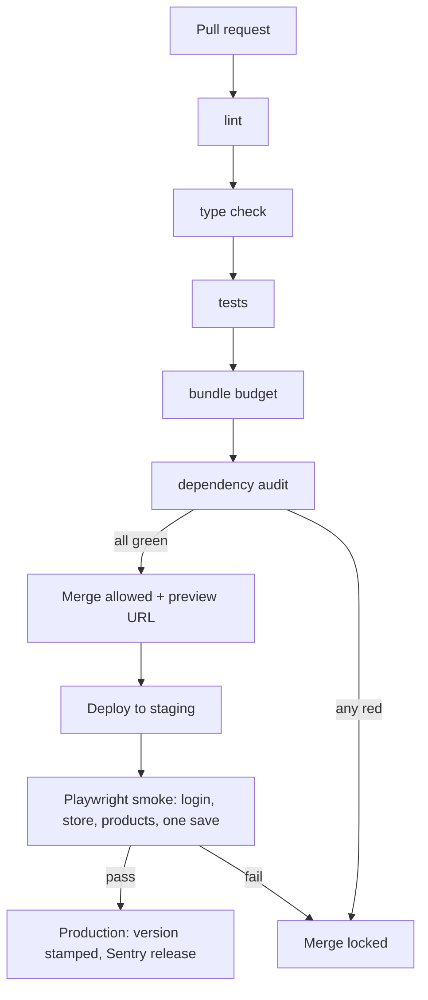

### 7.2 Environments, previews, versions and cache

Development runs on localhost against the sandbox gateway, exactly as gk-pages does today, which is possible because the sandbox cookie is SameSite None. Every pull request gets a preview deployment with its own URL pointing at the QA backend and wearing a visible non-production badge, so that QA, design and product review from a link with no local setup (d32). Staging is where the smoke test runs and where cutover is rehearsed. Production runs on the origin chosen in Part 2.

The git tag is the source of truth for versions. CI stamps the version and commit into the bundle, creates the GitHub release and registers the Sentry release, so "what is production running?" is answered by one console line or by any Sentry event, and rollback is a redeploy of the previous version rather than an investigation. Assets are content-hashed and cached immutably for a year while index.html is served with no-cache and invalidated at the CDN on each deploy; a new deploy changes the file names, so browsers fetch new files automatically. If a merchant is ever told to "hard refresh", that is a bug in this scheme. Dependencies are kept current by a bot opening small weekly update pull requests, with a committed lockfile and a written browser-support matrix (d34); the current gk-pages, still on TypeScript 4.3, is the reason small regular upgrades beat one yearly migration.

---

## Part 8. The contributor model and the AI-native repository

### 8.1 The three problems, in the team's own words

This part came from three problems stated directly. The first: engineers from other teams, assisted by AI, write frontend code in whatever pattern comes out and later report that "the frontend does not support" what they built. The second: nobody should be able to add to, edit or delete a UI kit component without the kit owner's approval; if someone wants a pink tag where only a blue one exists, they raise a request, and the kit team makes the change. The third: everyone now works through an AI assistant, so five engineers mean five prompting styles, and a lesson learned in one person's AI session is lost to everyone else.

### 8.2 Guardrails: recipes teach, lint blocks, the scaffolder paves the road

The principle behind decision d37 is that instructions alone stop nobody. Machines enforce, recipes teach, and the paved road makes the right way the fastest way. Four mechanisms implement it. CLAUDE.md files, nested per area with an AGENTS.md pointer for other tools, contain recipes with exact steps rather than policy prose, because an AI assistant follows steps and ignores lectures. A scaffolder, run as npm run new:resource, generates a complete resource folder, definition, endpoint files, tests and the four UX states, so that what it generates is the pattern and creating folders by hand is forbidden; this was the piece the team rated highest. ESLint boundary rules make wrong code unmergeable: no write calls outside commands, no endpoint imports in screens, no raw button or input elements, no imports from inside the kit, no shadow copies of kit components. A CODEOWNERS file on /src requires named approval, which GitHub enforces by refusing the merge. The first milestone of the project is the kit plus one golden exemplar feature, Products, because every recipe points at it and every scaffolded resource copies it.

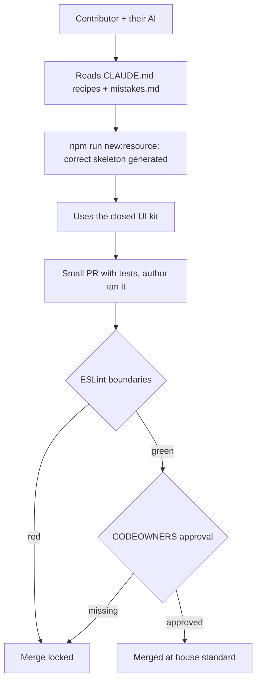

### 8.3 Kit lockdown

The pink-tag problem is solved by three locks and a door (d38). CODEOWNERS on /src/ui means the kit owner must approve any change to the kit. Closed component APIs, described in Part 5, are the cleverest lock, because they make an unapproved variant inexpressible rather than merely forbidden. Lint closes the bypasses. The door is a Kit Change Request template that makes legitimate requests fast, because a slow door is how shadow design systems are born and how real ones die.

### 8.4 The AI-native repository

Decision d39 treats every contributor's AI assistant as a team member who must be onboarded by the repository itself. Skills, the step-by-step workflows an assistant follows, are committed under .claude/skills: new-resource, add-command, review-pr and fix-bug, so that every developer's assistant runs the same playbook and prompt quality becomes a property of the repository rather than of the person. A team mistakes.md file records each costly mistake in a fixed format, what went wrong, what is correct, how it was caught, and is updated by pull request and read by every assistant session before it writes code, so that one person's two-hour debugging session becomes everyone's assistant's permanent knowledge the same day. An AI pull-request contract sets the norms: small pull requests with no "the AI wrote it, that is why it is big" exemption, the author states they ran the change with screenshots for interface work, tests ship in the same pull request, and reviewers read it asking "is this our pattern?", because "does it work" is CI's job. A committed .claude/settings.json gives every session the same safe pre-allowed commands and denies reads of .env and secrets.

---

## Part 9. Bugs: from a screenshot to a merged fix

### 9.1 The problem

A product manager who does not know the code hands a ticket to an engineer or to an AI assistant and says "fix this". Unless the application has collected the evidence itself, the fix is a guess, and a guessed fix is worse than no fix. The hospital is the right picture: the patient only says "my stomach hurts"; the lab report says what is inside; the reception desk asks the missing questions before the doctor's time is spent. The application must be the lab report, and the intake procedure must be the reception desk.

### 9.2 The support box

Every error screen carries a support box below the friendly message (d44). It shows a short Error ID such as K7F3-2Q9A, generated per crash and attached to the Sentry event as a searchable tag, kept short because long identifiers are misread in screenshots; the page route; the validated filters; the time, the application version and the store identifier; the last failed API call as method, path, status and the first eight characters of its request identifier; and the last three to five steps in human words, taken from navigation and command labels. A Copy button produces the same fields as text. One screenshot of this box is enough to begin debugging.

Equally important is what the box never shows: the stack trace, because that is our internal code map and the same reasoning that hides source maps applies; request and response bodies, because they may contain a customer's name, phone or address and screenshots travel through Jira and chat; and the full breadcrumb list. All of that lives in Sentry behind the Error ID. The rule is that the screen says where and what happened and Sentry holds what was inside. For defects that do not crash anything, a wrong total for example, a "Report a problem" item in the help menu opens the same box with the last five commands and a replay link added.

### 9.3 Settling frontend versus backend with the request identifier

Today the gateway generates an X-Request-Id for every call and returns it, but the response's exposed-headers list does not include it, so browser JavaScript cannot read it even though developer tools can. Think of a tracking number printed on a parcel that is sealed: the shopkeeper can see it, the courier cannot. One word added to the gateway's exposed headers makes the number readable; backend must also confirm that the services log the same identifier. From then on every API breadcrumb carries it, and when the API returned wrong data the ticket says "backend bug, request-id so-and-so, this came back, this was expected", and backend searches its logs by that identifier. Hiding a backend defect inside a frontend transformer is prohibited, because a defect hidden that way is never fixed at source.

### 9.4 The intake procedure

The fix-bug skill, committed in the repository, is the reception desk. Three things are required from the reporter before any fix starts: the page link, copied from the address bar; what happened versus what should have happened, in their own words; and the Error ID or a screenshot of the support box. Nice to have are a video, whether it happens every time, roughly when, and whether one merchant or many are affected. Everything else the engineer or assistant collects itself and never asks a human for: the Sentry trace, breadcrumbs and release, the request identifiers and the command log, what the API actually returned, and the recent history of the files involved. The rule is that if a system can tell you, you do not ask a person. When a required item is missing, every question is posted in one ticket comment in plain language with an example of what to send, and work stops until it is answered. Guessing is prohibited.

### 9.5 Four buckets and two checks

Every ticket is classified into exactly one bucket. A frontend bug, where the API returned correct data and the client showed or sent the wrong thing, is fixed test-first: write the failing test that demonstrates the bug, and if the test cannot be made to fail the bug is not understood and the right move is to go back and ask; then fix, open a small pull request stating what broke, why and how it is fixed, and post the preview link on the ticket. A backend bug is reported on the ticket with the request identifier, what came back and what was expected, with no client-side workaround. Something that is not a bug is explained in plain words and nothing changes. Missing information triggers the intake procedure. Two independent checks close a fix: a developer reviews the code for conformance to the pattern, and the reporter verifies the behaviour on the preview deployment. The engineer or the assistant opens the pull request; the developer reviews it. The code map makes this deterministic for every resource, because the scaffolder generates the same path from a URL to a route file, a resource, an endpoint file, a transformer and a command.

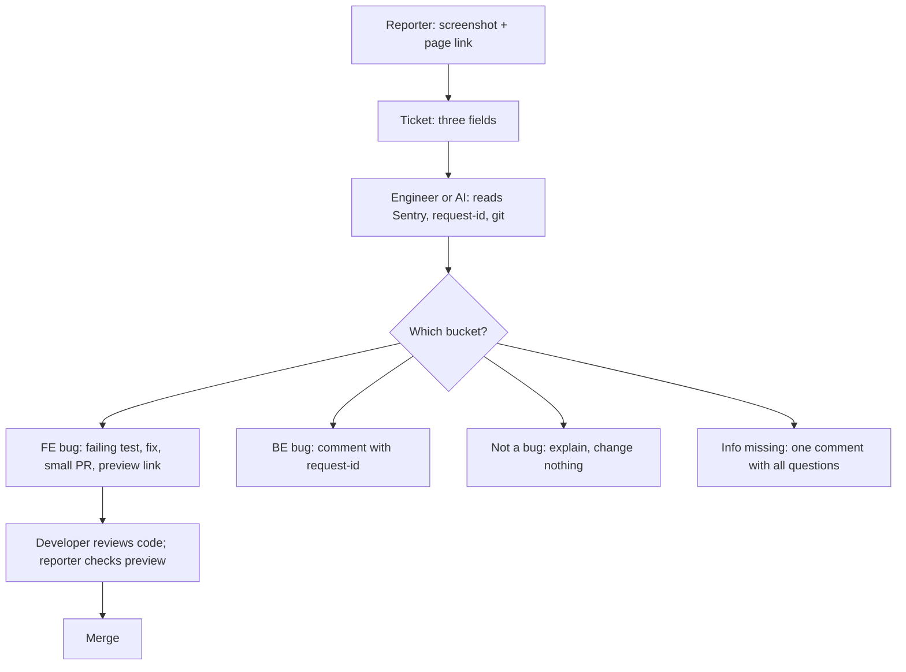

### 9.6 Silent bugs

The question "what about a flow that runs and calls the wrong API, with no crash at all?" has its own answer (d45), and the bank is the picture: the cashier checks the slip before paying, every transaction goes into the passbook, and a dispute is settled by the CCTV. Prevention: every command has a test asserting it calls this endpoint with this payload, so a wrong endpoint turns CI red; outgoing payloads are Zod-validated inside the command, so an amount not in paise or an empty order identifier never leaves the browser; multi-step flows run on a state machine whose map does not allow illegal steps. Detection: every runCommand execution writes a passbook breadcrumb naming the command, the endpoint, the status and the request identifier; invariant checks such as "a refund cannot exceed the order total", "saved data equals what was sent" and "a discount is never negative" report silently to Sentry without crashing the page; and a 4xx or 5xx that the interface turned into a toast is still reported once. Seeing: the session replay and the Report-a-problem box. The worked example was "a refund turned into a cancel": the replay shows Refund was clicked, the passbook shows order.cancel ran, so the button is wired to the wrong command; a failing test is written and the fix follows with zero guessing.

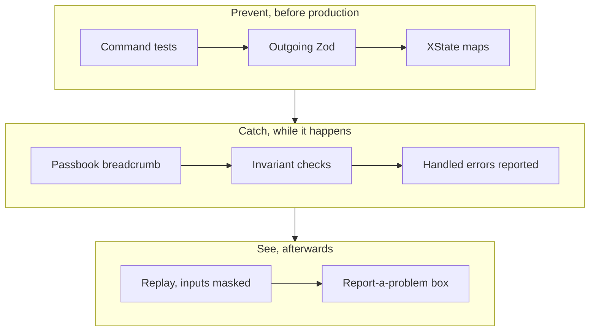

The three tools each have one job: Sentry for errors, Error IDs and alerts; PostHog for events, flags, Web Vitals and the debugging replay; Microsoft Clarity for heatmaps and rage clicks. The written artefacts exist already: the engineering chapter docs/engineering/08-bugs-and-debugging.md and the skill .claude/skills/fix-bug/SKILL.md.

---

## Part 10. MCP and the assistant

The Model Context Protocol is a standard way to expose a system's actions as "tools" that any AI assistant can call without a custom integration; think of it as a USB-C port for AI. A tool is a name, an input schema and a few annotations saying whether the action is read-only, destructive or idempotent. The question "in future we will work through MCP, place an order, create a product; have we decided anything?" has a straight answer: nothing is named MCP in the decisions, but the command registry was deliberately built so that MCP comes almost free. A command already carries a name, a Zod input schema that converts directly to the JSON schema MCP expects, the same three effect flags, a permission and a confirmation requirement, and a single execution path. Arya, the in-app assistant in Aman Zaid's design, stands on exactly this: the assistant proposes a command, the merchant approves, and the same runCommand executes it.

What is not decided is an external MCP server, that is, a merchant saying "create a product" from their own AI client outside the application. That needs an authentication story, because our session is a browser cookie and an MCP server is not a browser, so something like a per-merchant API token would be backend work; and it needs a decision about which commands to expose, since not all should be. The proposal on the table, d43, is: no MCP server in v1, but every command written with its effect annotations and schema from day one, so that adding a server later changes nothing in the commands, only adds a layer on top; Arya comes first and is the dress rehearsal; the external token question goes to backend when v2 picks it up. This is the one decision awaiting a call.

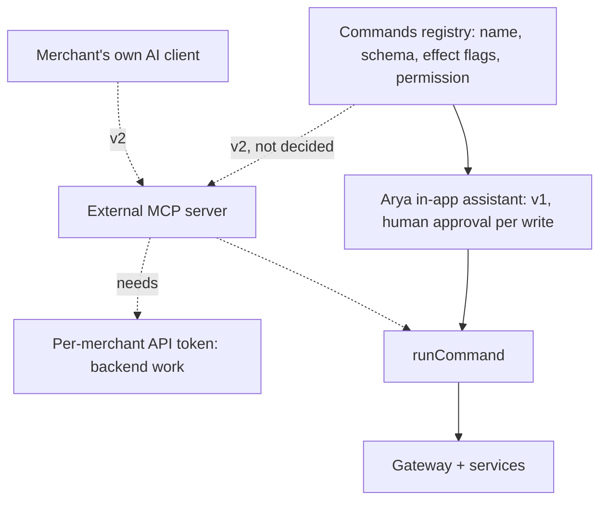

---

## Part 11. Migration and cutover

The work proceeds in five phases. Foundation: the API client and platform shell on localhost against sandbox, the UI kit and scaffolder, the CI gates, the Sentry and PostHog projects. Engine: the registries, runCommand and the record-editor machine, then Products as the golden exemplar, with preview deployments live. Parity: Orders, then the remaining entities per the v1 scope decision, the bypass audit, the browser matrix and the staging smoke. Cutover: the production origin live behind a flag, a phased merchant rollout, the redirect, and removal of the import-map entry. Follow-through: the Content Security Policy from report-only to enforced, the assistant, and extensions.

Before cutover a checklist must be clean: the production cookie family confirmed and the origin decision implemented; the gateway CORS entries live with the request identifier exposed and login accepting the origin; the bypass audit complete; the smoke test green and the manual browser matrix passed including iOS Safari and Chrome Incognito; alerts verified end to end into OpsGuard and the synthetic check live; the parity checklist signed off by product; the redirect deployed but disabled; and rollback rehearsed on staging within the target time.

The cutover itself is six steps. Enable the production origin for a pilot cohort by feature flag. Verify login, merchant selection and one write per entity for that cohort. Turn on the dashboard redirect from /gk-pages. Expand the cohort while watching Sentry's new-issue and spike alerts, the synthetic check and the CDN alarms. Remove the gk-pages entry from the import map. Keep the old bundle deployable for the agreed transition window. Rollback is the reverse and takes minutes: restore the import-map entry, disable the redirect, turn the flag off. There is no data migration to reverse because the backend is unchanged. Think of opening the new showroom before pulling the old shop's shutter, with the shutter key kept in your pocket.

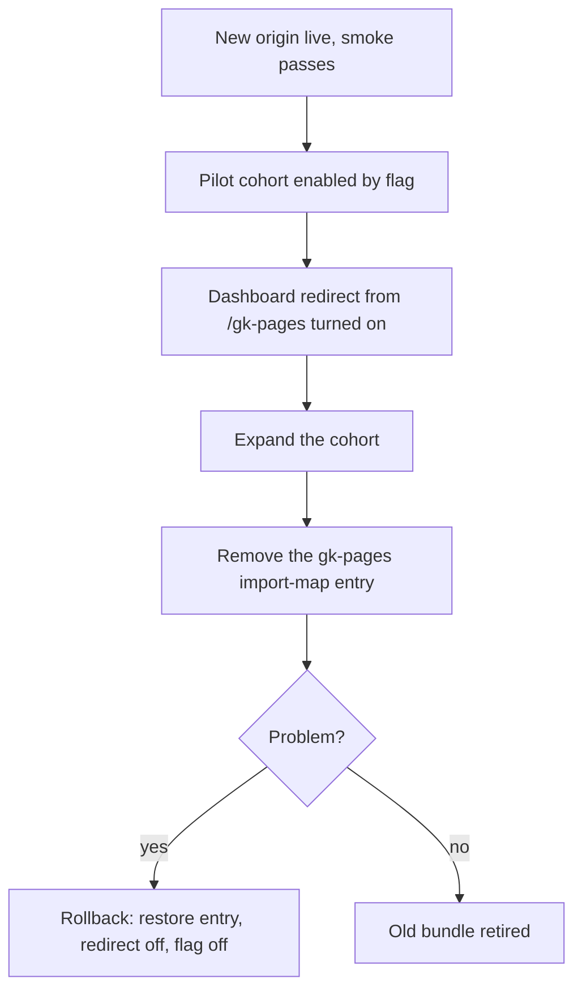

---

## Part 12. Convergence with the draft architecture

The two workstreams agreed, independently, on server state in React Query, no Redux, the URL as view state, Zod at the boundaries, an own UI kit, and the authentication, domain and entitlement conclusions. The draft contributed the router and build tool, TanStack Router and Vite, where the discovery had assumed React Router and webpack; the data-layer shape, registries where the discovery had feature folders with API files; and the state-machine approach to flows, which the discovery had not addressed. The discovery contributed the entire operations layer, Sentry to OpsGuard, security headers, uptime, release engineering and budgets, and the whole contribution and AI model, which the draft did not cover.

Three genuine disagreements were resolved explicitly (d42). On repository strategy the discovery leaned towards converting gk-pages in place to keep its history and the draft leaned towards a fresh codebase to start from the registry skeleton; fresh was chosen, with domain logic and transformers lifted selectively for parity. On data freshness the discovery had staleTime zero by default and the draft had 30, 60 and 600 seconds; the draft's defaults were adopted with explicit zero where it matters and the two safety nets described in Part 4. On where documentation lives the discovery said Confluence and the draft said in the repository; Confluence won for documentation, with one non-negotiable exception: CLAUDE.md, mistakes.md, the committed skills and the settings file stay in the repository, because they are not documentation, they are the operating system of the AI contributors and must be read from the code they govern.

Seven of the draft's open questions were answered by these decisions: fresh versus reuse (fresh); name and subdomain (Ratio, first-party origin per Part 2); gateway CORS (one configuration); login from the new origin (confirmed); hosting and CI (shape decided, detail with platform); gateway bypasses (audit plan); activity log (PostHog only in v1). Two remain open: where the assistant's language model runs and what it costs, and whether Arya is core or an installed application.

---

## Part 13. Registers

### 13.1 Decisions

d01, Ratio is the product name, a product call. d02, the origin must be first-party with the authentication cookie: a gokwik.in subdomain by default, a separate domain only with a first-party API host; the wording was revised on 21 October from "a separate domain is impossible" to this more precise form. d03, merchant eligibility comes from selected_products.pages with phasing decided at cutover. d04, a frontend route guard on that flag. d05, backend allows the new origin on login and OTP verification. d06, no token is stored anywhere; the gateway-cookie design is reused. d07, merchant selection through React Query and sessionStorage under the existing key, no Redux. d08, the existing permissions model is unchanged. d09, the URL scheme is /store/:storeId/…. d10, a redirect stub for old URLs at cutover. d11, an own API client that sets headers in one place and throws on error. d12, one source for user and merchant data with sessionStorage as a mirror. d13, no breadcrumbs. d14, information architecture by product with two-level nesting supported. d15, an own UI kit, no antd. d16, v1 shell features are global search, store switcher, profile and logout. d17, one gateway CORS configuration. d18, a gateway-bypass audit. d19, SPA hosting on S3 and CloudFront with pipeline detail last. d20, a separate PostHog project. d21, the cutover sequence with import-map rollback. d22, Sentry with alerts to OpsGuard through the existing pipe, PostHog kept separately. d23, code splitting and a CI bundle budget. d24, security headers v1 with full CSP deferred. d25, a synthetic uptime check and no frontend latency SLOs. d26, route error boundaries, blank screens banned. d27, PostHog feature flags with kill-switches. d28, blocking CI gates and a Playwright smoke as the deploy gate. d29, four UX states, keyboard and AA contrast. d30, Web Vitals autocapture only. d31, React Query with merchant-first keys, pragmatic Zod and hard parsing of money. d32, previews, git-tag versioning and the cache policy. d33, CDN image transforms, lazy loading, skeleton-first. d34, a dependency bot, audit gate, lockfile and browser matrix. d35, team documents on Confluence: runbook, decision records, tracking plan, PII policy. d36, staff management out of v1. d37, contribution guardrails. d38, UI-kit lockdown with a playground and no npm package yet. d39, the AI-native repository. d40, the stack: Vite, TanStack Router and Query, Zustand for UI flags, React Hook Form and Zod, XState, registries. d41, the scope rulebook, palette-lite, XState ownership. d42, fresh repository, the draft's freshness defaults with explicit zero and safety nets, Confluence with AI files in the repository. d43, MCP readiness, pending. d44, the bug-ready application. d45, silent-bug prevention, detection and replay with three tools.

### 13.2 Risks

R-01, the production cookie family differs from the assumption, which would place the subdomain in the wrong family and break login; mitigated by confirming the Domain attribute before any staging deploy. R-02, a separate brand domain is required late after option A is built; mitigated by deciding A or C now, since nothing else depends on it. R-03, option B is attempted as an interim and breaks on Safari at launch; mitigated by its explicit rejection and the ten-minute Safari test. R-04, gateway-bypass calls fail from the new origin; mitigated by the audit and smoke test. R-05, backend shape drift breaks screens; mitigated by one endpoint file per API, transformers and Zod drift logging. R-06, the mode parameter has semantics Ratio omits, such as live versus test data; mitigated by requiring the answer before go-live. R-07, the UI kit becomes the schedule bottleneck; mitigated by making the kit plus the Products exemplar the first milestone and keeping the change-request door fast. R-08, the registry is over-applied to bespoke screens; mitigated by the scope rulebook and review discipline. R-09, a forgotten freshness override shows stale data silently; mitigated by the scaffolder requirement and global refetch on focus. R-10, alert noise trains the team to ignore OpsGuard; mitigated by rules on new issues and spikes only and a review after two weeks. R-11, third-party scripts complicate the later Content Security Policy; mitigated by the report-only phase. R-12, extensions and the visual editor are undesigned and surface late; mitigated by dedicated design sessions before the Orders increment.

### 13.3 Gaps and open questions

GAP-01, the production cookie Domain attribute, .gokwik.in or .gokwik.co, a five-minute developer-tools check owned by frontend, needed this week. GAP-02, the v1 scope and parity checklist across products, collections, inventory, orders, customers, discounts, analytics, content library, settings and the visual editor, owned by product with engineering, needed before the Orders increment, because there is no cutover date without it. GAP-03, the extensions and apps system that gk-pages runs today through useExtensionPoint, useActionExtensions and useAppBridge, undesigned for Ratio, owned by architecture. GAP-04, the visual editor migration including its separate editor-token flow, owned by architecture. GAP-05, the exact domain name and the choice between options A and C, owned by product with platform, needed before the first staging deploy. GAP-06, the final information architecture, owned by product. GAP-07, the deployment pipeline detail, owned by platform, sequenced last by design. GAP-08, the assistant's language-model hosting and cost, owned by backend and management. GAP-09, Arya core versus installed application, owned by Aman Zaid. GAP-10, the final call on d43. GAP-11, the fifteen proposed defaults below.

### 13.4 Asks

To backend, as one message: allow the exact Ratio origin at the gateway with Allow-Credentials and the two merchant headers; add X-Request-Id to the exposed response headers; confirm that service logs record the same identifier; allow the new origin on login and OTP verification; participate in the bypass audit after the staging smoke; answer whether the merchant_id query parameter is still required beside the header; explain the mode parameter and whether Ratio needs it, required before go-live; confirm whether the internal-user write block is enforced on the server; and, for information, the utilities bundle inlines the Jenkins build environment. Later, for v2, a per-merchant API token for MCP and external AI access. To platform: the CloudFront response-headers policy, the Sentry project on the OpsGuard pipe, the PostHog project, the Clarity key, and under option C the gateway hostname under the new domain with TLS and cookie domain per host, plus the deployment pipeline, preview environments and the synthetic check. To product: the domain name and whether a separate brand domain is required, the final information architecture, the v1 scope and parity checklist, and merchant phasing.

### 13.5 Proposed defaults awaiting ratification

These were the author's suggestions accepted inside bulk-closed decisions and never discussed individually; the team should accept or strike each in one sitting. A pull-request size guideline of about 400 lines. A component size guideline of about 150 lines. A kit change-request turnaround of one to two days. A synthetic uptime check every minute. A rule to remove feature flags once a feature is stable. The browser-support matrix as a single written page. A PII masking policy as a named document. Tracking-plan event names as object_verb in snake_case. The runbook written before launch. The dependency bot enabled only after the repository settles. Fixing or quarantining the seven inherited failing test suites before gates go blocking. Confirming login rate limiting with backend. Testing specifics: MSW for integration tests, no snapshot tests, role-based queries. The "rejected alternatives" recorded with each decision being the author's analysis rather than separately ratified statements. The short Error ID attached to the Sentry event as a searchable tag.

---

## Part 14. Roadmap and next steps

The build order is the one agreed from the draft: the API client and platform shell first, then the registry engine, then Products as the golden exemplar with the UI kit, scaffolder and CLAUDE.md ready before it, then Orders, then the assistant, then the remaining entities, then extensions. The first step is unblocked today: nothing in it waits on CORS, the cookie domain or the request identifier, because development runs on localhost against sandbox exactly as gk-pages does now; only the mode-parameter answer is needed before go-live, not before starting.

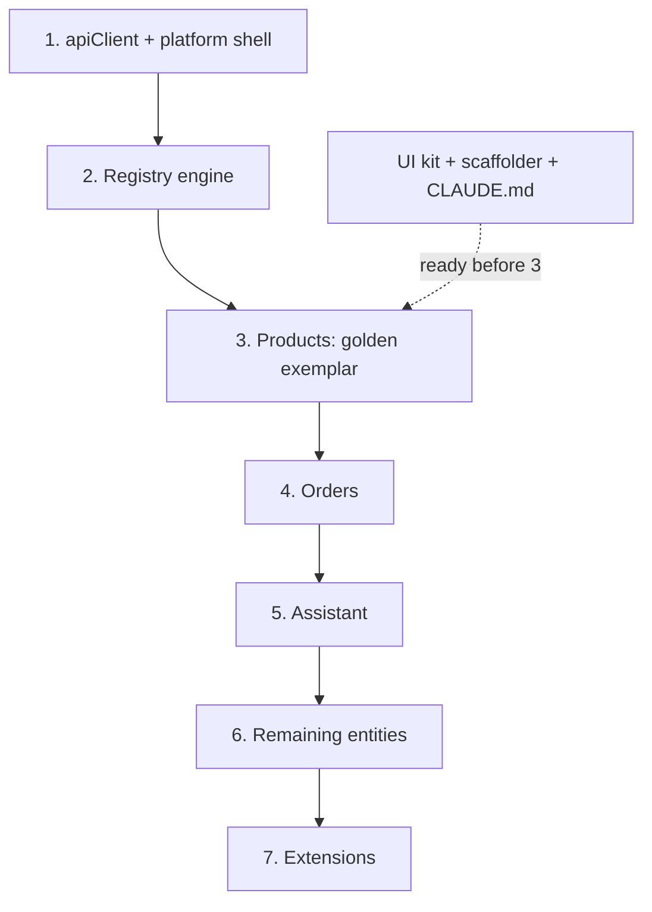

Milestone exit criteria: M1 Foundation is done when login and merchant selection work on localhost against sandbox, the CI gates are blocking and the kit playground is live. M2 Engine is done when the Products list and form are generated from a definition and a second scaffolded resource compiles and passes its tests. M3 Parity is done when the parity checklist is signed, the smoke is green and the browser matrix has passed. M4 Cutover is done when all pilot merchants are live and rollback has been rehearsed in under fifteen minutes. M5 Follow-through is done when the Content Security Policy is enforced and the assistant runs on commands.

The next two weeks: confirm the cookie family; send the backend list; hold the v1 scope and parity session; hold the extensions and visual-editor design session; decide d43 and the proposed defaults; write the implementation plan for M1.

---

## Appendix A. Evidence

Entitlement gating the menu only: dashboard-ui, src/library/components/common/sideNav/index.tsx, line 1386. User details fetch and merchant persistence: dashboard-ui, src/store/user/index.ts. Clarity injection and merchant tag: dashboard-ui-configuration, src/index.ejs line 139; dashboard-ui, src/root.component.tsx line 94. CSP hashes including clarity.ms: dashboard-ui-configuration, scripts/compute-csp-hashes.js line 88. The gk-pages API wrapper adding merchant headers: gk-pages, src/utils/apiUtils.ts lines 33 to 42. The discount V2 endpoint and merchant_id query parameter: gk-pages, src/modules/discounts/v2/api.ts lines 11 to 22. PostHog initialisation: gk-pages, src/providers/PostHogProvider.tsx line 10. Extension hooks: gk-pages, src/library/utilities/hooks. The utilities makeAPICall behaviour: the live bundle at dashboard.gokwik.co/utilities/gokwik-utilities.js. Gateway response headers including Envoy markers, X-Request-Id and the exposed-headers list: developer-tools capture, 17 October 2026. Production and sandbox cookie attributes: developer-tools captures, 9 October 2026.

## Appendix B. Related material

Decision tracker: claude.ai artifact af4bb5ce. Interactive handbook: claude.ai artifact 11ba7e95. Review deck: claude.ai artifact EWYNr8F22K8qZz5CZoGvRe. Full A-to-Z record and the complete question-and-answer chain: Google Docs and the claude.ai doc f855bc4c. Repository documents, the design spec, decision log and engineering chapters 01 to 08: this repository under docs/. Jira: INFN-3338 (discovery) and INFN-3457 (this review).

## Appendix C. Two corrections, recorded for transparency

Early in the discovery it was stated that the API client injected the token as a header; the shipped bundle showed otherwise, and the statement was corrected to the cookie-borne model described in Part 2. The first wording of decision d02 said a separate domain was impossible; the options analysis in Part 2 replaced it with the precise statement that a separate domain is possible when the API is served first-party under it.
