# Ratio: Architecture and Engineering Design, by Topic

**Document ID:** TRD-RATIO-002 · **Version:** 1.0 · **Status:** Draft for review · **Date:** 21 October 2026 · **Author:** Ashish Kumar (Frontend, Primathon) · **Jira:** INFN-3338 (discovery), INFN-3457 (review)

**Purpose.** This is the topic-wise companion to the Technical Requirements and Design Document in this folder. The TRD follows the shape of a review document: requirements, options, registers. This document follows the shape of the system. Each top-level topic is self-contained: it explains the concept in plain language first, states what was found in the current code, states what was decided for Ratio and why, and ends with what is still open for that topic. A reader who cares only about observability, or only about how bugs get fixed, can read that one topic and have full context.

**Audience.** The technical manager, engineering leads for frontend, backend and platform, product, and every engineer who will contribute to Ratio, including the AI assistants they work with.

**How to read.** Topics 1 to 3 are the product and the two things that touch the backend: authentication and the gateway. Topics 4 to 6 are how the code is built: the architecture, the AI-driven development model, and the UI system. Topics 7 to 10 are how the product is kept healthy: observability, error finding, security, quality and delivery. Topic 11 is documentation and knowledge. Topic 12 is migration and cutover. Topic 13 holds the registers: decisions, risks, gaps and asks. Topic 14 is the roadmap. Diagrams are Mermaid and render on GitHub and in Notion.

**Labels.** A *verified fact* was proven in code or in browser developer tools and is a constraint, not an opinion. A *decision* was discussed and called. A *proposal* was suggested and is not yet ratified. *Pending* means discussed, final call due.

---

## 1. Overview: what Ratio is and why

### 1.1 The product today

The GoKwik merchant dashboard is assembled in the browser from three repositories using Single-SPA. The root configuration (dashboard-ui-configuration) owns the HTML page, an import map that resolves bundle names to URLs, and a layout that says which application mounts at which path. The shell (dashboard-ui) owns login and OTP, merchant selection, the sidebar and top bar, a Redux store with the user and merchant, and breadcrumbs; it mounts at the root. GK Pages (gk-pages) owns the merchant's storefront back office: products, collections, inventory, orders, customers, discounts, analytics, the content library, settings and the visual editor; it mounts under /gk-pages.

GK Pages therefore owns almost nothing around itself. It has no HTML document, no login, no navigation chrome. It reads the active merchant from sessionStorage, calls APIs through a shared utilities package, and leans on the shell for everything else. The borrowing was counted exactly: the shared API function is imported in 39 places, the shell's Redux store in 17, the breadcrumb updater in 11, and the merchant identifier is read from sessionStorage in 77 places. These numbers are the reason the separation is a bounded project rather than an open-ended one.

### 1.2 The product tomorrow

Ratio is GK Pages rebuilt as a standalone application in the style of a Shopify admin: its own domain, login page, navigation and UI kit, its own release pipeline, on a fresh codebase. The backend does not change. The same API gateway, the same services, the same cookie-based session serve both the old dashboard and Ratio throughout the transition. Ratio is a frontend project with one gateway configuration change; it is not a platform migration.

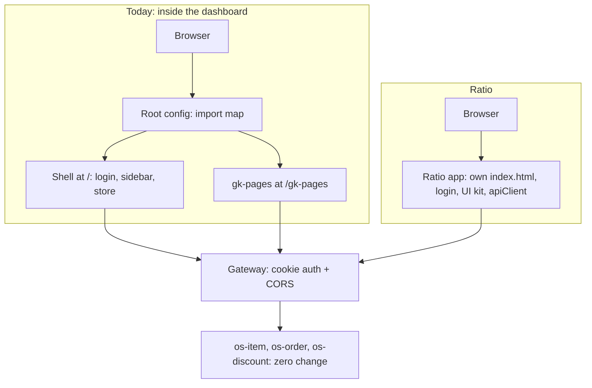

### 1.3 How the design was produced

The design was built problem-first. A concrete problem was stated in plain words, a solution was designed for that problem, and the solution became structure. No pattern was adopted because it is standard; every one was challenged with "why" and "how far" before it was accepted, and the places where a reasonable default was accepted without a full discussion are listed in topic 13 as proposals rather than presented as decisions. Wherever a claim could be checked in code or in the browser, it was checked, and the evidence is listed in Appendix A.

### 1.4 The whole design in one paragraph

Authentication is reused unchanged, because the frontend never handled a token in the first place; the one constraint this creates is that Ratio's page and its API must be first-party to each other, which leaves two safe domain options and one tempting option that must be rejected. The gateway is the only backend component that changes, and only its configuration. The code is organised around registries in which every entity and every action is defined exactly once; that single choke point is what absorbs the backend's instability, what makes any contributor's code come out at the house standard, and what makes the product ready for an AI assistant. Observability is set up so that errors reach the team before merchants report them, every error screen carries its own evidence, and a product manager's screenshot is enough for an engineer or an AI to find and fix a defect without guessing. The first increment, the API client and the platform shell, is unblocked today.

---

## 2. Authentication, session and domain

### 2.1 The concepts, in plain language

Four browser mechanisms decide this topic, and confusing any two of them produces the wrong answer, so they are defined here once.

A **cookie** is a small value the server asks the browser to store and return with later requests. It belongs to the site that set it, not to the page that happens to be open. An **httpOnly** cookie cannot be read by JavaScript on the page, but the browser still sends it; this attribute protects against theft by scripts and plays no role in deciding which domain a page may live on. **CORS** (cross-origin resource sharing) is the server's permission for a page on one origin to read responses from another; it is configured entirely on the server with the exact allowed origin, a flag permitting credentials, and lists of allowed request headers and exposed response headers. **SameSite** is a rule written on the cookie telling the browser whether to attach it to requests that come from a different site: Lax withholds it from cross-site API calls, None sends it (and requires Secure). The server sets the attribute; the browser enforces it; no server setting overrides the browser. **Third-party cookie blocking** is a separate browser policy: when a cookie's site differs from the page's site, Safari (and every browser on iOS), Chrome Incognito and Brave refuse it regardless of SameSite. Chrome's plan to block third-party cookies everywhere was halted in 2025, so normal Chrome windows still allow them.

A useful picture: the cookie is a gym membership card kept in the gym's locker; the browser is the friend who decides whether to carry it for you. On the gym's campus the card always comes along. In another neighbourhood the friend refuses, even if the gym says "let them in". CORS is the gym's permission; SameSite and third-party blocking are the friend's own rules.

### 2.2 What the code says (verified facts)

The frontend never handles an authentication token. The shipped utilities bundle sends credentials on every request; no code path reads a token into a header. The only read of the token cookie anywhere is a leftover console.log that prints null on every load, because the cookie is httpOnly. In sandbox the cookie is set on the gateway's own host with SameSite None, which is exactly why localhost development can log in. In production the cookie was observed on Domain .gokwik.in with the SameSite attribute blank, which Chromium treats as Lax. A later request trace showed production hosts under gokwik.co, so the exact production family is re-confirmed before the first staging deploy (gap GAP-01).

Entitlement already exists. GET /api/dashboard/user/details returns, per merchant, the map selected_products; the dashboard shows or hides the GK Pages menu entry on selected_products.pages in a single line of the sidebar component. Nothing else checks it, so a merchant without the product can open the application by URL. That was tolerable inside the dashboard, where the URL was not discoverable, and is not tolerable in a standalone product.

### 2.3 Decisions

**No token is stored anywhere (d06).** The question started as "sessionStorage like today, or an httpOnly cookie?" and dissolved when the code showed there is no token in sessionStorage today. Ratio reuses the gateway-cookie design as is: the client sends credentials and nothing else, and learns session state from a "who am I" call. Storing a token in web storage would be a downgrade; a new token-based design is unnecessary work for v1.

**Login from the new origin (d05).** The login and OTP-verification endpoints must accept the Ratio origin. This is the only new authentication work, and backend confirmed it is configuration.

**Merchant selection without Redux (d07, d12).** After login Ratio fetches user details through React Query, shows a merchant picker when there is more than one store, and on selection writes the merchant identifier to sessionStorage under the existing key merchant-mid, so the 77 existing readers keep working. The user details are mirrored to sessionStorage only for synchronous reads; the query cache is the source of truth. The shell's Redux store becomes one small hook. A second copy of server data is where staleness bugs are born, and a page-size incident in the collections screen came from exactly that.

**Entitlement and the route guard (d03, d04).** Which merchants get Ratio is answered by the existing selected_products.pages flag; nothing is built on the backend. What is new is a frontend route guard: when the flag is false, every product route is blocked and a clean screen says the merchant does not have access and whom to contact.

**Permissions and staff (d08, d36).** The existing roles and permissions model is reused unchanged. A Ratio-native staff and roles screen is out of scope for v1 and cheap to add later through the command registry.

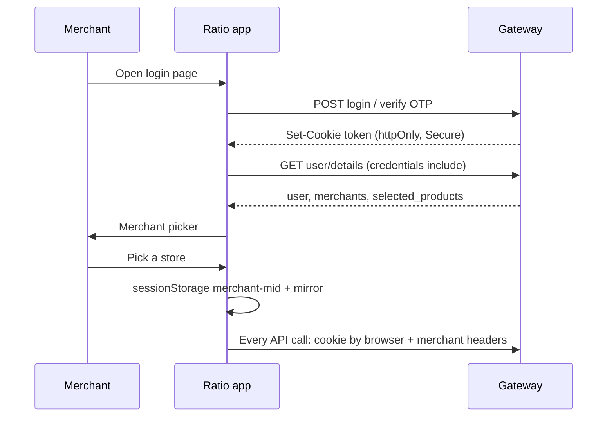

### 2.4 Where Ratio may live: the domain options

The question "can Ratio run on a completely separate domain such as ratio.in if backend allows it?" has a precise answer: yes, but only one way.

**Option A, a gokwik.in subdomain.** The page and the cookie share a site, the cookie is first-party, and every browser sends it. This needs no authentication change at all, only a CORS allow-list entry, and SameSite Lax remains a lock against cross-site request forgery. This is the default.

**Option B, ratio.in with the cookie relaxed to SameSite None.** Backend can do this and allow the origin in CORS, and a normal Chrome window will work; sandbox already runs this way for localhost. It is a trap. On ratio.in the gokwik.in cookie is third-party, and Safari, every iOS browser, Chrome Incognito and Brave block it regardless of SameSite, so login fails for the merchants who use phones. It also weakens the old dashboard's forgery protection, because the same cookie serves both. Option B passes a demo and fails a launch, and the failure cannot be fixed from our side. Rejected.

**Option C, ratio.in with the API served first-party as api.ratio.in.** The gateway gets a second hostname under the new domain and sets the cookie with Domain .ratio.in for requests arriving on it. The cookie is first-party again, every browser works, Lax can stay. This is gateway and infrastructure work (hostname, TLS, cookie domain per host, possibly a separate session scope) and is the correct route if a separate brand domain is a product requirement. It must be scheduled with platform before the first staging deploy.

**Option D, token-based authentication** with the token held in memory and a refresh flow works everywhere but changes the security model and is not justified by v1.

Nothing else in this document depends on the choice between A and C. The ten-minute proof of option B's failure is available today: run the local gk-pages against sandbox in Safari or Chrome Incognito.

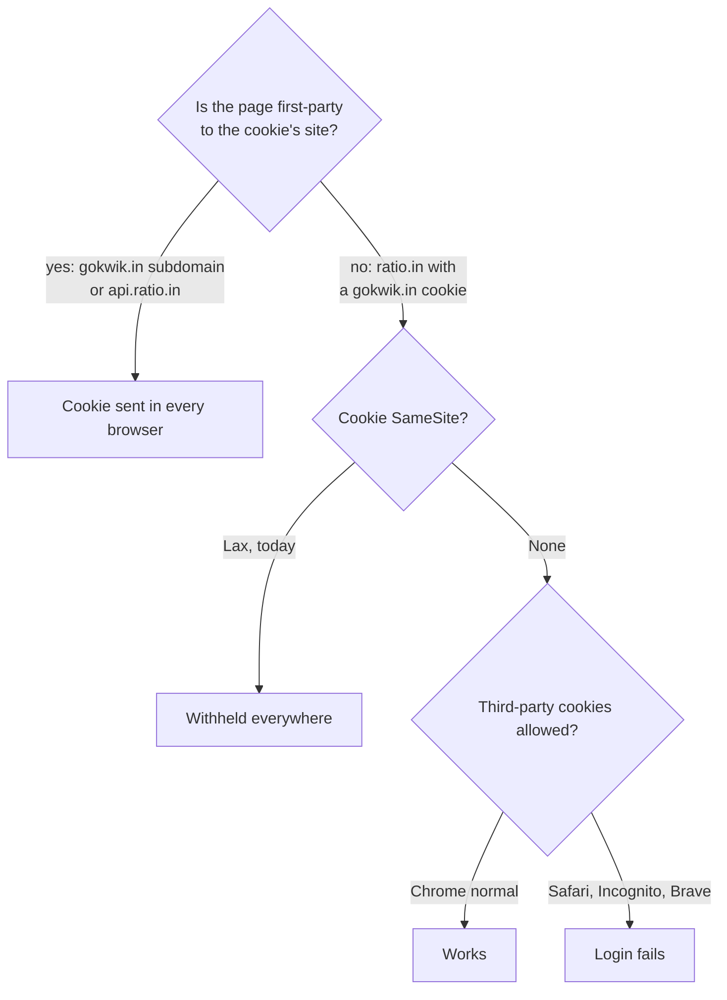

### 2.5 Security of the model

Against "can someone take the token and hit our APIs from their own site?", three independent locks hold: httpOnly stops scripts reading the cookie; SameSite Lax stops other sites' requests carrying it; the custom merchant headers force a CORS preflight that kills a cross-site call before it is sent. Outside a browser, with a stolen value and curl, no cookie scheme helps; expiry and server-side validation do, as in every authentication design.

### 2.6 Open for this topic

Confirm the production cookie family (GAP-01). Decide option A or C with product and platform (GAP-05).

---

## 3. API access and the gateway

### 3.1 The gateway

Every request from the browser goes to one edge service, an Envoy gateway behind Cloudflare. It validates the session cookie, enforces CORS, stamps a request identifier, and forwards to the internal service that owns the data. The services never see the browser; they trust the context the gateway hands them. This single enforcement point is why "won't every API have to support the new application?" has the answer no: supporting Ratio is one gateway configuration (d17): the exact new origin in the allow-list (a wildcard is not allowed with credentials), the Allow-Credentials flag (without it the cookie never flows), the two merchant headers gk-merchant-id and merchant-mid in allowed request headers, and X-Request-Id in exposed response headers (topic 8 explains why). The merchant-headers line is the lesson of an earlier incident in which a discount endpoint was called on a direct service host that did not allow the header.

The free pass covers gateway-routed calls only. The current code also makes calls that bypass the gateway: direct service hosts, fetch-based uploads with hand-set headers, third-party endpoints. Each carries its own CORS and none has been tested from a new origin, so decision d18 is an audit: tag every call as gateway or bypass, smoke-test the bypass list from the new origin on staging, and have backend fix what breaks.

### 3.2 What the current client does, and what Ratio keeps

The shipped utilities client was taken apart so that nothing useful is lost and nothing harmful is copied. It takes its base URL from a build-time variable and sends credentials on every call; both are kept. It attaches the merchant header from sessionStorage, and because gk-pages wraps it with its own injection the header is sent twice; Ratio sets it once. It sends five response headers (X-Content-Type-Options, Referrer-Policy, X-XSS-Protection, Content-Security-Policy, Strict-Transport-Security) on every request, where the server ignores them and they only force extra CORS entries; dropped. It refuses non-GET calls for users whose role is "internal user" unless the URL is allow-listed; whether the server enforces the same is a question for backend. It adds a mode parameter from localStorage for non-internal users; its meaning is unknown and must be answered before go-live. It fires a global loader event; dropped, because query state drives loading UI. It never throws, returning errors as data with an error flag; Ratio throws, because React Query, retry and error boundaries all depend on rejection. It inlines the whole build environment, 69 keys including Jenkins paths and the git commit, into the public bundle; Ratio uses a build-time public-variable allow-list, and the utilities team should be told about the leak.

### 3.3 Ratio's API client

The client (d11) is built on fetch with credentials included. It sets the two merchant headers in one place, takes query parameters through a params option, reads X-Request-Id from every response into a Sentry breadcrumb with the method, path and status, throws a typed ApiError with status, request identifier and body on any 4xx or 5xx, and on a 401 stores the return path and redirects to login. Every API is named in exactly one endpoint file inside the resource that owns it; screens never import endpoints and only use React Query hooks over them.

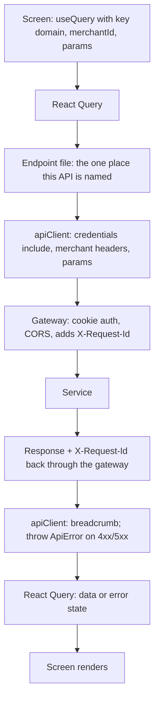

### 3.4 URLs

The scheme is /store/:storeId/… (d09). The /gk-pages prefix existed only for the Single-SPA root configuration. The store identifier stays in the path so deep links work, two stores can live in two tabs, and a shared link opens the same screen. Filters, pagination and sort live in search parameters, typed and validated through TanStack Router, so a URL reproduces a screen exactly; topic 8 relies on this. At cutover a redirect in the old dashboard maps old paths to the new domain (d10).

### 3.5 Open for this topic

Whether the merchant_id query parameter is still needed beside the header; the meaning of the mode parameter; whether the internal-user write block is enforced server-side. All three are in the backend list in topic 13.

---

## 4. Code architecture

### 4.1 The stack, each piece with its reason

Vite builds the application: an admin behind a login needs neither search-engine indexing nor server-side rendering, and Next.js was rejected for that reason and because its server rendering complicates the cookie story. TanStack Router handles routing, because view state lives in the URL and the router gives typed routes and Zod-validated search parameters. TanStack Query holds server data. React Hook Form with Zod schemas handles forms. XState v5 handles multi-step flows. Zustand holds interface flags. Registries define entities and actions (d40).

Two pieces were challenged hard. Zustand looked like a breach of the "no Redux" rule until the rule was restated precisely: what is banned is server data in a global store, and it stays banned in Zustand; Zustand is a zero-boilerplate global useState for flags like sidebar open, active modal and bulk selection. React Query was challenged with "this is a dashboard, I do not want to cache anything, it must show the updated value every second." The answer is what caching means here: React Query shows the cached result instantly while fetching fresh in the background, so it removes loading flashes without ever serving old data as final. A plain useEffect fetch is in fact staler, because it fetches once on mount and never again; React Query refetches on focus and can poll.

### 4.2 Layers

The platform shell owns everything cross-cutting: boot, login, merchant picker, route guard, navigation, the API client, observability wiring and error boundaries. The registry engine owns the mechanics: defineResource, defineCommand, runCommand, the record-editor state machine, query-key helpers and the Zod boundaries. Resources are one generated folder per entity with a definition, one endpoint file per API, transformers, schemas, bespoke components and tests. The UI kit is a set of closed-API components with tokens and a playground. Bespoke experiences, the visual editor, analytics and onboarding, are ordinary feature code whose writes still go through commands.

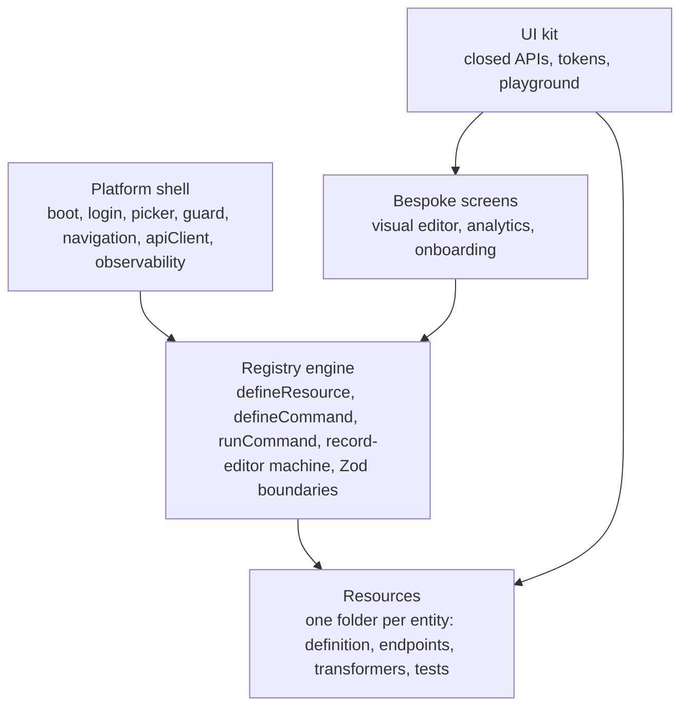

### 4.3 Registries: define once, run everywhere

The architecture's core idea fits in one sentence: the function is written in one file, and that same function is used everywhere. A **resource** declares an entity once: identifier and labels, list columns, filters and default sort, form fields and Zod schema, endpoints, transformers in and out, freshness, permissions and invariants; from it the engine renders the list and form screens and registers the standard commands. A **command** declares an action once: an identifier such as order.refund, an input schema, the confirmation text, the permission, the endpoint, what to invalidate on success, error mapping, and three effect flags, readOnly, destructive and idempotent. **runCommand** is the one execution path: permission check, confirmation, outgoing Zod validation, the endpoint call through the API client, a breadcrumb we call the passbook entry, invalidation, and the toast or error. A row button, a context menu, the bulk bar, the command palette and the assistant all call runCommand with the same command; there is no second way to write.

Today every waiter cooks at the table: the product delete action exists three times, each copy slightly different. The registry puts one menu card in front of one kitchen; whether the order comes from the dining room or a delivery app, the dish is the same, and a new dish is one entry that appears at every counter.

The backend is unstable; the order API and the product API disagree on conventions and endpoints change. That is the pattern's best argument rather than its weakness: with every endpoint in exactly one file, a backend change is a one-file edit that fixes all five surfaces at once; per-service transformers clean snake_case versus camelCase and staff_id versus staffId at the door; Zod logs drift to Sentry before merchants notice. Every part of this is standard practice, the command pattern of CQRS and VS Code, React-Admin's resource model, Shopify's bulk jobs, MCP's tool annotations; the assembly is ours. For a three-screen tool it would be overkill; at eleven entities, five surfaces, outside contributors and an AI assistant, it pays.

```mermaid
flowchart TB
  B[Row button] --> RC{runCommand}
  M[Context menu] --> RC
  BK[Bulk bar] --> RC
  K[Command palette] --> RC
  AI[Assistant / MCP] --> RC
  D[Command definition<br/>schema, confirm text, endpoint, effect flags] --> RC
  RC --> P[permission check] --> C[confirm] --> Z[outgoing Zod] --> API[endpoint file] --> L[passbook breadcrumb] --> I[invalidate queries + toast]
```

### 4.4 How far the registry goes

Four rules (d41). Every data-changing action is a command, no exceptions, because one bypassed write is an unsafe path for the assistant. The roughly eleven table-plus-form entity screens are built from definitions. Different-experience screens, the visual editor, analytics and onboarding, are normal code whose writes still use commands. The registry is a plumber, not a UI designer: a complex component such as the variant matrix is hand-built and plugged into a definition that carries fetch, save, errors and cache underneath it. The command palette is kept in reduced form: navigation and actions, which need no backend, stay; record search is cut because there is no backend search service. Global search calls two or three entities' list endpoints in parallel with their existing search parameters.

### 4.5 State and freshness

Server data lives in React Query with keys of the form [domain, merchantId, params]; the merchant identifier is mandatory and first, and the cache is cleared on merchant switch, because two merchants' data mixing is a security bug, not a usability bug. View state lives in the URL. Form state lives in React Hook Form. Interface flags live in Zustand. Multi-step flow state lives in a machine. Merchant context lives in React Query with a sessionStorage mirror.

Freshness defaults are 30 seconds for lists, 60 for detail views and 10 minutes for lookups, with explicit staleTime zero wherever freshness matters (d42). The failure mode of a forgotten override is silent stale data, so two safety nets exist: refetch on window focus is on globally, and the scaffolder requires an explicit staleTime on every resource so that omission is an error. Zod is applied pragmatically: critical reads use safeParse with a Sentry log on mismatch so the page keeps rendering; money is parsed hard so a wrong price stops rendering rather than displaying, a rule learned from a rupees-versus-paise incident; outgoing payloads are validated too; a schema for every endpoint is not a goal.

### 4.6 Flows as state machines

A machine is used only for flows with three or more steps: login with OTP, boot, the record editor, refund, import and job tracking. Three boolean flags give eight combinations, five of them nonsense, and the nonsense states are where double-save bugs live. A washing machine has one dial, not five switches, and the dial is in one position at a time; while the flow is in saving there is no transition for Save, so a second click is ignored by design. One record-editor machine, with pristine, dirty, saving, done and error states, drives every entity form. Two or three engineers write machines; everyone else consumes hooks.

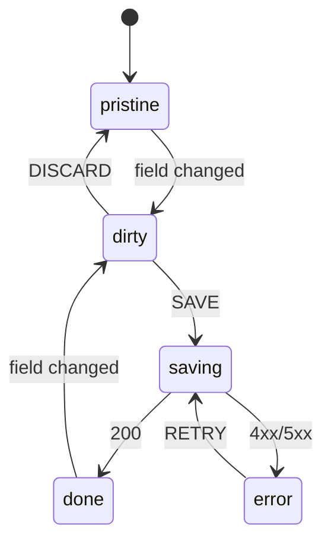

### 4.7 Open for this topic

The extensions and apps system that gk-pages runs today (useExtensionPoint, useActionExtensions, useAppBridge) and the visual editor with its separate editor-token flow are the two undesigned areas (GAP-03, GAP-04).

---

## 5. AI-driven development

### 5.1 The problem this topic solves

Every contributor now works through an AI assistant. That changes what a repository has to do. Five engineers mean five prompting styles. A lesson learned in one person's session is lost to everyone else. An AI can produce a fifteen-hundred-line pull request faster than anyone can review it. Engineers from other teams, assisted by AI, write frontend code in whatever pattern comes out and then report that "the frontend does not support it". The repository itself must onboard every assistant, make the right path the fastest path, and make the wrong path unmergeable.

### 5.2 Guardrails: recipes teach, lint blocks, the scaffolder paves the road

Instructions alone stop nobody; machines enforce and recipes teach (d37). CLAUDE.md files, nested per area with an AGENTS.md pointer for other tools, hold recipes with exact steps rather than policy prose, because an assistant follows steps and ignores lectures. The scaffolder, npm run new:resource, generates a complete resource folder with definition, endpoint files, tests and the four UX states; what it generates is the pattern, hand-made folders are forbidden, and contributor creativity goes into business logic rather than structure. ESLint boundary rules make wrong code unmergeable: no writes outside commands, no endpoint imports in screens, no raw button or input, no imports from inside the kit, no shadow copies of kit components. CODEOWNERS on /src requires named approval, which GitHub enforces. The first milestone is the UI kit plus one golden exemplar feature, Products, because every recipe points at it and every scaffolded resource copies it.

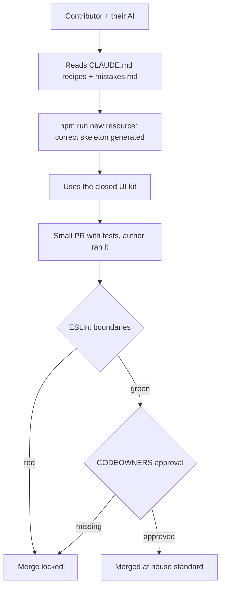

### 5.3 The repository as the assistant's operating system

Decision d39 treats every assistant as a team member onboarded by the repository. Skills, the step-by-step workflows an assistant follows, are committed under .claude/skills: new-resource, add-command, review-pr and fix-bug, so every developer's assistant runs the same playbook and prompt quality becomes a property of the repository. A team mistakes.md records each costly mistake in a fixed format, what went wrong, what is correct, how it was caught, is updated by pull request, and is read by every assistant session before it writes code, so one person's two-hour debugging session becomes everyone's assistant's knowledge the same day. An AI pull-request contract sets the norms: small pull requests with no "the AI wrote it" exemption, the author states they ran the change with screenshots for interface work, tests ship in the same pull request, and reviewers ask "is this our pattern?" because "does it work" is CI's job. A committed .claude/settings.json gives every session the same pre-allowed safe commands and denies reads of .env and secrets.

### 5.4 Commands as AI tools, and MCP readiness

The Model Context Protocol is a standard way to expose a system's actions as tools any assistant can call: a tool is a name, an input schema and annotations saying whether it is read-only, destructive or idempotent. A command already carries exactly that: a name, a Zod schema that converts to JSON schema, the same three effect flags, a permission, a confirmation requirement and a single execution path. The in-app assistant, Arya, stands on this: it proposes a command, the merchant approves, and the same runCommand executes it, so the assistant can never do anything a button cannot do.

What is not yet decided is an external MCP server, a merchant saying "create a product" from their own AI client outside the application. That needs an authentication story, since the session is a browser cookie and an MCP server is not a browser, so a per-merchant API token would be backend work; and it needs a choice of which commands to expose. The proposal (d43, pending) is no MCP server in v1, but every command written with its effect annotations and schema from day one so that a server later adds a layer and changes no command; Arya is the dress rehearsal.

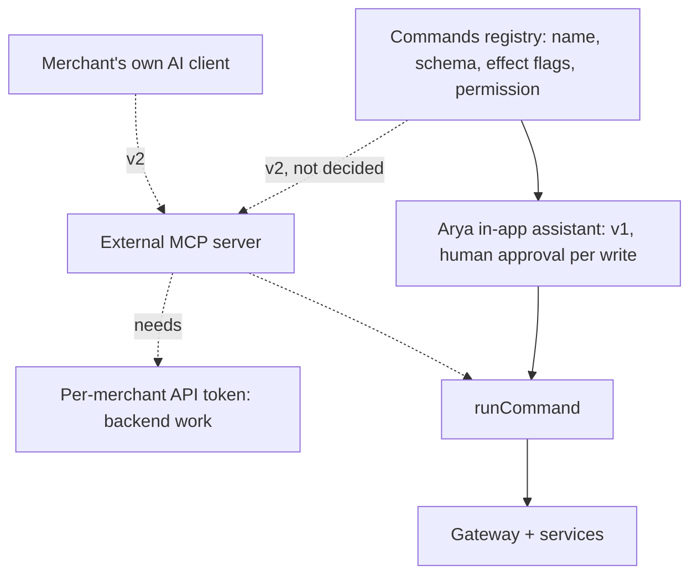

### 5.5 Open for this topic

The final call on d43; where the assistant's language model runs and what it costs (GAP-08); whether Arya is core or an installed application (GAP-09).

---

## 6. UI system

Ratio gets its own component kit on Radix primitives, Tailwind and design tokens (d15); the antd-based gokwik-ui-kit does not come along. The reasons are brand independence and the end of override conflicts with antd, of which the gk-ant class-prefix saga, where styles silently matched nothing, was the most painful. This is the single biggest piece of work in the project, which is why its governance is designed with it.

The kit exposes closed APIs: a fixed list of variants per component and no style or className passthrough. If a Tag accepted an arbitrary class, a new colour could appear in a feature without anyone noticing; with a closed variant list the colour cannot be expressed in feature code at all, so introducing it means changing the kit, which triggers the owners. That is the pink-tag rule (d38): someone who wants a pink tag where only a blue one exists raises a request, and the kit team makes the change. Three locks and a door implement it: CODEOWNERS on /src/ui, the closed APIs, lint rules that ban raw elements and shadow components, and a Kit Change Request template that keeps legitimate requests fast, because a slow door is how shadow design systems are born. The kit stays an in-repo folder rather than an npm package while the build phase lasts; the triggers for packaging are a second consuming application or repeated bypasses. A playground route in non-production builds catalogues every component and variant, which also replaces the breadcrumbs that were dropped (d13), since the real need behind them was discovering what exists. The shell supports two levels of navigation nesting (d14) so it can be built while product finalises the information architecture, and v1 ships global search, a store switcher and profile and logout (d16).

---

## 7. Observability

### 7.1 Why

The current frontend has no error tracker, and the microfrontend wrapper returns nothing when a section crashes, so failures disappear silently and the team learns about them from support. Ratio's standard is that errors reach the team before merchants, nothing ever renders blank, and the right person is woken only when something new or widespread happens.

### 7.2 Error tracking with Sentry, and what source maps are

An error tracker receives every JavaScript error from every merchant's browser, groups identical errors, tags them with the release and the affected user, and alerts on new or spiking issues. Sentry is chosen (d22) because it is already in the organisation and is the strongest tool for this job. A production stack trace on its own is useless, because production code is minified and points at x.js line 1 column 482917; a source map is the build's translation file that turns that back into ProductForm.tsx line 142. Maps are generated hidden, uploaded privately to Sentry by CI and stripped from the deployed assets, so the team gets readable traces and the public CDN discloses nothing. Releases are tagged ratio@version; merchant identifier and route are attached as context; personal information is never sent; Sentry's own session replay stays off.

### 7.3 Error boundaries

An error boundary is a React component that catches a rendering crash below it and shows something else instead of letting the page go white. Ratio has one on every route and one global crash page (d26). On a crash the merchant sees a card with a Retry button while the rest of the application stays alive, the boundary reports to Sentry, and, as topic 8 describes, the card carries the evidence a support engineer needs.

### 7.4 Alerting through OpsGuard

OpsGuard is the organisation's on-call and alerting destination. Backend already runs a pipe from Sentry to OpsGuard, so Ratio's Sentry project is added to that pipe rather than anyone building new plumbing. Rules fire only on new issues and on spike or affected-user thresholds, never per event, because noisy alerts train people to ignore alerts.

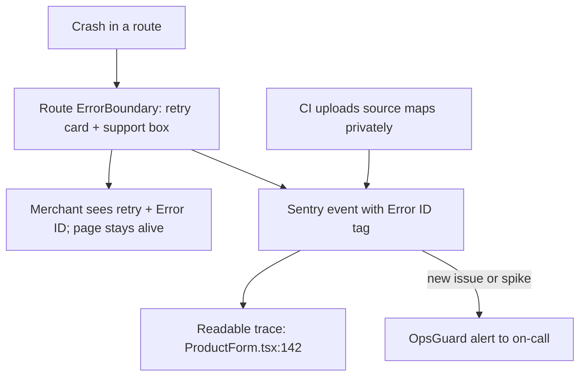

### 7.5 Uptime, latency, Web Vitals

Backend owns API latency with its own service-level objectives and on-call; the frontend does not duplicate p95 dashboards (d25). The browser half of the experience, bundle parsing, rendering and interaction latency, is invisible to backend monitoring, so PostHog's automatic Web Vitals capture is on with no alerting (d30), so that numbers exist on the day someone says "it feels slow". One synthetic check loads the login page and makes one API round-trip, and CDN alarms route into the same OpsGuard pipe, because backend's on-call does not watch our domain.

### 7.6 PostHog and Microsoft Clarity

PostHog gets a separate project for Ratio (d20) and owns product events, feature flags, Web Vitals and the debugging session replay, which records the page structure and every change to it and plays it back with network calls and console errors alongside. Microsoft Clarity, which the root configuration injects today and gk-pages never loaded itself, is added explicitly to Ratio for heatmaps, rage clicks and dead clicks (d45). With two recorders, all inputs are masked in both and recording is sampled.

---

## 8. Error finding and bug resolution

### 8.1 The problem

A product manager who does not know the code hands a ticket to an engineer or an AI assistant and says "fix this". Unless the application has collected the evidence itself, the fix is a guess. The hospital is the picture: the patient only says "my stomach hurts", the lab report says what is inside, and the reception desk asks the missing questions before the doctor's time is spent. The application is the lab report; the intake procedure is the reception desk.

### 8.2 The support box

Every error screen carries a support box under the friendly message (d44): a short Error ID such as K7F3-2Q9A, generated per crash and attached to the Sentry event as a searchable tag, short because long identifiers are misread in screenshots; the page route; the validated filters; time, version and store identifier; the last failed API call as method, path, status and the first eight characters of its request identifier; and the last three to five steps in human words from navigation and command labels. A Copy button gives the same fields as text. One screenshot is enough to begin.

What the box never shows matters as much: the stack trace, which is our internal code map; request and response bodies, which may hold a customer's name, phone or address while screenshots travel through Jira and chat; and the full breadcrumb list. Those live in Sentry behind the Error ID. The screen says where and what happened; Sentry holds what was inside. For defects that do not crash, a wrong total for example, a "Report a problem" item in the help menu opens the same box with the last five commands and a replay link.

### 8.3 Frontend or backend: the request identifier settles it

The gateway already generates an X-Request-Id per call and returns it, but the response's exposed-headers list omits it, so JavaScript cannot read what developer tools can see: a tracking number printed on a sealed parcel. One word added to the gateway's exposed headers makes it readable, and backend confirms the services log the same identifier. From then on every API breadcrumb carries it, and a backend defect is reported as "backend bug, request-id so-and-so, this came back, this was expected", which backend can search in its logs. Hiding a backend defect inside a frontend transformer is prohibited; it would never be fixed at source.

### 8.4 Intake, four buckets, two checks

The fix-bug skill committed in the repository is the reception desk. Required from the reporter: the page link, what happened versus what should have happened, and the Error ID or a screenshot of the box. Nice to have: a video, whether it happens every time, roughly when, one merchant or many. Collected by the engineer or assistant and never asked of the reporter: the Sentry trace, breadcrumbs and release, the request identifiers and command log, what the API returned, and the recent history of the files involved. If a system can tell you, you do not ask a person. A missing required item produces one ticket comment with every question in plain language with examples, and work stops until it is answered. Guessing is prohibited.

Every ticket lands in one bucket. Frontend bug: write the failing test first, and if it cannot be made to fail the bug is not understood, so go back and ask; fix; open a small pull request saying what broke, why and how; post the preview link. Backend bug: a ticket comment with the request identifier, received and expected, and no client-side workaround. Not a bug: explain in plain words, change nothing. Information missing: intake. Two checks close a fix: a developer reviews the code for pattern conformance, and the reporter verifies behaviour on the preview deployment. The code map makes this deterministic, because the scaffolder generates the same path from URL to route file to resource to endpoint file to transformer to command for every entity.

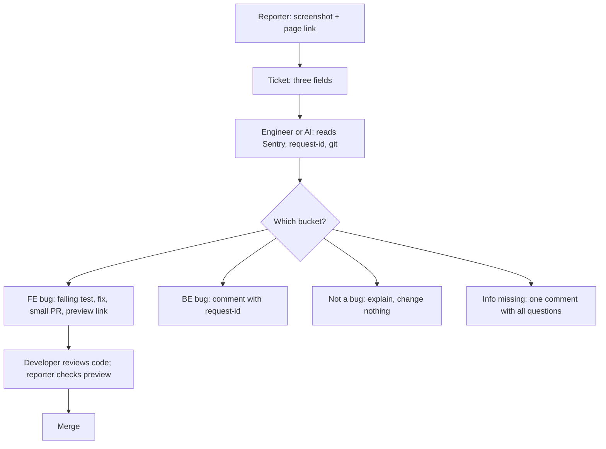

### 8.5 Silent bugs: prevent, catch, see

For defects with no crash at all, a wrong API or a wrong amount, the bank is the picture (d45). Prevent: every command has a test asserting endpoint and payload, outgoing payloads are Zod-validated so a wrong shape never leaves the browser, and flows run on state machines that disallow illegal steps. Catch: every runCommand writes a passbook breadcrumb; invariant checks such as "a refund cannot exceed the order total" and "saved data equals what was sent" report silently to Sentry without crashing; a 4xx or 5xx turned into a toast is still reported once. See: the session replay and the Report-a-problem box. The worked example: a refund turned into a cancel; the replay shows Refund was clicked, the passbook shows order.cancel ran, so the button is wired to the wrong command; a failing test, then the fix, with zero guessing.

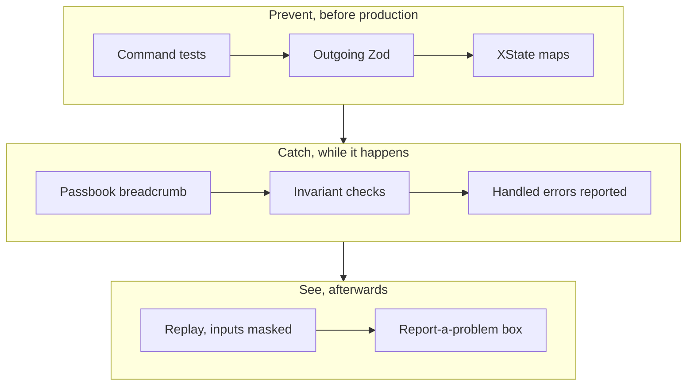

The three tools each have one job: Sentry for errors, Error IDs and alerts; PostHog for events, flags, Web Vitals and the debugging replay; Clarity for heatmaps and rage clicks. The written artefacts exist: docs/engineering/08-bugs-and-debugging.md and .claude/skills/fix-bug/SKILL.md.

---

## 9. Security

The session model is unchanged and its locks were described in topic 2. The remaining security work is at the CDN and in the build. One CloudFront response-headers policy ships five headers (d24): Strict-Transport-Security to force HTTPS; Content-Security-Policy with only frame-ancestors none, plus X-Frame-Options DENY, so no other site can embed the admin in an invisible frame and farm clicks; Referrer-Policy to limit what URLs leak; and Permissions-Policy denying camera, microphone and geolocation. These live in CDN configuration, and frame-ancestors restricts who may embed Ratio rather than what Ratio embeds, so the visual editor's own frame is unaffected. No secret enters the bundle, enforced by the build-time allow-list; no source map is public. The full Content Security Policy is deferred, not deleted: applied blind it breaks something on launch day, and the old dashboard has one, so Ratio ships it in report-only mode after launch, collects violation reports, then enforces. Cross-merchant isolation in the client cache is guaranteed by merchant-first query keys. No personal information reaches Sentry or the support box, and both replay recorders mask inputs. Open items: confirm the internal-user write block is server-side, confirm login rate limiting with backend (proposal), and inform the utilities team about the build-environment leak in the current bundle.

---

## 10. Quality and delivery

### 10.1 Continuous integration and testing

A robot runs a fixed set of checks on every pull request and the merge stays locked until they pass, with no exception for AI-authored changes (d28): lint with the boundary rules, the TypeScript type check, the tests, the bundle budget and the dependency audit for high and critical findings. On staging a Playwright smoke that logs in, selects a merchant, opens the products list and performs one save is the gate for production. Tests are layered: unit tests for transformers, schemas, machines and command definitions; integration tests for resource screens against mocked endpoints; the smoke end to end; and a failing-then-passing test with every bug fix. Route-level code splitting plus a CI-enforced initial-bundle budget (d23) stop bundles growing silently; the single-bundle gk-pages is the cautionary example.

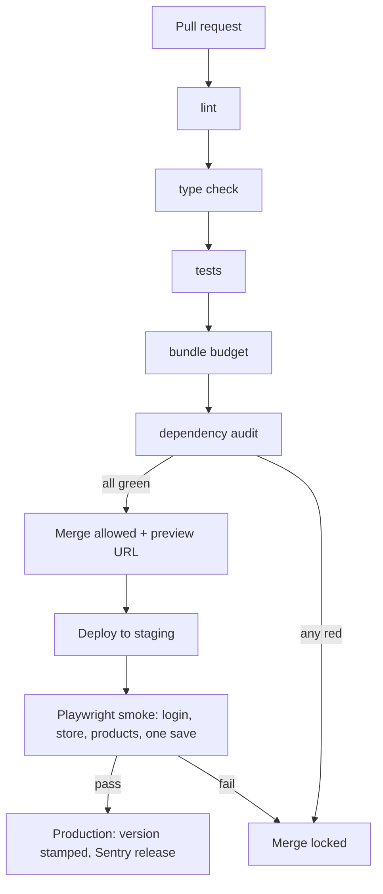

### 10.2 Environments, previews, versions, cache

Development runs on localhost against sandbox, as gk-pages does today. Every pull request gets a preview deployment with its own URL on the QA backend and a visible non-production badge, so review happens from a link (d32). Staging runs the smoke and the cutover rehearsal. The git tag is the source of truth for versions; CI stamps version and commit into the bundle and registers the release with GitHub and Sentry, so "what is production running" is one console line and rollback is a redeploy. Assets are content-hashed and cached immutably for a year, index.html is served no-cache and invalidated at the CDN on deploy, and if a merchant is ever told to hard-refresh, that is a bug. Feature flags (d27) give percentage and per-merchant rollout with kill-switches, so rolling back a feature is a toggle and the launch itself can ride a flag. Dependencies are kept current by a bot with small weekly pull requests, a committed lockfile and a written browser-support matrix (d34).

### 10.3 The UX baseline

Every screen ships four designed states, skeleton while loading, an empty state with a call to action rather than a bare "no data", an error state with retry, and ready; it is keyboard operable with visible focus and AA contrast (d29). Product images are transformed at the CDN, below-the-fold images lazy-load, and screens render skeleton-first with no layout shift (d33). The pull-request checklist and the scaffolder's page template enforce all of it.

---

## 11. Documentation and knowledge

Documentation lives in two places by deliberate design, and the split is by audience, not by convenience. Documents that people read live on Confluence (d35, d42): the runbook for when production is down, the architecture decision records that capture this whole journey, the tracking plan that fixes event names before analytics turns into ProdCreate2Final rubbish, and the PII policy. One document, one home. Files that an AI assistant reads live in the repository and nowhere else: CLAUDE.md with its recipes, mistakes.md, the committed skills under .claude/skills, and .claude/settings.json. These are not documentation; they are the operating system of the AI contributors and must be read from the code they govern, which is why they are the one non-negotiable exception to the Confluence rule.

In the repository today, under docs, sit the design specification, the decision log with provenance for every decision, engineering chapters 01 to 08 (coding principles, contribution guardrails, UI-kit governance, the AI-native repository, quality and operations, release engineering, data policy, bugs and debugging) and this folder's two design documents. Outside the repository, the interactive decision tracker and handbook, the review deck and the A-to-Z record exist as presentation and onboarding material and are linked in Appendix B. The rule for keeping all of this honest is simple: a decision is recorded with the question that started it, what was examined, what settled it and what was rejected; a reader must always be able to tell a made call from a sensible suggestion, which is why proposals are listed separately in topic 13.

---

## 12. Migration and cutover

The work runs in five phases: foundation (API client, platform shell, UI kit, scaffolder, CI gates, Sentry and PostHog projects), engine (registries, runCommand, record-editor machine, the Products exemplar, previews), parity (Orders, the remaining v1 entities, the bypass audit, the browser matrix, the staging smoke), cutover (production origin behind a flag, phased rollout, redirect, import-map removal), and follow-through (Content Security Policy to enforced, the assistant, extensions).

Before cutover the checklist must be clean: cookie family confirmed and origin decision implemented; gateway CORS entries live with the request identifier exposed and login accepting the origin; bypass audit complete; smoke green and the manual browser matrix passed including iOS Safari and Chrome Incognito; alerts verified end to end into OpsGuard and the synthetic check live; parity checklist signed off by product; the redirect deployed but disabled; rollback rehearsed on staging within the target time.

Cutover is six steps: enable the production origin for a pilot cohort by flag; verify login, merchant selection and one write per entity for that cohort; turn on the dashboard redirect from /gk-pages; expand the cohort while watching Sentry, the synthetic check and the CDN alarms; remove the gk-pages entry from the import map; keep the old bundle deployable for the agreed window. Rollback is the reverse and takes minutes, restore the entry, disable the redirect, turn the flag off, and there is no data migration to reverse because the backend is unchanged. Open the new showroom before pulling the old shutter, and keep the shutter key in your pocket.

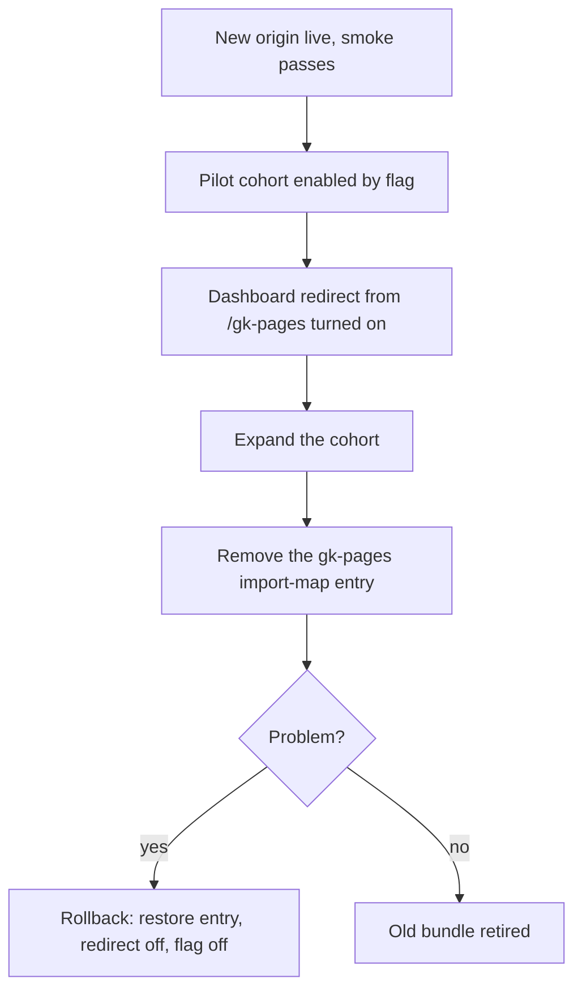

---

## 13. Decisions, risks, gaps and asks

### 13.1 Decisions

d01 Ratio is the name. d02 the origin is first-party with the authentication cookie: a gokwik.in subdomain by default, a separate domain only with a first-party API host. d03 merchant eligibility from selected_products.pages, phasing decided at cutover. d04 a frontend route guard on that flag. d05 backend allows the new origin on login and OTP. d06 no token stored anywhere; the gateway-cookie design reused. d07 merchant selection through React Query and sessionStorage under the existing key, no Redux. d08 the existing permissions model unchanged. d09 URL scheme /store/:storeId/…. d10 a redirect stub for old URLs. d11 an own API client, headers in one place, throws on error. d12 one source for user and merchant data. d13 no breadcrumbs. d14 information architecture by product, two-level nesting supported. d15 own UI kit, no antd. d16 v1 shell features: global search, store switcher, profile and logout. d17 one gateway CORS configuration. d18 gateway-bypass audit. d19 SPA hosting on S3 and CloudFront, pipeline detail last. d20 separate PostHog project. d21 cutover sequence with import-map rollback. d22 Sentry with alerts to OpsGuard through the existing pipe, PostHog kept separately. d23 code splitting and a CI bundle budget. d24 security headers v1, full CSP deferred. d25 synthetic uptime check, no frontend latency SLOs. d26 route error boundaries, blank screens banned. d27 PostHog feature flags with kill-switches. d28 blocking CI gates, Playwright smoke as deploy gate. d29 four UX states, keyboard, AA contrast. d30 Web Vitals autocapture only. d31 React Query with merchant-first keys, pragmatic Zod, hard parsing of money. d32 previews, git-tag versioning, cache policy. d33 CDN image transforms, lazy loading, skeleton-first. d34 dependency bot, audit gate, lockfile, browser matrix. d35 team documents on Confluence. d36 staff management out of v1. d37 contribution guardrails. d38 UI-kit lockdown, playground, no npm package yet. d39 the AI-native repository. d40 the stack: Vite, TanStack Router and Query, Zustand for UI flags, React Hook Form and Zod, XState, registries. d41 the scope rulebook, palette-lite, XState ownership. d42 fresh repository, freshness defaults with explicit zero and safety nets, Confluence with AI files in the repository. d43 MCP readiness, pending. d44 the bug-ready application. d45 silent-bug prevention, detection and replay with three tools.

### 13.2 Risks

R-01 the production cookie family differs from the assumption; confirm the Domain attribute before any staging deploy. R-02 a separate brand domain is required late; decide A or C now. R-03 option B attempted as an interim; explicitly rejected, Safari test available. R-04 gateway-bypass calls fail from the new origin; audit and smoke test. R-05 backend shape drift; one endpoint file per API, transformers, Zod drift logging. R-06 the mode parameter has semantics Ratio omits; answer required before go-live. R-07 the UI kit becomes the bottleneck; kit plus Products exemplar as the first milestone, fast change-request door. R-08 the registry over-applied to bespoke screens; scope rulebook and review. R-09 a forgotten freshness override; scaffolder requirement and global refetch on focus. R-10 alert noise; rules on new issues and spikes only, review after two weeks. R-11 third-party scripts complicate the later CSP; report-only phase. R-12 extensions and the visual editor surface late; design sessions before the Orders increment.

### 13.3 Gaps

GAP-01 production cookie family, .gokwik.in or .gokwik.co, frontend, this week. GAP-02 v1 scope and parity checklist across all modules, product with engineering, before the Orders increment. GAP-03 the extensions and apps system in Ratio, architecture. GAP-04 the visual editor migration and its editor-token flow, architecture. GAP-05 exact domain name and option A versus C, product with platform, before the first staging deploy. GAP-06 final information architecture, product. GAP-07 deployment pipeline detail, platform. GAP-08 the assistant's model hosting and cost, backend and management. GAP-09 Arya core versus installed application, architecture. GAP-10 the final call on d43. GAP-11 the proposals below.

### 13.4 Asks

To backend, in one message: allow the Ratio origin at the gateway with Allow-Credentials and the two merchant headers; add X-Request-Id to exposed response headers; confirm service logs record the same identifier; allow the origin on login and OTP; join the bypass audit after the staging smoke; answer whether the merchant_id query parameter is still required; explain the mode parameter, required before go-live; confirm whether the internal-user write block is server-side; for information, the utilities bundle inlines the Jenkins build environment; later, for v2, a per-merchant API token for external AI access. To platform: the CloudFront headers policy, the Sentry project on the OpsGuard pipe, the PostHog project, the Clarity key, under option C the gateway hostname with TLS and cookie domain per host, the deployment pipeline, preview environments and the synthetic check. To product: the domain name and whether a brand domain is required, the final information architecture, the v1 scope and parity checklist, and merchant phasing.

### 13.5 Proposals awaiting ratification

A pull-request size guideline of about 400 lines; a component size guideline of about 150 lines; a kit change-request turnaround of one to two days; a synthetic check every minute; removing feature flags once stable; the browser-support matrix as one page; a PII masking policy as a named document; event names as object_verb in snake_case; the runbook written before launch; the dependency bot enabled after the repository settles; fixing or quarantining the seven inherited failing suites before gates go blocking; confirming login rate limiting with backend; MSW for integration tests, no snapshot tests, role-based queries; the short Error ID attached to the Sentry event as a tag.

---

## 14. Roadmap

The build order is the API client and platform shell, then the registry engine, then Products as the golden exemplar with the UI kit, scaffolder and CLAUDE.md ready before it, then Orders, then the assistant, then the remaining entities, then extensions. The first step is unblocked today; nothing in it waits on CORS, the cookie family or the request identifier.

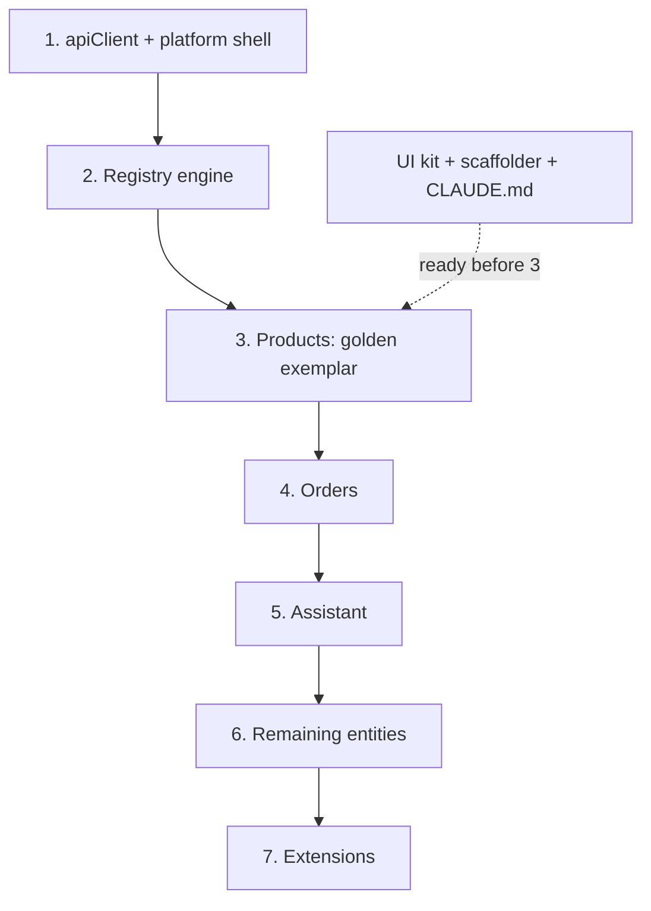

Milestone exits: M1 Foundation when login and merchant selection work on localhost against sandbox, CI gates are blocking and the kit playground is live. M2 Engine when the Products list and form are generated from a definition and a second scaffolded resource compiles and passes its tests. M3 Parity when the parity checklist is signed, the smoke is green and the browser matrix has passed. M4 Cutover when all pilot merchants are live and rollback has been rehearsed in under fifteen minutes. M5 Follow-through when the Content Security Policy is enforced and the assistant runs on commands.

Next two weeks: confirm the cookie family; send the backend list; hold the v1 scope and parity session; hold the extensions and visual-editor design session; decide d43 and the proposals; write the implementation plan for M1.

---

## Appendix A. Evidence

Entitlement gating the menu only: dashboard-ui, src/library/components/common/sideNav/index.tsx line 1386. User details fetch and merchant persistence: dashboard-ui, src/store/user/index.ts. Clarity injection and merchant tag: dashboard-ui-configuration, src/index.ejs line 139; dashboard-ui, src/root.component.tsx line 94. CSP hashes including clarity.ms: dashboard-ui-configuration, scripts/compute-csp-hashes.js line 88. The gk-pages API wrapper adding merchant headers: gk-pages, src/utils/apiUtils.ts lines 33 to 42. The discount V2 endpoint and merchant_id query parameter: gk-pages, src/modules/discounts/v2/api.ts lines 11 to 22. PostHog initialisation: gk-pages, src/providers/PostHogProvider.tsx line 10. Extension hooks: gk-pages, src/library/utilities/hooks. The utilities makeAPICall behaviour: the live bundle at dashboard.gokwik.co/utilities/gokwik-utilities.js. Gateway response headers including Envoy markers, X-Request-Id and the exposed-headers list: developer-tools capture, 17 October 2026. Production and sandbox cookie attributes: developer-tools captures, 9 October 2026.

## Appendix B. Related material

The review-shaped TRD in this folder: 2026-10-21-ratio-trd.md. Design specification: docs/specs/2026-10-16-ratio-standalone-design.md. Decision log: docs/architecture/discovery-decisions.md. Engineering chapters: docs/engineering/01 to 08. Interactive decision tracker: claude.ai artifact af4bb5ce. Interactive handbook: claude.ai artifact 11ba7e95. Review deck: claude.ai artifact EWYNr8F22K8qZz5CZoGvRe. Full A-to-Z record and the complete question-and-answer chain: Google Docs linked from Jira INFN-3457. Jira: INFN-3338 (discovery) and INFN-3457 (review).

## Appendix C. Glossary

Single-SPA, root config, shell, microfrontend: the composition model of the current dashboard. Gateway (Envoy): the API edge that authenticates the cookie, enforces CORS and forwards to services. httpOnly: cookie attribute preventing JavaScript access. SameSite: cookie attribute governing cross-site sending. Third-party cookie: a cookie whose site differs from the page's site. CORS and preflight: server-granted cross-origin permission and the browser's OPTIONS check for custom headers. CSRF: a hostile site making the browser send an authenticated request. Entitlement: selected_products.pages. Resource, command, runCommand: the registry's entity definition, action definition and single execution path. Stale-while-revalidate and staleTime: serving cached data while refetching, and the freshness window. Invariant: a business rule that must always hold. Source map: the file mapping minified code back to source. Support box: the evidence block on error screens. MCP: Model Context Protocol, a standard for exposing tools to AI assistants. OpsGuard: the organisation's alerting and on-call destination.
