# Ratio — Code Architecture Reference

**Document:** TRD-003 · **Version:** 1.0 · **Date:** 21 October 2026 · **Author:** Ashish Kumar · **Status:** For review

**Companion documents:** [Ratio TRD v1.1](2026-10-21-ratio-trd.md) (the full technical requirements document) · [Ratio architecture by topic](ratio-architecture-by-topic.md) (the same material organised by topic). The per-layer specification files that this document consolidates live in [`docs/architecture/`](../architecture/README.md) on this branch; where this document says "spec file", it points there.

---

## How to read this document

This is the single, exhaustive reference for how Ratio's code is organised. Everything else in the TRD set treats code architecture as one topic among many; this document treats it as the only topic and goes all the way down: every layer, every contract type, every registry entry, every state machine, every convention, with code examples and diagrams. Nothing that was decided about the code is left out.

It is written to be read in order the first time and used as a lookup afterwards. Part 1 states what is being built and the seven principles that constrain every later choice. Part 2 is the layer model, which is the one picture to keep in mind. Parts 3 to 9 walk the layers from the bottom (platform core) to the top (surfaces). Parts 10 to 13 cover the pieces that cut across layers: state, the UI kit, the assistant and extensions, and the decisions from the discovery tracker that were layered on top of the architecture. Parts 14 to 16 cover how the code is built, shipped and reviewed, the architecture decision records, and the open questions that still affect code. The appendices hold a glossary and an index.

Two framings of the same architecture exist in the wider document set and both are correct. The discovery tracker and the by-topic document describe Ratio as "platform shell, registry engine, resources, UI kit, bespoke screens"; the spec files describe it as six numbered layers plus a side layer. The mapping is exact: the platform shell is layer 1 together with the session machines of layer 5 and the chrome of layer 6; the registry engine is layers 4 and 5; resources are the per-entity content of layers 2, 3 and 4; bespoke screens are feature code in layer 6. This document uses the six-layer numbering because it is the finer-grained one, and names the tracker's terms where they help.

A note on tables: the earlier TRD drafts were criticised for leaning on tables. This document uses prose, code blocks and diagrams. Where a list of items is genuinely a list (the registries), it is given as a code block or a bulleted list so that it can be scanned without becoming a grid.

---

## Part 1. What is being built, and the rules that shape it

### 1.1 The product in one paragraph

Ratio is the new merchant admin for GoKwik: products, collections, inventory, purchase orders, transfers, orders, draft orders, customers, segments, discounts and discount sets, with an AI assistant and a modern interaction layer on top of a CRUD core. It is built as a fresh codebase in this repository. gk-pages, the current Single-SPA microfrontend inside the GoKwik dashboard, is the behaviour reference, not the code base: business rules, payloads and validations are ported with tests that pin today's behaviour. Nothing behind the API gateway changes.

Four things are being built. The **core** is tables and forms over eleven resources, with filters, bulk actions, import and export. The **flows** are a handful of multi-step processes: bulk edit, CSV import, draft order to order, price schedules, refunds, order editing. The **assistant** is an in-app AI that can read the current screen and propose actions the user confirms. **Extensibility** keeps today's third-party UI extensions and embedded apps, re-hosted on the new contracts.

### 1.2 What is kept from gk-pages, and what is dropped

Kept: Zod and React Hook Form; the module-per-domain organisation (API, transformer, types); the auth model (httpOnly gateway cookie, no token in JavaScript); the extension model (sandboxed extensions and the app bridge), re-hosted; the backend services and gateway, unchanged.

Dropped: Redux for server data; effect-driven fetching; every dependency on the dashboard shell (the borrowed `makeAPICall`, the shell's Redux store, the import map); and the very large page components that mix rules, UI and API calls.

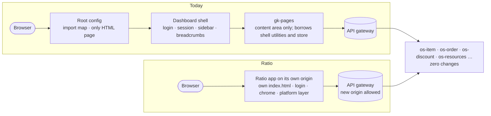

### 1.3 The seven principles

Every later decision in this document can be traced to one of these.

1. **Define once, use everywhere.** An entity is described once (a resource); an action is described once (a command). Tables, menus, the command palette, the assistant and extensions all consume the same definitions.
2. **Server data lives in the server cache.** It is never copied into a global store. No `useEffect` decides when to fetch.
3. **View state lives in the URL.** Filters, sort, page and tab are URL search parameters. Refresh and shared links restore the view.
4. **One schema per shape.** Zod schemas validate API responses, drive forms and become AI tool inputs.
5. **Machines for flows, hooks for rendering.** If a flow needs three or more booleans or an effect chain, it is a state machine.
6. **Spec first, confirmed by real screens.** The resource and command definitions are the target specification; products and orders are built first by hand against it, and the contracts are adjusted where real code disagrees.
7. **Parity now, change later in one place.** Business logic behaves exactly as in today's gk-pages. Known future changes (tax, channels, inventory history, new settings) are prepared as local seams: a schema field, a transformer, a command, a registered section.

### 1.4 Five domain rules that shape everything

These come from the common commerce shape (Shopify Admin API, commercetools, Medusa) plus Indian needs (MRP, GST, HSN, COD), and they are the reason several contracts look the way they do.

1. **Every product has at least one variant.** Price, SKU and stock live on the variant. A product without options has one default variant.
2. **Orders snapshot, they do not reference.** A line item copies title, SKU and price at purchase time.
3. **Status is more than one field.** An order has a payment status and a fulfillment status; a product has a lifecycle status and channel visibility.
4. **Money is never a float.** Integer paise plus a currency code.
5. **Stock is per location, in named states.** Not a single `quantity` number.

The **parity rule** sits on top: today's backend and gk-pages behaviour are the source of truth for business logic (tax, totals, discounts, pricing, inventory). The revamp may rearrange screens, rename fields and wrap calls; it does not change what is calculated or how without product sign-off.

---

## Part 2. The layer model

### 2.1 The picture

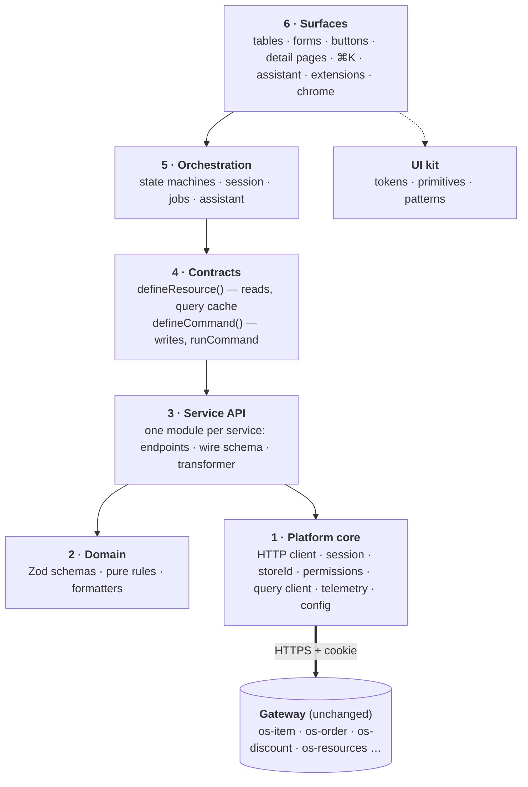

A layer uses only layers below it (any of them, not just the next one), never one above. The UI kit is a side layer used only by surfaces. State is not a layer: server data sits in the query cache (the client lives in platform core, queries and keys in contracts), view state in the URL (the router, in surfaces), UI flags in components or a small store.

### 2.2 What each layer is for

**Layer 1, platform core**, is plumbing every layer above uses and contains no feature code: the HTTP client, configuration, session, merchant context, permissions, the query client with its cache policy, and telemetry. It imports nothing from the app.

**Layer 2, domain**, is what each entity is and the business rules about it: Zod schemas, pure rule functions, display formatters. It is React-free and network-free and imports nothing outside itself.

**Layer 3, service API**, is one module per backend service, the anti-corruption layer between backend shapes and the domain. It is the only place that knows wire names, envelopes, pagination formats and money encodings.

**Layer 4, contracts**, is the two registries: resources (reads) and commands (writes). A resource definition drives lists, editors, search and assistant read tools; a command definition drives every write from every surface through one execution path.

**Layer 5, orchestration**, is the state machines: session, jobs and the assistant app-wide, plus page machines for login, saving, refunds, order editing, the discount wizard, draft payment watch, import and export.

**Layer 6, surfaces**, is what the user sees and touches: generated list, editor and detail pages, hand-written flow routes, chrome, the assistant panel, the extension host.

**The UI kit** draws and nothing else: tokens, primitives, patterns and shell frames with closed APIs.

### 2.3 Repository structure

```
src/
  routes/          route tree                                                   6 surfaces
  features/        custom sections and screens that don't fit the generic ones
  assistant/       panel, context collector, proposal cards, tool generation
  extensions/      extension host, app bridge
  machines/        <flow>/machine.ts, actors.ts, actions.ts, types.ts           5 orchestration
  resources/       <resource>.ts  (defineResource: data provider, keys, list, editor)   4 contracts
  commands/        <resource>.ts  (defineCommand: steps call api/)
  api/             <service>/client.ts, wire.ts, transformer.ts, errors.ts, fixtures/   3 service API
  domain/          <entity>/schema.ts, rules.ts, format.ts  (Zod schemas, pure rules)   2 domain
  platform/        http client, session, merchant (storeId), permissions, query client, telemetry, config   1 platform core
  ui/              tokens, primitives, patterns, shell components               side: UI kit
```

### 2.4 Who may import what

The import rules are the layer model made enforceable. They are checked by ESLint import boundaries, one rule per row below, and a red lint locks the merge.

- **Surfaces** (`routes/`, `features/`, `assistant/`, `extensions/`) may import orchestration, contracts, domain rules and formatters, platform core (session, permissions, telemetry) and `ui/`. They must not import `api/` or the HTTP client: reads go through resources, writes through `runCommand`.
- **Orchestration** (`machines/`) may import contracts, domain and platform core. It must not import `api/` (writes are commands), `ui/` or React components.
- **Contracts** (`resources/`, `commands/`) may import `api/`, domain and platform core. They must not import `machines/`, `ui/` or surfaces.
- **Service API** (`api/<service>/`) may import domain schemas and platform core (HTTP client, config). It must not import React or any layer above.
- **Domain** (`domain/`) may import other domain modules only. No React, no network, nothing else in the app.
- **Platform core** (`platform/`) imports nothing in the app.
- **UI kit** (`ui/`) imports nothing in the app, and nothing in the app except surfaces imports it.

Three refinements. Machines import `runCommand` and resource queries directly, but their async work stays in `actors.ts` so tests can replace it. Every write endpoint is called from exactly one command (ADR 0001); the exceptions are login, OTP, logout and store switch, which are platform session calls. Custom cells and sections in contracts name a component by a string `ComponentId` that surfaces resolve, so contracts never import React components.

A sketch of the ESLint boundary configuration, so that the rule is concrete:

```js
// eslint.config.js (excerpt)
import boundaries from 'eslint-plugin-boundaries';

export default [{
  plugins: { boundaries },
  settings: {
    'boundaries/elements': [
      { type: 'platform',  pattern: 'src/platform/**' },
      { type: 'domain',    pattern: 'src/domain/**' },
      { type: 'api',       pattern: 'src/api/**' },
      { type: 'contracts', pattern: ['src/resources/**', 'src/commands/**'] },
      { type: 'machines',  pattern: 'src/machines/**' },
      { type: 'ui',        pattern: 'src/ui/**' },
      { type: 'surfaces',  pattern: ['src/routes/**', 'src/features/**', 'src/assistant/**', 'src/extensions/**'] },
    ],
  },
  rules: {
    'boundaries/element-types': ['error', { default: 'disallow', rules: [
      { from: 'platform',  allow: [] },
      { from: 'domain',    allow: ['domain'] },
      { from: 'api',       allow: ['domain', 'platform'] },
      { from: 'contracts', allow: ['api', 'domain', 'platform', 'contracts'] },
      { from: 'machines',  allow: ['contracts', 'domain', 'platform', 'machines'] },
      { from: 'ui',        allow: ['ui'] },
      { from: 'surfaces',  allow: ['machines', 'contracts', 'domain', 'platform', 'ui', 'surfaces'] },
    ]}],
  },
}];
```

Alongside the boundaries, the lint bans a fixed list of patterns as errors, not warnings: direct `axios` or `fetch` outside `platform/http` and the upload helpers; `useEffect` fetching; server data in Zustand; mutating query data (`no-param-reassign` on query results, readonly domain types); XState imports in components; `any`; and the UI-kit rules described in Part 11.

### 2.5 The stack, each piece with its reason

Adopted as d40 after review; each row lists the main alternative that was considered.

- **React + TypeScript (strict)** for the app, because of team skills and the ecosystem. Alternative: Svelte.
- **Vite** for the build: fast dev, simple config, route splitting. Alternative: Next.js, not needed because the admin sits behind a login with no SEO, and its server rendering complicates the cookie story.
- **TanStack Router** for routing: typed routes and search params, so URL state is safe. Alternative: React Router.
- **TanStack Query** for server data: cache, dedupe, retry, invalidation, optimistic updates. Alternative: RTK Query.
- **TanStack Table** for tables: headless, works with our own components. Alternative: AG Grid.
- **React Hook Form + Zod** for forms: already used; the schema is shared with the API and commands. Alternative: TanStack Form.
- **XState v5** for flows: explicit states for multi-step processes. Alternative: Zustand plus reducers.
- **Zustand (small)** for UI state: only a few global UI flags. Alternative: React context.
- **Radix + Tailwind** for components: accessible primitives, our own look. Alternative: shadcn/ui as a starting copy.
- **Sentry** for errors and **PostHog** for product analytics, events, flags and Web Vitals, both already used in the organisation. **Microsoft Clarity** for session replay (tracker decision; see Part 13).
- **Vitest + Testing Library** for unit tests, **Playwright** for end-to-end, **ESLint + Prettier** (or Biome) for lint and format.

Two of these were challenged hard during discovery and the answers are part of the record. Zustand looked like a breach of the "no Redux" rule until the rule was restated precisely: what is banned is server data in a global store, and it stays banned in Zustand; Zustand is a zero-boilerplate global `useState` for flags such as sidebar open, active modal and bulk selection. React Query was challenged with "this is a dashboard, I do not want to cache anything, it must show the updated value every second." The answer is what caching means here: React Query shows the cached result instantly while fetching fresh in the background, so it removes loading flashes without ever serving old data as final, and a plain `useEffect` fetch is in fact staler because it fetches once on mount and never again. The freshness policy in Part 6.4 is the mechanical consequence.

---

## Part 3. Layer 1: platform core

Platform core lives in `src/platform/` and is organised as seven modules.

- `http`: one client for every service call: cookie, merchant headers, errors.
- `config`: environment and service base URLs, read only here.
- `session`: who is logged in; the login, OTP and logout calls.
- `merchant`: the current `storeId` and switching store.
- `permissions`: the entitlement flag and `can(scope)`.
- `query`: the query client and the cache policy.
- `telemetry`: Sentry and PostHog wiring.

### 3.1 What this layer replaces

The dashboard shell lent gk-pages a handful of things through the runtime import map, and this layer is their replacement. From `@gokwik/utilities` gk-pages used nine exports: `makeAPICall` (44 imports), `dashboardStore` (18), `updateBreadcrumbs` (11 calls), `validatePermission` (2), `filterStore` (2), three date helpers, `logUserEvent` and `downloadFromURL`. It read and wrote `sessionStorage['merchant-mid']` 79 times. It had one import-map entry, `@gokwik/gk-pages`, and a Single-SPA error boundary that returned `null` on a crash, so a broken section simply vanished. The API client, merchant context and chrome replace the first two groups; the import-map entry is removed at cutover; route error boundaries replace the silent `null`.

### 3.2 The API client (d11, d31)

Ratio owns its HTTP client. The tracker had originally kept `makeAPICall`'s signature for an in-place conversion; the new-codebase decision (ADR 0002) gives the client its own typed API, called only from `api/<service>` modules.

What the client does, concern by concern. **Credentials:** `credentials: 'include'` on every call, because the session is a cookie. **Merchant:** headers `merchant-mid` and `gk-merchant-id`, both equal to the current `storeId`, sent once each. **Other headers:** none, except an idempotency header a service needs; anything else fails the gateway's CORS preflight. **Idempotency:** `newIdempotencyKey()` produces a UUID v4, one per attempt; the service module shapes it and places it where its service wants it (refunds use `refund-<orderId>-<uuid>`, capped at 64 characters, in the `x-idempotency-key` header; bulk archive puts `idempotencyKey` in the body; draft completion puts `idempotency_key` in the body). **Response:** status and body are returned as-is; envelopes differ per service, so unwrapping is the service module's job. **Errors:** every non-2xx becomes an `ApiError`; a 401 also emits a `session-expired` event that sends the Session machine to login. **Uploads:** presigned storage PUTs bypass the client entirely (no cookie, no merchant headers).

```ts
interface ApiError {
  status: number;
  code?: string;          // first of: body.code, body.error_code, body.errors[0].code (inventory v3)
  message: string;        // body.message; a Nest string[] is joined
  raw: unknown;           // full body, for the service module
  requestId?: string;     // X-Request-Id from the gateway, when exposed (Part 13.1)
}
```

What is explicitly **not** the client's job, and belongs to layer 3: envelopes; `success: false` inside a 2xx body; scoping parameters (`?storeId=`, `merchant_id`, `?merchantId=`); staff fields in write bodies; case conversion; schema validation.

A sketch of the client, to make the contract concrete:

```ts
// platform/http/client.ts
import { getMerchantId } from '@/platform/merchant';
import { emit } from '@/platform/events';
import { addBreadcrumb } from '@/platform/telemetry';

export interface RequestOptions {
  method?: 'GET' | 'POST' | 'PUT' | 'PATCH' | 'DELETE';
  params?: Record<string, string | number | boolean | undefined>;
  body?: unknown;
  headers?: Record<string, string>;     // only idempotency headers are allowed here
  signal?: AbortSignal;
}

export async function request<T = unknown>(url: string, opts: RequestOptions = {}): Promise<{ status: number; body: T; requestId?: string }> {
  const storeId = getMerchantId();
  const qs = opts.params ? '?' + new URLSearchParams(clean(opts.params)).toString() : '';
  const res = await fetch(url + qs, {
    method: opts.method ?? 'GET',
    credentials: 'include',
    headers: {
      'content-type': 'application/json',
      'merchant-mid': storeId,
      'gk-merchant-id': storeId,
      ...opts.headers,
    },
    body: opts.body === undefined ? undefined : JSON.stringify(opts.body),
    signal: opts.signal,
  });
  const requestId = res.headers.get('x-request-id') ?? undefined;
  addBreadcrumb({ category: 'api', message: `${opts.method ?? 'GET'} ${url}`, data: { status: res.status, requestId } });
  const body = await parseBody(res);
  if (res.status === 401) emit('session-expired');
  if (!res.ok) throw toApiError(res.status, body, requestId);
  return { status: res.status, body: body as T, requestId };
}

export const newIdempotencyKey = () => crypto.randomUUID();
```

### 3.3 Base URLs and configuration

Base URLs are read only in `platform/config`. The tokens used throughout the spec files map to environment variables with the names gk-pages already uses; Ratio reads them with Vite's `VITE_` prefix, and only allowlisted keys reach the bundle.

```
{BASE}               REACT_APP_BASE_URL                       gateway; also dashboard APIs and Discount V2
{ORDER}              REACT_APP_ORDER_BASE_URL
{INVENTORY}          REACT_APP_INVENTORY_API_URL
{CUSTOMER}           REACT_APP_CUSTOMER_BASE_URL
{KWIKPASS_CUSTOMER}  REACT_APP_KWIKPASS_CUSTOMER_API_URL
{DISCOUNT}           REACT_APP_KWIKPASS_DISCOUNT_API_URL
{TIMELINE}           REACT_APP_TIMELINE_SERVICE_API_URL
{BULK_OPS}           REACT_APP_BULK_OPS_API_URL
{RESOURCES}          REACT_APP_OS_RESOURCE_API_URL
{APPS}               REACT_APP_MERCHANT_APP_STORE_API_URL
```

A URL is base plus path, joined verbatim. Some bases already end in `/api`, so real paths can read `…/api/api/v1/…` (os-order); that is correct, and the client never collapses it, because the single-`/api` path lands on dashboard-backend and returns 404. Each service module owns its path prefix.

### 3.4 Session and merchant context (d05, d06, d07, d12)

The session is a cookie. Login and OTP APIs allow the new origin (d05, confirmed with the backend team). The token is stored nowhere in the frontend: it is an httpOnly, Secure cookie set by the gateway (d06). JavaScript never reads or sends it; `document.cookie` shows nothing, checked in production DevTools. The session check is `GET /user/details`; a 401 means logged out. The dashboard's `is_logged_in` cookie is set by JavaScript and proves nothing; `/user/auth/me` exists in constants but is never called.

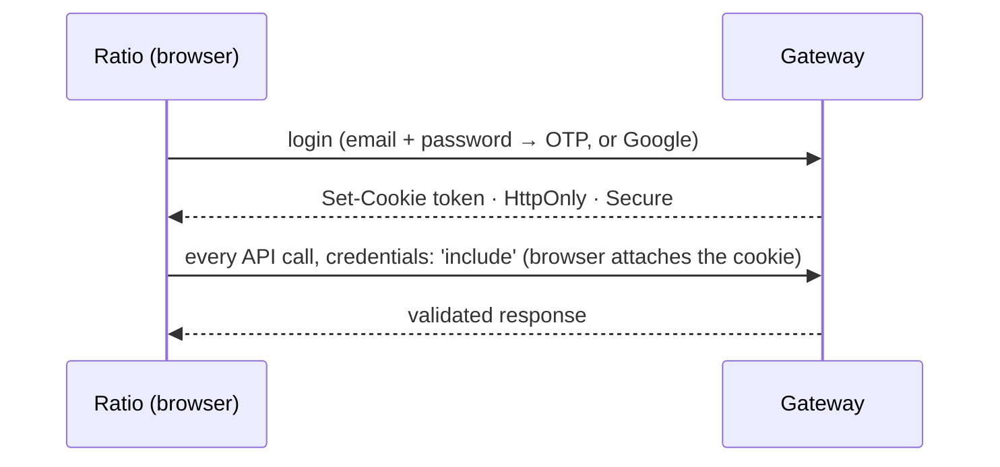

Login is `POST /user/signin` (email, AES-encrypted password), then `POST /user/verify-otp`, or `GET /user/google-signin?code=`. The password on signin and the email on verify-otp are AES-encrypted client-side with `REACT_APP_PUBLIC_CRYPTO_KEY`. Branches: a signin 400 whose message contains "otp already sent" counts as sent; a 403 on signin or verify-otp means the email is unverified and leads to send-otp; a `token: { token, otp_verified: true }` result means a forced password change; `current_dashboard: 'old'` redirects to the old dashboard. Logout is `GET /user/logout`, after which the query cache and the sessionStorage keys are cleared. The Login machine in Part 8 carries all of these branches.

Merchant selection: user details come through React Query; the picker writes `merchant-mid` (the same key as today) and `user-details` to sessionStorage (d07). React Query is the source of truth for user and merchant data; sessionStorage mirrors it for synchronous code; `dashboardStore` imports are replaced by one small utility (d12).

```ts
useUserDetails()          // React Query: GET /api/dashboard/user/details
useMerchant()             // selected merchant; storeId from the route
getMerchantId()           // synchronous read for non-React code (the HTTP client uses this)
```

Two identifiers exist and they must not be confused. `storeId` is `merchant_details.m_id`, a string, used in the URL, in query keys and in the `merchant-mid` / `gk-merchant-id` headers. `merchant_details.id` is a number, used only by `POST /team/switch-merchant`. Switching store is `POST /team/switch-merchant { merchant_id: id }`, then a refetch of `user/details`, then writing the two sessionStorage keys, then clearing the query cache and every merchant-scoped UI state. The route's `storeId` and the selected merchant must agree; opening a link for another store switches first. The store list is `user_details.allowed_merchants`; internal users search with `GET /user/merchant-search?q=`.

### 3.5 Identity, entitlement and permissions (d01–d04, d08, d36)

The product is Ratio (d01). The domain is deferred, with the constraint that the session cookie must be first-party to the page (d02; the full analysis with options A to D is in the TRD). Who gets Ratio is the existing per-merchant flag `selected_products.pages`, the single source of truth (d03). Entitlement is the same flag, enforced by a route guard (d04). Permissions use the existing model from the same user-details API (d08). Staff and roles UI is out of scope (d36).

```
GET /api/dashboard/user/details
  → data.config.selected_products: { pages: true, checkout, rto, … }   // set per merchant by the internal team
```

With `pages: true` the app opens; with `false` every route is blocked and a "You don't have access. Talk to sales." screen shows. Today the flag only shows the sidebar item (`dashboard-ui` `sideNav/index.tsx`), and gk-pages still mounts by URL. Ratio's guard makes it real: it runs in the Session machine, before any route renders.

Permissions are declared on every command and resource as Shopify-style scopes (`read_products`, `write_orders`, `write_refunds`). Backend permissions are strings in `user_details.role.permissions` (`view_order`, `refund`, `view_unmasked_report`, `live_mode`, …). The scopes map to them in one table in `platform/permissions`, and `can(scope)` reads it. Enforcement is off in v1, as today: gk-pages `main` checks permissions only in Ratio Reports (`reports.view`, `reports.viewUnmaskedReport`), those two checks carry over, and unmapped scopes pass. Turning enforcement on is one switch once roles are defined. The server remains the authority throughout; a passed client check is a UX hint, not security.

### 3.6 The query client and cache policy

The query client is created once in `platform/query` with `refetchOnWindowFocus: true` globally and the cache policy described in Part 6.4. Query keys follow `[domain, storeId, …]` (d31), so one store's cache never shows in another.

### 3.7 Telemetry

Sentry (a new project, alerts through the existing Sentry to OpsGuard pipe, d22) and PostHog (a separate project for Ratio, d20) are initialised here. Route boundaries call `captureException`. Source maps are built hidden, uploaded by CI, and removed from the deployed bundle. Tags are the release (`ratio@<version>`), the merchant ID and the route; no PII. Reported: 5xx, network errors, schema drift, boundary crashes. Not reported: 4xx `ApiError`s, which are results, not failures. Command runs emit one PostHog event each (Part 7.6).

---

## Part 4. Layer 2: domain

The domain is what each entity is and the business rules about it. It is React-free and network-free and imports nothing outside `domain/`. Fields come from the gateway wire shapes through a transformer (layer 3); the types below are written as TypeScript for readability and are Zod schemas in code. The domain schema drives forms (through the Zod resolver) and becomes the command and AI tool input. Responses are parsed by the wire schema in layer 3, not here.

### 4.1 Per-entity folder

```
domain/order/
  schema.ts   # Zod: Order, inputs
  rules.ts    # pure functions from the Rules list of the entity's spec file
  format.ts   # display helpers: labels, money, dates
```

Rules are plain functions. Components, commands and the assistant call the same one, so "can I refund this?" has exactly one answer:

```ts
// domain/order/rules.ts — as today (gk-pages OrderDetails.tsx:546)
export const refundBlockReason = (o: Order): string | undefined =>
  isCod(o) ? 'COD orders cannot be refunded — no payment was captured.'
  : o.financialStatus === 'refunded' ? 'This order has already been fully refunded.'
  : o.financialStatus === 'partially_refunded' ? 'This order has already been partially refunded.'
  : o.financialStatus === 'refund_pending' ? 'A refund for this order is already pending. Wait for it to settle before issuing another.'
  : undefined;
```

Rules are unit-tested against gk-pages behaviour; they are the cheapest tests in the codebase. Every rule in the spec files cites the gk-pages source line it was ported from, so a characterisation test can be written against the original.

### 4.2 Conventions shared by every entity

**Identity.** `type Id = string`, opaque; the UI never parses or builds IDs. `type Handle = string`, a URL-safe slug unique per store per entity type. Some services brand ids with a prefix (inventory `invi_`, `iloc_`, `invl_`, `inva_`); they are still opaque and typed per entity (`LocationId`). The tenant is `storeId`, the merchant's string `m_id`; entities do not carry it, and the backend's other names for it stay inside layer 3.

**Naming.** One name per concept across the frontend; where a choice is open, the Shopify Admin vocabulary wins (ADR 0003). The tenant is `storeId`, never `merchantId`, `mid` or `shop`. A write that changes an existing record is `resource.update`, never `.save` or `.edit`. Create and delete are `resource.create` and `resource.delete`, never `.add` or `.remove`. A permission is a scope such as `read_products`, never `products:view`. Service ids in definitions are lowercase as in the gateway pages (`'item'`, `'os-order'`).

**Money.**

```ts
type CurrencyCode = 'INR' | string;   // ISO 4217
interface Money {
  minor: number;            // integer paise. ₹449.00 → 44900
  currency: CurrencyCode;
}
```

Never a float, never a string: transformers turn wire strings and rupees into integer paise. Helpers add, subtract, multiply by quantity and format.

**Dates.** `type DateTime = string` (ISO 8601, UTC) and `type DateOnly = string` ("2026-10-14"). Epoch timestamps (the timeline) become `DateTime` at the boundary. Display uses the store time zone; no wire field carries one, so v1 uses `Asia/Kolkata`.

**Common shapes.**

```ts
interface Entity { id: Id; createdAt: DateTime; updatedAt: DateTime }

interface Page<T> { items: T[]; page: number; limit: number; total: number; hasNext: boolean }

interface Address {
  firstName?: string; lastName?: string; company?: string;
  address1: string; address2?: string;
  city: string; province?: string; provinceCode?: string;   // state; "MH"
  zip: string;                                             // pincode
  country: string; countryCode: string;                    // "IN"
  phone?: string;
}
interface Image { id: Id; url: string; altText?: string; width?: number; height?: number }
interface Weight { value: number; unit: 'g' | 'kg' | 'lb' | 'oz' }
```

**References versus snapshots.** A reference (`productId`) is a live relationship, as in collection to products. A snapshot (copied fields) is a historical record, as in an order line item's title and price.

### 4.3 The entity map

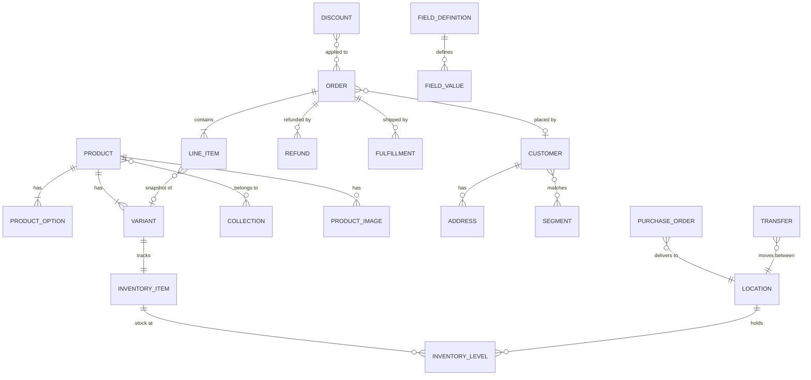

### 4.4 Catalog: product, variant, option, image, collection, taxonomy

A product holds content and grouping; price and stock live on variants. Product-level price, SKU and inventory fields on the wire are copies of the default variant; the domain reads the variant.

```ts
type ProductStatus = 'active' | 'draft' | 'archived';

interface Product extends Entity {
  title: string; handle: Handle; descriptionHtml: string; status: ProductStatus;
  vendor?: string; productType?: string;
  category?: { id: Id; name: string; fullName: string };
  tags: string[];
  options: ProductOption[];          // ≤ 3
  variants: Variant[];               // ≥ 1
  variantsCount?: number; defaultVariantId?: Id;
  images: ProductImage[];
  collectionIds: Id[];
  seo: { title?: string; description?: string };
  templateSuffix?: string;
  channels: ('online' | 'pos')[];    // wire: string[] or { online, pos }
  publishedAt?: DateTime;
  tax: ProductTax;                   // { taxable; hsnCode? }
  countryOfOrigin?: string; isPhysical: boolean; hasSkuOrBarcode: boolean;
  customFields: FieldValue[];
}
interface ProductOption { id: Id; name: string; position: 1 | 2 | 3; values: string[] }
interface Variant extends Entity {
  productId: Id; title: string;      // "M / Blue"; "Default Title" = no options
  selectedOptions: { name: string; value: string }[];
  sku?: string; barcode?: string;
  price: Money; compareAtPrice?: Money; costPerItem?: Money;
  taxable: boolean; requiresShipping: boolean; weight?: Weight;
  inventoryTracked: boolean;         // derived: inventory_management === 'shopify'
  inventoryPolicy: 'deny' | 'continue';
  inventoryQuantity: number;         // total across locations
  imageUrl?: string;
}
interface ProductImage { id: Id; url: string; altText?: string; width?: number; height?: number; position: number }
// ProductImage.id is generated client-side (UUID); the backend upserts on it, so a duplicated image
// must always get a fresh id — reusing one re-parents the row.
```

A collection is manual or smart. A smart collection has `rules: { match: 'all' | 'any'; rules: { field; operator; value; fieldDefinitionId?; fieldKey? }[] }` over fields title, product type, vendor, tag, category, price, compare-at price, weight, variant title and custom field, with operators equals, not equals, greater than, less than, contains, not contains, starts with, ends with, is empty and is not empty. It also carries `sortOrder`, `productsCount`, `published`, `seo`, `templateSuffix` and `customFields`. A `TaxonomyNode` is the Shopify standard taxonomy: `id`, `name`, `fullName` ("Apparel > Shirts"), `parentId`, `isLeaf`.

The catalog rules, each with its gk-pages origin: `isDefaultVariant` (one variant titled "Default Title" means the product has no options); `generateVariants` (every combination of option values, by position, titled "A / B / C"); `matchExistingVariants` (on option change, keep ids and prices of variants whose titles still match); `newVariantDefaults` (price, compare-at and cost 0; kg; taxable; tracked; policy deny; on edit, new variants reuse the first non-zero price); `optionPresets` (Size, Color, Material, Style, Weight); `profit` and `margin` (profit = price − cost; margin = 0 when price ≤ 0, else profit ÷ price × 100; both two decimals, computed on the client and sent on write); `deriveHandle` (trimmed SEO handle, else title lowercased with spaces replaced by hyphens); `productValidation` (title required; each option at least one value; variant price required; image source required; tags at most 50 characters; SKU optional); `normalizeWeightUnit`; `productDefaults` (status active, charge tax off, country of origin US, weight unit kg); `tagsJoin` (joined and split on ", "); `ruleOperators` per field type; `collectionValidation` (smart needs at least one rule; manual create needs at least one product).

### 4.5 Orders: order, line item, totals, payment, refund, edit, draft, fulfillment, timeline

Totals, tax and discounts come from the server (draft `calculate`, edit-session `preview`); the domain mirrors them and never recalculates, with one exception kept from today, the display tax fallback.

```ts
type OrderStatus = 'open' | 'archived' | 'cancelled';
type FinancialStatus = 'pending' | 'partially_paid' | 'paid' | 'refund_pending' | 'partially_refunded' | 'refunded' | 'voided';
type FulfillmentStatus = 'unfulfilled' | 'partially_fulfilled' | 'fulfilled' | 'shipped' | 'delivered';
type CancelReason = 'customer' | 'declined' | 'fraud' | 'inventory' | 'staff' | 'other';

interface Order extends Entity {
  name: string;                      // "#1042"
  number?: number; externalId?: string; externalName?: string; externalNumber?: string;
  status: OrderStatus; financialStatus: FinancialStatus; fulfillmentStatus: FulfillmentStatus;
  customer?: { id: Id; firstName?: string; lastName?: string; email?: string; phone?: string };
  email?: string; phone?: string;
  shippingAddress?: Address; billingAddress?: Address;
  lineItems: LineItem[];
  shippingLines: { title: string; isRemoved: boolean }[];
  otherCharges: { type: string; label: string; amount: Money }[];
  discountCodes: { code: string; amount: Money; type: string }[];
  discountApplications: DiscountApplication[];
  taxLines: TaxLine[];
  totals: OrderTotals;               // { lineItems; subtotal; discounts; tax; total; outstanding (signed) }
  payment: Payment;                  // { method; gateways; amount?; paymentId?; gatewayTransactionId?; instrument? }
  tags: string[]; note?: string; noteAttributes: { name: string; value: unknown }[];
  sourceName?: string; sourceIdentifier?: string;
  activeHoldsCount?: number;         // list only
  cancelledAt?: DateTime; cancelReason?: CancelReason; cancelReasonText?: string; closedAt?: DateTime;
  statusUrl?: string;
  customFields: FieldValue[];
}
interface OrderDetail extends Order { neighbors: { previous?: Id; next?: Id } }   // J/K navigation
interface LineItem {
  id: Id; productId?: Id; variantId?: Id; handle?: string;
  title: string; variantTitle?: string; sku?: string; vendor?: string;   // snapshots
  quantity: number; originalQuantity?: number; currentQuantity: number; fulfillableQuantity: number;
  unitPrice: Money; discountAllocations: { amount: Money }[];
  requiresShipping: boolean; taxable: boolean; image?: Image;
}
```

A **refund** has `status` (pending, processing, success, failed), `trigger` (cancellation, merchant initiated, edit triggered, return), `restock` (cancel or no restock), per-line amounts and totals, and a `RefundCalculation` adds `totalPaid`, `totalRefundable` and `previouslyRefunded`. An **order edit** is a list of operations (`set_qty` with an absolute quantity, `remove_line`, `apply_line_item_discount` fixed or percent) and an `EditPreview` with `newTotal`, a signed `refundAmount` (positive owed to the customer, negative to collect) and per-line quantity deltas. A **draft order** shares the order core and adds `status` (open, invoice sent, completed), `invoiceUrl` (a live payment link, cleared when the draft is edited), `orderId` set on completion, `financialIntent`, custom line items with price overrides and server totals from `calculate`. A **fulfillment** carries tracking entries and line items per location; a **fulfillment hold** carries a reason from a fixed list (awaiting payment, high risk of fraud, incorrect address, out of stock, unknown delivery date, post-purchase cross-sell, awaiting return items, other), a scope of order or line items, and blockers. A **timeline event** has a subject (order, product, collection or customer), a type string, a message, data and a timestamp.

The order rules are the densest in the domain and each has a gk-pages source line: `orderStatus` (cancelled when `cancelledAt` or `cancelReason`, archived when `closedAt`, else the wire status; cancelled and archived badges show independently); `normaliseFulfillment`; `isCod` (payment method, lowercased, includes "cod"); `anyFulfilled`; `canCancel` and `canBulkCancel` (not cancelled and not any-fulfilled; bulk requires every selected order); `autoRefundEligible` (total above zero, not COD, not refunded, partially refunded or refund pending); `refundBlockReason` (shown above); `editBlockReason` (cancelled, fulfilled, or a blocking discount, each with its message); `hasEditBlockingDiscount`; `isShopifySourced`; `canIncreaseQuantities` (COD, not paid or partially paid, unfulfilled); `hasCommittedLineDiscount`; `editAmountLabel` ("Refund owed", "Additional collection required", "No amount due"); `paid` (total minus outstanding); `removedLines`; `lineGroups`; `rowPricing`; `fulfillmentView`; `summarizeRefunds`; `hasLiveInvoice` (`invoiceUrl` set; status alone is not enough); `draftValidation` (custom item name, price above zero, quantity at most 1,000,000; new customer names, email, 10 to 15 digit phone, address line, city, state, 6-digit PIN); `shouldOfferBulkFulfil`. Returns and exchanges are not in v1.

### 4.6 Inventory: location, item, level, adjustment, supplier, purchase order, transfer

Legacy screens call locations warehouses; every v1 `warehouse_id` gk-pages sends is in fact an `iloc_` id, because warehouses are v3 locations mirrored into the old shape.

```ts
interface Location extends Entity {
  id: LocationId; name: string; address: Address; phone?: string;
  active: boolean; isDefault: boolean; fulfillsOnlineOrders: boolean;
  inventorySource: 'ratio' | 'shopify' | 'oms'; omsProvider?: string; facilityCode?: string; gstin?: string;
}
interface InventoryItem { id: InventoryItemId; variantId: Id; productId?: Id; sku?: string; tracked: boolean; requiresShipping: boolean; cost?: Money; hsnCode?: string; harmonizedSystemCode?: string; countryCodeOfOrigin?: string; active: boolean }
interface InventoryLevel {
  id: LevelId; inventoryItemId: InventoryItemId; locationId: LocationId;
  available: number;
  committed: number;                 // order-driven; never set by the admin
  codCommitted: number;
  onHand: number;
  unavailable: { reserved: number; damaged: number; qualityControl: number; safetyStock: number };
  incoming: number;                  // total only
  reorderPoint?: number; version: number; updatedAt: DateTime;
}
type QuantityName = 'available' | 'committed' | 'incoming' | 'reserved' | 'damaged' | 'safetyStock' | 'qualityControl';
type MutableQuantityName = Exclude<QuantityName, 'committed'> | 'onHand';
type AdjustReason = 'correction' | 'received' | 'damaged' | 'safetyStockSet' | 'import' | 'other';
```

A **purchase order** has a supplier, a destination location, a status (draft, ordered, partially received, received, closed), expected and received dates, payment terms, shipping, a note to supplier, tags, ordered and received quantities, lines with per-unit cost and a `tax` string kept for display only, and a `totalCost`. A **transfer** has origin and destination locations, a status (draft, pending, partially received, received), shipping, note, tags and lines.

Inventory rules: `onHand` (available + committed + reserved + damaged + safety stock + quality control; incoming excluded); `unavailableTotal`; `bulkEditDerive` (buffer = on-hand minus available; editing one derives the other; last touched wins; negatives allowed); `bulkEditWrite` (a row with available uses set-quantities with `compare_quantity`; on-hand only uses set-on-hand; reason `correction`); `adjustPreview`; `adjustValidate`; `activeLocations`; `receiveRemaining`; `receiveCaps` (accept and reject clamp each other); `receivePayload` (a PO sends this session's deltas; a transfer sends cumulative totals); `poLineTotal` and `poTotals` (tax excluded); `poStatus`; `poActions` (draft: primary Mark as ordered, more edit and delete; ordered or partial: primary Receive, more close; received: primary Receive and, in v1, close, which needs sign-off because today falls back to the draft menu; closed: more reopen); `transferStatus`; `transferActions`; `poValidate`; `transferValidate` (origin differs from destination).

### 4.7 Customers and segments

```ts
interface Customer extends Entity {
  firstName?: string; lastName?: string; email?: string; emailDomain?: string;
  phone?: string;                    // primary identifier for many Indian customers
  company?: string;
  status: 'active' | 'blocked';      // derived from isBlocked
  isDeleted: boolean; defaultAddress?: Address; tags: string[]; note?: string;
  language: string; taxSetting: 'COLLECT_TAX' | 'DONT_COLLECT_TAX';
  marketing: { email: boolean; sms: boolean; push: boolean };
  anniversaryDate?: DateOnly;
  stats: { ordersCount: number; amountSpent: Money; averageOrderValue: Money; firstOrderAt?: DateTime; lastOrderAt?: DateTime; abandonedCheckoutAt?: DateTime };
  customFields: FieldValue[];
}
interface Segment extends Entity { name: string; description: string; conditions: { field: string; operator: string; value: unknown }[]; logic: 'AND' | 'OR'; customerCount: number; active: boolean }
```

Segment operators by field type: numeric (equals, not equals, greater, less, greater or equal, less or equal, is set, is not set); text (equals, not equals, contains, not contains, starts with, ends with, is set, is not set); boolean (is, is not); date (before, after, between); array (contains, contains any, contains all, is empty, is not empty). Rules: `customerValidation` (names letters and spaces; valid email; +91 and `^[6-9]\d{9}$` phone; tax setting; notes at most 5000); `customerSearch` (contains OR-ed across email, names, phone, company, tags and address, AND-ed with other filters); `segmentValidation`; `segmentFields`; `segmentDefaultOperator`; `segmentValueSplit`; `segmentLogic` (today's editor resets AND/OR to AND on edit; fixed in v1). Two known conflicts are kept as today: the form defaults `taxSetting` to don't-collect while the reader defaults to collect, and the form schema defaults language to "English [Default]" while the transformer uses `en`.

### 4.8 Discounts

Discounts use Discount Service V2; discount sets and AI-assisted create still use os-discount v1. There is one domain model and one transformer per API.

```ts
type DiscountKind = 'cart' | 'buy_x_get_y' | 'bundle' | 'dynamic_tier' | 'free_gift';
type DiscountValue = { type: 'percentage'; percent: number; maxDiscount?: Money } | { type: 'fixed'; amount: Money };
type Matcher = { by: 'product' | 'variant' | 'collection' | 'tag'; ids: Id[]; minQuantity?: number };

interface Discount extends Entity {
  title: string; displayName?: string; description?: string; terms: string[];
  kind: DiscountKind; method: 'code' | 'automatic';      // method fixed after create
  code?: string; status: 'draft' | 'published' | 'inactive' | 'deleted'; effectiveStatus?: string; priority?: number;
  // offer, by kind
  value?: DiscountValue; discountBase?: 'cart' | 'product';
  appliesTo?: { all: true } | { productIds?: Id[]; collectionIds?: Id[] };
  buyXGetY?: { buy: Matcher[]; get: Matcher; getQuantity: number; reward: 'free' | DiscountValue; autoAddFreebie: boolean };
  bundle?: { scope: { all: true } | { productIds?: Id[]; collectionIds?: Id[] }; tiers: { quantity: number; fixedPrice: Money }[] };
  dynamicTier?: { basis: 'amount' | 'quantity'; method: 'percentage' | 'fixed'; tiers: { min: number; max?: number; amount: number; maxDiscount?: Money }[] };
  freeGift?: { gift: GiftProduct } | { get: Matcher; getQuantity: number; autoAddFreebie: boolean };
  giftTopUp?: GiftProduct[];
  // conditions
  minimum?: { subtotal: Money; reference: 'subtotal' | 'to_pay' } | { quantity: number };
  eligibility: { type: 'all' } | { type: 'new' } | { type: 'returning' } | { type: 'customers'; ids: Id[]; exclude?: boolean } | { type: 'segments'; ids: Id[] };
  limits: { total?: number; perCustomer?: number; perOrder?: number };   // undefined = unlimited
  devices: ('website' | 'app')[]; visibility: 'always' | 'hidden' | 'eligible';
  startsAt: DateTime; endsAt?: DateTime;
  // engine behaviour, round-tripped
  stacking: StackingConfig; crossDomainEffects: CrossDomainEffect[];
  payment: { disableForCod: boolean; disableForPrepaid: boolean };
  mustApply?: boolean; bulkCampaign?: BulkCodeCampaign;
}
```

Rules: `statusTargets` (offer published, draft and inactive minus the current effective status; none when scheduled or expired); `displayStatus`; `wizardValidation` (the full list: title; code of at least three characters even in automatic mode; cart and tier amounts above zero; specific scope needs a product or collection; BXGY needs a buy rule, get quantity and an amount unless free; bundle needs a tier with size and price above zero; free gift needs a product or a get rule and quantity; end after start; description when visible; minimum value when a minimum is set; usage limits integers of at least one or empty; at least one device); `draftValidation` (a draft needs only kind and title); `codeUnique` (checked on leaving step 2; a failed check does not block); `modeFixed`; `legacyValidation`; `discountSetValidation`; `unlimited` (V2 omits the field or reads int64-max or negative as unlimited; v1 uses 1,000,000); `noEndDate` (V2 omits; v1 sends `9999-12-31T23:59:59Z`); `tierOrder` (stored highest first, shown lowest first); `codFlags`; `legacyBxgyQuantity`. Money in discount payloads is paise, multiplied by 100 from rupee inputs; this was the cause of a live incident in gk-pages and is a hard rule here.

### 4.9 Custom fields (metafields) and the runtime schema

Field definitions are Shopify-compatible: an owner type (product, variant, collection, customer, order, draft order, location, page, blog, blog post, market, shop, company, company location, metaobject), a namespace and key, a type from the Shopify list (single and multi-line text, rich text, integer, decimal, boolean, date, date-time, URL, link, colour, JSON, id, rating, money, weight, dimension, volume, and the reference types), a `list` flag, validation, `required`, `pinned`, category ids and a `referenceId` for metaobject references. A value carries `namespace`, `key`, `type` and a `value` parsed by type. Metaobject definitions and metaobjects model reusable structured content such as size charts.

Definitions come from the server, so the editor builds a Zod schema at runtime and merges it with the static one:

```ts
const schema = ProductInputSchema.extend({ customFields: fieldsSchema(definitions) });
```

Rules: `fieldsSchema` (one validator per definition: required, min and max length, pattern, choices, unit-aware min and max, date range, URL domains); `isListSupported`; `isReferenceType`; `maxPinned` (at most 20 per owner type); `mergeValues` (match by id, then `namespace:key`, then key).

### 4.10 Pricing, tax, price schedules, store, apps, media

`ProductTax` is `{ taxable; hsnCode? }`; a `TaxLine` is `{ title; rate (decimal); amount }`. The server calculates tax; the UI shows the lines it receives, and the one fallback kept from today is `displayTax`: when taxes apply and `total_tax` is missing, (subtotal − discount) × 18%. A `PriceSchedule` (flash sale) has an action on price or compare-at price (change to, increase or decrease by percent or amount), rounding and keep-old-price flags, a product scope (all or filters), a one-off or recurring execution and a notify flag; rules `scheduleTiming` and `scheduleCancellable` (only `pending` can be cancelled).

`Store` comes from `user/details` and the SEO defaults endpoint: `id` (the `m_id`), `merchantNumber`, name, email, website, country, platform, `products` (the `selected_products` map, where `pages` is the entitlement), a client-derived `mode` (live or test), `currency` and `timezone` (no wire fields; INR and Asia/Kolkata in v1) and `seoDefaults`. `App` and `MediaAsset` model the app store and media library; upload is one multipart request for images, documents and audio, and presign, storage PUT and confirm for video.

### 4.11 Deferred changes and the seams that make them local

Deferred items will come, and the work done now keeps each of them a local change: one schema field, one transformer, one command or one section, never a hunt across screens. The seams used throughout are: **lists, not booleans**, for anything that can grow (channels, tax lines, consent channels, payments); **unions with exhaustive switches** for kinds and statuses, so adding a value makes TypeScript point at every place to update; **one owner per rule**, each calculation in one domain function with characterisation tests; **one command per write**, so the endpoint behind it can change without touching screens or the assistant; **registries for surfaces**, so nav items, settings tabs, editor sections and list columns are registered, not hand-wired; **capability flags**, so features without a backend are registered but off; and **labels in one dictionary**, so "Compare-at price" versus "MRP" is copy, not code.

Business-logic items kept as today pending product sign-off: GST per product (tax is its own section and schema block, so `gstRate` is one field); tax line splits (the UI renders `taxLines[]` as a list and the fallback is one function); the MRP label; marketplaces as more channel values; inventory edit reasons and history (all stock writes already go through `inventory.adjust` and `inventory.bulkEdit`); diff-based variant save (decided inside `product.update` only); validations and margin ported as is; status names and pricing-with-variants as one predicate or one label. New features with no backend today, hidden rather than faked: store settings, shipping zones, custom domains, checkout connect, the notification feed, the onboarding checklist, custom field groups, gift cards, returns and exchanges, payment transactions, WhatsApp consent, free-shipping discounts (V2 already round-trips SHIPPING effects), product insights, per-product return window and COD, server-side filters for POs, transfers and segments, and server sort for products and collections.

---

## Part 5. Layer 3: service API

One module per backend service, in `api/<service>/`: the anti-corruption layer between backend shapes and the domain, and the only place that knows them.

### 5.1 Data flow: transform once, never mutate (ADR 0003, ADR 0004)

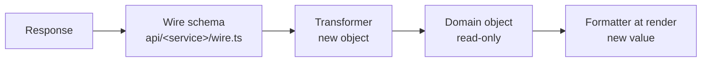

At the boundary the response is parsed with its wire schema and the transformer builds a **new** domain object; this is the only place backend shapes change, and only for consistency. Above the boundary, domain objects are read-only: never mutated, never reshaped in hooks, never copied into state. At display time, labels, formatted money and grouped rows come from pure `domain/<entity>/format.ts` functions. Writes go the other way: the command passes domain input; the module's `toWire` builds the request with wire names, units, scoping params and staff fields. Commands never see wire names.

Every response is parsed, the same way everywhere (ADR 0004): `safeParse`, shape drift logged to Sentry with endpoint and field path, data still rendered. Money is the one strict case: a bad money value shows "can't display" in its place and the rest renders. The earlier tracker decision to validate only "critical" endpoints was superseded because in the new codebase every resource and command already has a schema, so there is no list to maintain and drift shows up in Sentry before it shows up as a bug.

A wire schema describes what one service sends, lives in `api/<service>/wire.ts` and changes when the backend changes. A domain schema describes what the app means by the entity, lives in `domain/<entity>/schema.ts` and changes when the business meaning changes.

### 5.2 Module contract

Each service module has five parts.

- `client.ts`: one exported function per endpoint, typed input in domain names to domain output, with options `{ signal, idempotencyKey }`. List functions take a typed query and return `Page<T>`.
- `wire.ts`: wire schemas, generated from OpenAPI when the service has one (open question 20), otherwise written from sandbox captures.
- `transformer.ts`: `toDomain` and `toWire`, pure.
- `errors.ts`: maps `ApiError` bodies (`code`, `error_code`, v3 `errors[]`, `status_code` plus `message`) and any 2xx `success: false` to the command result type, with field paths in domain names. Most of gk-pages' "soft failures" were `makeAPICall` swallowing a non-2xx; here nothing is swallowed.
- `fixtures/`: recorded responses; tests parse each with its wire schema, and MSW serves the same files.

No React, caching, retries or UI text live here; the query client and commands own those. An endpoint is called from one function only, so a backend change is a one-module change.

A worked example from os-order:

```ts
// api/os-order/wire.ts
export const WireOrder = z.object({
  id: z.string(), name: z.string(),
  financial_status: z.string(), fulfillment_status: z.string().nullable(),
  subtotal_price: z.string(),                 // paise as a decimal string, "600000.00"
  current_total_price: z.string().optional(), total_price: z.string().optional(),
  cancelled_at: z.string().nullable().optional(), closed_at: z.string().nullable().optional(),
  line_items: z.array(WireLineItem).optional(),
  // …
});
export const WireOrderList = z.object({ orders: z.array(WireOrder), pagination: z.object({ total: z.number(), pages: z.number(), current_page: z.number(), limit: z.number() }) });

// api/os-order/transformer.ts
export const toOrder = (w: z.infer<typeof WireOrder>): Order => ({
  id: w.id, name: w.name,
  status: orderStatus(w),                                     // domain rule
  financialStatus: w.financial_status as FinancialStatus,
  fulfillmentStatus: normaliseFulfillment(w.fulfillment_status),
  totals: { total: paiseString(w.current_total_price ?? w.total_price), /* … */ },
  lineItems: (w.line_items ?? []).map(toLineItem),
  // …
});

// api/os-order/client.ts
export async function listOrders(q: OrderQuery, { signal }: { signal: AbortSignal }): Promise<Page<Order>> {
  const { body } = await request(`${ORDER}/api/v1/admin/orders`, { params: encodeOrderQuery(q), signal });
  const parsed = WireOrderList.safeParse(body);
  if (!parsed.success) reportDrift('os-order', 'GET /orders', parsed.error);
  const data = parsed.success ? parsed.data : (body as z.infer<typeof WireOrderList>);
  return { items: data.orders.map(toOrder), page: data.pagination.current_page, limit: data.pagination.limit, total: data.pagination.total, hasNext: data.pagination.current_page < data.pagination.pages };
}
```

### 5.3 What transformers normalise

The domain sees one shape; every item below is fixed inside the service's transformer, which is why the list is long.

**Case.** snake_case on dashboard, os-order orders, fulfillment, edit and refund requests, item reads, inventory and discounts. camelCase on os-customer, media, apps, bulk-ops, os-order drafts, refund responses and tags, and item collections. PascalCase keys in the bulk-ops import preview.

**Envelope.** dashboard `{ status_code, data }`; os-customer, discount and media `{ success, …, data }`; inventory v3 `{ data, errors, api_version, request_id }`; os-order `{ orders | draft_orders, pagination }`; others per endpoint (bare arrays, `{ data, meta }`, `{ assets, pagination }`).

**Pagination.** Mostly page plus limit; v3 levels by offset; totals as `total`, `total_pages`, `pages` / `current_page` or `hasNextPage`.

**Money.** Paise as integers or decimal strings (`"600000.00"`). Rupees in customer amounts, draft `shippingLine.price`, edit-commit `refund_amount` and PO line tax.

**Numbers.** Weights, quantities and some ids arrive as strings.

**Status.** lowercase; PascalCase (PO, transfer); UPPER_SNAKE (refunds, hold reasons, Discount V2); display strings (cancel reasons, collection rule fields).

**Sentinels.** End date `9999-12-31T23:59:59Z` and unlimited `1000000` (v1) or int64-max (V2) become `undefined`.

**Booleans.** `boolean | 0 | 1` on custom fields.

**Tenant.** `storeId` maps to `merchant_id`, `merchantId`, `store_id`, `storeId`, `store-id` or `?merchantId=` depending on the service; the numeric merchant id is used only for switch-merchant.

**Staff.** os-order writes carry `staff_id` and `staff_name` in the body; os-customer `staffId` and `staffName`; bulk-ops `user-email` and `user-name` as query parameters.

### 5.4 The gateway and its services

Everything below the service modules is backend and unchanged by Ratio. Every request carries the httpOnly `token` cookie (sent with `credentials: 'include'`) and the merchant headers `merchant-mid` and `gk-merchant-id`. The gateway, an Envoy behind Cloudflare, enforces both authentication and CORS, which is why one configuration change opens every gateway-routed API to the new origin (d17):

```
allowed_origins   += https://<ratio-origin>        (exact origin; wildcards don't work with credentials)
Access-Control-Allow-Credentials: true
allowed_headers   += gk-merchant-id, merchant-mid, idempotency-key, x-idempotency-key
expose_headers    += X-Request-Id                  (Part 13.1; today the id is returned but not exposed)
```

Calls that bypass the gateway are audited and smoke-tested from the new origin before launch (d18): list every call per service, tag gateway-routed versus bypass (direct service hosts, storage uploads, third-party endpoints), smoke the bypass list from the new origin on staging (login, products, one save, one upload), and have the backend fix what fails. Known candidates are the presigned media uploads and the separate KwikPass customer host. Discount V2 already goes through the gateway.

The eight service modules, with what each serves, its base and its wire character. The full endpoint tables (295 endpoints) are in `docs/architecture/gateway/`.

- **dashboard** (`{BASE}/api/dashboard`, 20 endpoints): login, session, user details, merchant config. snake_case; envelope `{ status_code, message?, data }`.
- **os-order** (`{ORDER}` and `{TIMELINE}`, 54 endpoints): orders, the edit session, fulfillment and holds, refunds, drafts, tags, timeline. Orders, fulfillment, edit and refund requests snake_case; drafts, refund responses, tag bodies camelCase. Paise everywhere as decimal strings except `shippingLine.price` and commit `refund_amount` (rupees). Staff attribution in the body. The `{ORDER}` base already ends in `/api`.
- **item** (`{BASE}/api/v1/admin`, 41 endpoints): products, variants, options, collections, lookups, price schedules, content AI. Reads snake_case, writes mixed (product top level snake, nested variants and images camelCase, collections camelCase). Integer paise on writes; `?storeId=` scoping. `PUT /products/:id` sends `replaceVariants`, `replaceOptionValues` and `replaceOptions` true.
- **inventory** (`{INVENTORY}`, 76 endpoints): v3 items, levels, adjustments and locations; v1 import and export, purchase orders, suppliers, transfers, custom fields. snake_case; v3 envelope `{ data, errors, api_version, request_id }` with lists as `{ items, total }`; branded ids; every v3 write sends an `idempotency-key` header. Handled v3 error codes: `INSUFFICIENT_STOCK`, `NEGATIVE_TARGET`, `COMPARE_AND_SET_CONFLICT`, `COMMITTED_NOT_ALLOWED`, `LOCATION_IS_DEFAULT`, `LOCATION_HAS_STOCK_MOVE_FIRST`, `DRAIN_SAME_SOURCE_AND_DESTINATION`, `VALIDATION_ERROR`, `NOT_FOUND`.
- **os-customer** (`{CUSTOMER}` and `{KWIKPASS_CUSTOMER}`, 29 endpoints): customers, addresses, comments, segments, export. camelCase; rupees as plain numbers; envelope `{ success, statusCode, data }`; staff identity as `staffId` / `staffName` in the body (the DTOs forbid non-whitelisted keys, so snake_case would 400).
- **discount** (`{BASE}/dashboard/v2/discount` and `{DISCOUNT}`, 16 plus V2): Discount V2 create, get, update, fetch, bulk update, check-code and merchant config; os-discount v1 sets, AI sessions, redeem. snake_case; paise; envelope `{ success, status_code, message, data }`. No delete route: delete, publish, revert and disable are all `PUT /bulk/update` with a status. `mode` is immutable after create. Must go through the gateway; the microservice host rejects the merchant headers.
- **bulk-ops** (`{BULK_OPS}/api/v1/admin/bulk-ops`, 9 endpoints): export template and preview, import preview, process, job progress, cancel, history. camelCase; previews take `store-id` as a query parameter; pagination uses `hasNextPage` / `hasPreviousPage`.
- **media-apps** (`{RESOURCES}` and `{APPS}`, 18 endpoints): media library, uploads (multipart, or presign, storage PUT and confirm for video), app store. camelCase; the list and detail asset shapes differ (`fileName` / `size` versus `filename` / `fileSize`) and the transformer unifies them.

Not in v1 and not documented: analytics, session analytics, search-discovery, loyalty, mega-menu, reviews, A/B testing, visual editor, brand mappings.

---

## Part 6. Layer 4: resources (reads)

A **resource** is one entity as the admin presents it: how it is fetched, listed, edited and found. Each is defined once; list screens, editors, command-palette search, the assistant and extensions read the same definition. The resource layer is built on the domain, then data access, then the definition, then the generic screens.

Three rules. **Reads only**: writes are commands, referenced by ID. **Declarative first, escape hatch always**: any column, filter, field or section can be a custom component, any route can use its own page, and bespoke screens (visual editor, analytics, onboarding) are plain feature code whose writes are still commands (d41). **Behaviour as today**: filters map to today's API parameters, and validations and derived values cite their gk-pages source lines.

### 6.1 The resource contract

```ts
interface ResourceDefinition<
  T extends Entity,             // detail shape
  TItem = T,                    // list row shape
  TInput = unknown,             // editor draft shape
> {
  // ── Identity ────────────────────────────────────────────
  name: string;                 // "product"; used in routes, keys, commands
  label: { singular: string; plural: string };   // copy keys
  icon: IconName;
  title: (r: T | TItem) => string;               // "#1042", product title
  subtitle?: (r: T | TItem) => string;

  // ── Data ────────────────────────────────────────────────
  service: 'dashboard' | 'os-order' | 'item' | 'inventory' | 'os-customer' | 'discount' | 'bulk-ops' | 'media-apps';
  schema: { detail: ZodType<T>; item: ZodType<TItem>; input?: ZodType<TInput> };
  data: DataProvider<T, TItem>;
  keys: QueryKeys;

  // ── Routes ──────────────────────────────────────────────
  routes: {
    list: string;                                // "/orders"
    detail?: string;                             // "/orders/$id"
    create?: string;                             // "/orders/new"
    sub?: Record<string, string>;                // { receive: "/purchase-orders/$id/receive" }
  };
  kind?: 'collection' | 'singleton';

  // ── Screens ─────────────────────────────────────────────
  list?: ListConfig<TItem>;
  detail?: DetailConfig<T>;                      // read view with actions (orders)
  editor?: EditorConfig<T, TInput>;
  quickCreate?: { fields: (keyof TInput)[]; command: CommandId };

  // ── Relations ───────────────────────────────────────────
  relations?: Record<string, { resource: string; kind: 'one' | 'many'; via: string }>;

  // ── Actions (references only) ───────────────────────────
  commands?: {
    row?: CommandId[];
    bulk?: CommandId[];
    page?: CommandId[];                          // header buttons
    primary?: (r: T) => CommandId | undefined;   // status-driven main button (PO: Mark as ordered / Receive)
    more?: (r: T) => CommandId[];                // status-driven "More" menu
  };

  // ── Discovery ───────────────────────────────────────────
  search?: { enabled: boolean; limit?: number }; // ⌘K
  nav?: { group: string; position: number; parent?: string; badge?: { params: Partial<ListParams>; cap?: number } };

  // ── Extensibility ───────────────────────────────────────
  customFields?: { ownerType: OwnerType; placement: 'main' | 'aside'; readOnly?: boolean };
  extensionTargets?: string[];                   // today's target names, e.g. "admin.product-details.block.render"

  // ── Access ──────────────────────────────────────────────
  permissions: { read: Permission; write?: Permission };
  capability?: string;                           // feature flag; off = hidden everywhere

  // ── Assistant ───────────────────────────────────────────
  assistant?: { description: string; readableFields: string[]; listParams?: ZodType };
}

interface DetailConfig<T> {
  layout: { main: Section<T>[]; aside?: Section<T>[] };
  pager?: (r: T) => { previous?: Id; next?: Id };   // orders: from the API; J/K keys
  editRoute?: (r: T) => string;                      // orders: "/orders/$id/edit"
}

type Permission = `${'read' | 'write'}_${string}`;
type ComponentId = string;                          // custom cell / section; surfaces resolve it
type IconName = string;
type StatusSpec = { label: string; tone: 'success' | 'warning' | 'critical' | 'info' | 'neutral' };
interface CreateContext { sourceId?: Id; selection?: { resource: string; rows: unknown[] }; customerId?: Id }
```

Design notes on the contract. Most resources edit in place (an editor); orders are a read view with actions plus a separate edit route, because editing an order goes through an os-order edit session (begin, stage, preview, commit). Purchase orders and transfers change their main button and menu by status, and `primary` and `more` express that instead of hard-coded buttons. A relation `via` a list parameter (`customerId`) gives "View all orders" from the customer page with no extra code. Commands are IDs: the registry resolves them, checks permission and enablement, and asks for confirmation. The capability flag hides the resource from nav, routes, the palette and the assistant at once. Assistant metadata is opt-in.

### 6.2 Data access: providers, parameters, keys

Each resource has a read-only data provider. Writes are commands, which call the API module directly.

```ts
interface DataProvider<T, TItem> {
  cache: CacheClass;                                 // required; the scaffolder refuses to generate without it
  getList(params: ListParams, opts: { signal }): Promise<Page<TItem>>;
  getOne(id: Id, opts: { signal }): Promise<T>;
  getMany?(ids: Id[], opts: { signal }): Promise<TItem[]>;            // pickers, references
  search?(text: string, limit: number, opts: { signal }): Promise<TItem[]>;   // ⌘K and pickers
}

interface ListParams {
  view?: string;                         // active tab
  search?: string;
  filters?: Record<string, unknown>;     // filter id → value; turned into the typed query by each filter's toQuery
  scope?: Record<string, string>;        // required scope (location) or relation scope (customerId)
  sort?: { field: string; direction: 'asc' | 'desc' };
  page?: number;                         // 1-based
  limit?: number;                        // 50
}
```

A provider only builds the typed query and calls the API module, which parses, transforms and returns a page:

```ts
getList: (p, { signal }) => api.osOrder.listOrders(toQuery(p), { signal })
```

Query keys are per resource, `[domain, storeId, …]`:

```ts
const keys = {
  all:     ['product', storeId] as const,
  lists:   () => [...keys.all, 'list'] as const,
  list:    (p: ListParams) => [...keys.lists(), p] as const,
  details: () => [...keys.all, 'detail'] as const,
  detail:  (id: Id) => [...keys.details(), id] as const,
  calc:    (input: unknown) => [...keys.all, 'calc', input] as const,   // server calculations
};
```

The store id is in every key, mandatory and first, so one store's cache never shows in another, and the whole cache is cleared on store switch. Two merchants' data mixing is a security bug, not a usability bug, which is why this is a structural rule rather than a convention.

### 6.3 Cache policy: one switch (ADR 0005, d42)

Today's gk-pages has no cache; every navigation refetches. In Ratio, freshness is one setting, not per-screen code. Every query takes its `staleTime` from a named class; the classes come from one policy object; switching the policy is a one-line change.

```ts
// platform/query/cachePolicy.ts
type CacheClass = 'list' | 'detail' | 'lookup' | 'calc';

const policies = {
  balanced: { list: 30_000, detail: 60_000, lookup: 10 * 60_000, calc: 0 },   // default (d42)
  fresh:    { list: 0,      detail: 0,      lookup: 10 * 60_000, calc: 0 },   // revalidate on every mount
} satisfies Record<string, Record<CacheClass, number>>;

export const ACTIVE_POLICY: keyof typeof policies = 'balanced';   // ← the switch
```

The `list` class is for list screens, because orders arrive constantly. `detail` is for detail and editor reads, because the editor keeps its own draft. `lookup` is for vendors, types, tags, taxonomy, locations, suppliers, sort options and views, which rarely change. `calc` is for server calculations (`/calculate`, edit-session preview), which must always be current. Data providers declare a class, never a number; the `new:resource` scaffolder will not generate one without it, and a resource that must always be fresh overrides with `0` and a comment. `refetchOnWindowFocus: true` is on globally in every policy, so returning to the tab always revalidates. Either policy renders cached data instantly while the background refetch runs. Polling is declared on commands and jobs and run by machines, not by queries.

### 6.4 Invalidation, seeding, prefetch, errors

Commands declare what they invalidate. After a save the detail cache is set from the response and lists are invalidated. The timeline is refetched immediately and again after 2.5 seconds after an order mutation, as today, because events are written asynchronously. Opening a row seeds the detail with the list row so the header shows instantly; hovering a row prefetches its detail.

Errors on reads: schema drift is logged to Sentry and the data still renders, except a bad money value, where the row shows "can't display" and the list continues; a 401 goes to the session flow; a 403 shows the permission screen on detail; a 404 shows a not-found screen with a link to the list; network and 5xx errors get two retries with backoff, then an error state with retry.

### 6.5 The list configuration

```ts
interface ListConfig<TItem> {
  scope?: ScopeSelector;                   // inventory: a warehouse must be chosen
  columns: Column<TItem>[];
  defaultColumns?: string[];
  search?: {
    placeholder: string;
    debounceMs: number;                    // 500, as today's shared toolbar
    minLength?: (q: string) => boolean;    // orders: ≥2 chars or an order number
    mode?: 'server' | 'client';            // client = filters the loaded page (as today where the API lacks it)
  };
  filters?: Filter[];
  views?: { source: 'static'; items: View[]; mode?: 'server' | 'client' } | { source: 'server'; default: 'is_default' | 'first' };
  sort?: { source: 'static'; options: SortOption[]; default: SortOption }
       | { source: 'server'; default: SortOption }      // orders, drafts: /sortby
       | { source: 'column' };                           // column click sets sort { field, direction }
  pageSize: number;                        // 50 everywhere
  selection?: { enabled: boolean; max?: number };   // orders: max 100
  cellEdit?: { cells: string[]; command: CommandId };   // inventory: per-cell popover, immediate save
  insights?: { component: ComponentId; capability: string };
  rowLink?: 'detail' | ((r: TItem) => string) | false;
  empty: { title: string; body?: string; action?: CommandId };
}

type Filter<TQuery = unknown> = {
  id: string; label: string;
  toQuery: (value: unknown) => Partial<TQuery>;   // the list function's typed query, domain names
  mode?: 'server' | 'client';
} & (
  | { type: 'enum' | 'multi_enum'; options: Option[] | (() => Promise<Option[]>) }
  | { type: 'text' }
  | { type: 'number_range' }
  | { type: 'money_range' }                // entered in rupees, becomes Money
  | { type: 'date_range' }                 // local days, { from, to } DateOnly
  | { type: 'conditions'; fields: ConditionField[] }   // customers: condition list
);

interface Column<TItem> { id: string; header: string; cell?: (row: TItem) => CellSpec | { component: ComponentId }; sortKey?: string }
type CellSpec = { kind: 'text' | 'money' | 'date' | 'datetime' | 'status' | 'image_title' | 'count'; value: unknown };
interface View { id: string; label: string; params?: Partial<ListParams> }
interface SortOption { field: string; direction: 'asc' | 'desc'; label?: string }
interface ScopeSelector { param: string; source: () => Promise<Option[]>; required: boolean }
interface ConditionField { field: string; type: 'text' | 'number' | 'money' | 'date' | 'boolean' | 'tags' }
```

`toQuery` speaks domain names and units; the API module encodes them for its service (comma-joined, repeated arrays, min and max pairs, condition objects, paise, day bounds).

**URL state.** A list URL looks like `/orders?view=unfulfilled&q=rahul&financial_status=paid&created=2026-10-01..2026-10-14&sort=created_at:desc&page=2`. `view` is the active tab; `q` the search text; each filter id its value, with lists comma-separated and ranges as `min..max`; `sort` is `field:direction`; `page` the page with size fixed per resource; scope parameters such as `location` and relation scopes such as `customerId` ride alongside. Changing search, filters, sort, view or scope resets `page`.

**Views and sort.** Server views (orders, drafts) are loaded from `/views`; a view's query becomes URL parameters; the default is the view marked default, else the first. Server sort options (orders, drafts) are loaded from `/sortby`. Column sort (discounts, orders, drafts) sets `sort` on a column click and the API module encodes it per service. No sort for products and collections (fixed to newest first) because the API does not sort; customers' API sorts but the UI is deferred.

**Selection and bulk.** Selection is per page; there is no "select all matching" because no API supports filter-based bulk. An optional cap applies (orders: 100, with a warning). Some bulk commands are conditional on the whole selection (orders: Unarchive only if all selected are archived). Selection clears when the URL changes.

**Column preferences** are visible columns per resource, stored locally per user; they never change the URL or what is fetched.

**States.** First load shows a table skeleton with real headers; a refetch keeps rows and shows a thin progress bar; empty with no records shows `empty` with its action; empty with filters shows "No results" and clear filters; an error shows a message and retry; a row that fails to parse shows "can't display".

### 6.6 The editor configuration

The editor is the record page for resources edited in place: product, collection, purchase order, transfer, draft order, customer, segment, discount.

```ts
interface EditorConfig<T, TInput> {
  toInput: (record: T) => TInput;
  layout: { main: Section<TInput>[]; aside?: Section<TInput>[] };   // 65/35 on desktop, as today
  readOnlyWhen?: (r: T) => boolean;          // draft order completed
  header?: { status?: (d: TInput) => StatusSpec };
  save: CommandId;
  create?: { route: string; initial: (ctx: CreateContext) => TInput; command: CommandId };
  calculate?: {                              // server-side totals
    query: (d: TInput) => Promise<unknown>;  // draft calculate
    debounceMs: number;                      // 500 as today
    skipWhen?: (d: TInput) => boolean;       // no line items
  };
  children?: Record<string, ChildConfig>;
}

type Section<TInput> =
  | { id: string; title: string; fields: FieldSpec<TInput>[]; visibleWhen?: (d: TInput) => boolean; collapsible?: boolean }
  | { id: string; title?: string; component: ComponentId; visibleWhen?: (d: TInput) => boolean };

interface FieldSpec<TInput> {
  path: Path<TInput>; label: string;
  type: 'text' | 'textarea' | 'rich_text' | 'number' | 'money' | 'percent' | 'select'
      | 'multi_select' | 'tags' | 'boolean' | 'date' | 'image' | 'media_list' | 'reference' | 'phone';
  help?: string;
  readOnly?: boolean | ((d: TInput) => boolean);
  visibleWhen?: (d: TInput) => boolean;
}

interface ChildConfig {
  path: string;                              // "variants", "lineItems", "addresses"
  columns: Column<unknown>[];
  editable?: string[];
  preview?: number;                          // rows before "View all" (design: 4 variants)
  subRoute?: string;                         // full list view
  pageSize?: number;                         // server-paged children (collection products: 50)
  blockPagingWhenDirty?: boolean;            // as today in collection products
}
```

**Saving.** Dirty and valid come from the form; Save is enabled only when both hold. Validation is the input schema plus the runtime custom-field schemas, always run before save. The save itself runs the record save machine (Part 8), with one save bar with Discard and Save. Every editor has the leave guard. With `calculate`, the totals shown come from the server response and are never computed locally (today's tax fallback is the one exception); a response older than the latest request is dropped.

**Children.** When a child is saved through its own endpoint (customer addresses), the save command orchestrates the calls in today's order; the UI never calls child endpoints directly.

**Create.** A create route uses the same editor with `create.initial`. Prefill sources are part of `CreateContext`: duplicate (`sourceId`), selected inventory rows (transfer or PO from inventory), customer (order from the customer page). On success, navigate to the new record.

**Sub-routes.** Flows that are their own page today stay their own route: receive (PO, transfer), edit order, customers in segment, the full variants list.

### 6.7 The registry

Every route lives under `/store/$storeId`; the paths below are relative to it.

```
order           os-order      /orders · /orders/$id · /orders/$id/edit              list + detail view + edit route     nav Orders (badge: count)
draftOrder      os-order      /draft-orders · /draft-orders/$id · /draft-orders/new  list + editor                       nav Orders › Drafts
product         item          /products · /products/$id · /products/new · /products/$id/variants   list + editor   nav Products
collection      item          /collections · /collections/$id · /collections/new    list + editor                       nav Products › Collections
inventory       inventory     /inventory?location=                                  list with cell edit                 nav Products › Inventory
location        inventory     /inventory/locations                                  list + form; status-driven row menu  reached from the inventory page
purchaseOrder   inventory     /purchase-orders · /$id · /new · /$id/receive         list + editor + receive             nav Products › Purchase orders
transfer        inventory     /transfers · /$id · /new · /$id/receive               list + editor + receive             nav Products › Transfers
customer        os-customer   /customers · /customers/$id · /customers/new          list + editor                       nav Customers
segment         os-customer   /segments · /$id · /new · /$id/customers              list + editor                       nav Customers › Segments
discount        discount V2   /discounts · /discounts/$id · /discounts/new          list + editor (wizard)              nav Discounts
discountSet     os-discount   /discount-sets · /$id · /new/$kind                    list + editor                       nav Discounts › Bulk codes
```

Supporting resources have no list screen of their own in v1 and are used by pickers, filters and the settings sheet: supplier (PO picker); vendor, product type and tags (product filters and organisation fields); taxonomy (product category); field definition and metaobject (Settings › Custom fields, runtime editor fields, reference fields); price schedule (Products › Flash sale); app (Settings › Apps); media asset (pickers, Content); timeline event (order and customer detail); order tag (tags section and bulk tags); job (jobs indicator, import and export history, `bulkOps.cancel`). Design-only resources are registered with their capability off until a backend exists (Part 4.11).

### 6.8 Worked example: the product resource

This is the exemplar every recipe points at. It is reproduced nearly in full because the scaffolder's output is modelled on it.

```ts
// resources/product.ts
export const product = defineResource<Product, ProductListItem, ProductInput>({
  name: 'product',
  label: { singular: 'Product', plural: 'Products' },
  icon: 'package',
  title: (p) => p.title,
  service: 'item',
  schema: { detail: ProductSchema, item: ProductListItemSchema, input: ProductInputSchema },
  data: {
    cache: 'list',
    getList: (p, o) => api.item.listProducts(toProductQuery(p), o),
    getOne:  (id, o) => api.item.getProduct(id, o),
    search:  (q, limit, o) => api.item.searchProducts(q, limit, o),
  },
  keys: productKeys,
  routes: { list: '/products', detail: '/products/$id', create: '/products/new', sub: { variants: '/products/$id/variants' } },

  list: {
    columns: [
      { id: 'product',  header: 'Product',   cell: imageTitle },
      { id: 'status',   header: 'Status',    cell: statusBadge },           // active green, draft yellow, archived gray
      { id: 'inventory',header: 'Inventory', cell: inventorySummary },      // "50 in stock for 5 variants"
      { id: 'category', header: 'Category',  cell: (p) => p.category?.name },
      { id: 'channels', header: 'Channels',  cell: channelsCount },
      { id: 'type',     header: 'Type',      cell: (p) => p.productType },
      { id: 'vendor',   header: 'Vendor',    cell: (p) => p.vendor },
      { id: 'createdAt',header: 'Created at', cell: date, hidden: true },
      { id: 'updatedAt',header: 'Updated at', cell: date, hidden: true },
    ],
    search: { placeholder: 'Search and filter', debounceMs: 500 },
    filters: [
      { id: 'vendor', label: 'Vendor', type: 'multi_enum', options: lookups.filters.vendors, toQuery: (v) => ({ vendors: v }) },
      { id: 'tags',   label: 'Tags',   type: 'multi_enum', options: lookups.filters.tags,    toQuery: (v) => ({ tags: v }) },
      { id: 'type',   label: 'Type',   type: 'enum',       options: lookups.productTypes,    toQuery: (v) => ({ productType: v }) },
    ],
    views: { source: 'static', items: [
      { id: 'all', label: 'All' },
      { id: 'active',   label: 'Active',   params: { status: 'active' } },
      { id: 'draft',    label: 'Draft',    params: { status: 'draft' } },
      { id: 'archived', label: 'Archived', params: { status: 'archived' } },
    ] },
    // no sort: the API has none
    pageSize: 50,
    selection: { enabled: true },
    insights: { component: 'productInsights', capability: 'product-insights' },   // off: no backend
    empty: { title: 'Add your first product', action: 'product.create' },
  },

  editor: {
    toInput: productToInput,
    layout: {
      main: [
        { id: 'details',   title: 'Product details', fields: [title, descriptionHtml, images, category] },
        { id: 'sku',       title: 'SKU',       fields: [hasSkuOrBarcode, 'variants.0.sku', 'variants.0.barcode'], visibleWhen: noOptions },
        { id: 'variants',  title: 'Variants',  component: 'variantsCard' },
        { id: 'pricing',   title: 'Pricing',   fields: ['variants.0.price', 'variants.0.compareAtPrice', 'variants.0.costPerItem', profit, margin], visibleWhen: noOptions },
        { id: 'inventory', title: 'Inventory', component: 'inventorySection', visibleWhen: noOptions },   // v3 immediate adjust; not part of the draft
        { id: 'shipping',  title: 'Shipping',  fields: [isPhysical, 'variants.0.weight', countryOfOrigin] },
        { id: 'tax',       title: 'Tax',       fields: ['tax.taxable', 'tax.hsnCode'] },                  // own section: GST rate lands here later
        { id: 'custom',    title: 'Custom fields', component: 'customFields' },
        { id: 'seo',       title: 'Search engine listing', fields: ['seo.title', 'seo.description', handle], collapsible: true },
        { id: 'ext-block', component: 'extension:admin.product-details.block.render' },
      ],
      aside: [
        { id: 'status',   title: 'Status',         fields: [status] },
        { id: 'channels', title: 'Sales channels', fields: [channels] },
        { id: 'template', title: 'Template',       fields: [templateSuffix] },
        { id: 'org',      title: 'Organization',   fields: [productType, vendor, collections, tags] },
        { id: 'ext-side', component: 'extension:admin.product-details.sidebar.render' },
      ],
    },
    children: {
      variants: { path: 'variants', columns: [image, title, sku, price, stock], editable: ['sku', 'price'], preview: 4, subRoute: '/products/$id/variants' },
    },
    save: 'product.update',
    create: { route: '/products/new', initial: productInitial, command: 'product.create' },
  },
  quickCreate: { fields: ['title', 'status', 'vendor'], command: 'product.create' },

  commands: {
    page: ['priceSchedule.create', 'product.export', 'product.import', 'product.create'],
    bulk: ['product.bulkEdit', 'product.setStatus', 'product.bulkDelete'],
    more: () => ['product.duplicate', 'product.copyLink', 'product.generateContent', 'product.delete'],
  },

  relations:        { collections: { resource: 'collection', kind: 'many', via: 'collectionIds' } },
  search:           { enabled: true, limit: 4 },
  nav:              { group: 'products', position: 1 },
  customFields:     { ownerType: 'product', placement: 'main' },
  extensionTargets: ['admin.product-details.block.render', 'admin.product-details.sidebar.render', 'admin.product-details.action.render'],
  permissions:      { read: 'read_products', write: 'write_products' },
  assistant: {
    description: 'Items the store sells, with variants, prices and stock.',
    readableFields: ['title', 'status', 'vendor', 'productType', 'tags', 'category', 'variants.sku', 'variants.price', 'variants.inventoryQuantity'],
  },
});
```

Notes that the definition alone does not show. The variants child groups rows by the first option with groups collapsed; new unsaved variants show a NEW badge and edit in a modal; the variants page keeps its own save, `product.updateVariant`, as today, and per-location stock there is an immediate `inventory.adjust`. Custom field definitions are fetched for the owner type and the product's category, refetched when the category changes, and their errors block save. Design shows Pricing together with Variants; today Pricing hides when variants exist, and v1 keeps today's rule. Action extensions add items to the More menu.

### 6.9 The other definitions, in brief

**Order** is a detail view, not an editor: `pager: (o) => o.neighbors` for J/K navigation, `editRoute: (o) => '/orders/${o.id}/edit'` with the Edit entry disabled by `editBlockReason`. Server views and server sort; eight filters (payment, fulfillment, created, total as a money range, item count, discount code, tagged, not tagged); search with a minimum of two characters or an order number; selection capped at 100; a nav badge with the total count capped at "10,000+". Page commands export, import and "Create order" (which opens a new draft); bulk cancel, tags, archive, unarchive and fulfill; the More menu is status-driven from the domain rules.

**Draft order** has server views and sort, status, created, customer and tags filters, an editor with `readOnlyWhen` completed and a `calculate` block (debounced 500 ms, skipped with no line items), primary "Place order" when not completed, and More with send invoice, duplicate and delete.

**Collection** has a type filter, static All/Published/Draft views, a products child paged at 50 with paging blocked while dirty, and type chosen only on create.

**Inventory** has a required location scope, four single-range filters (availability, incoming, committed, on hand), column sort, static All/Incoming views, cell edit on available and on-hand through `inventory.adjust`, and no record editor.

**Purchase order** and **transfer** have client-side status views (kept until the API has the parameter), status-driven `primary` and `more`, a receive sub-route, and no selection because today's bulk actions are stubs.

**Customer** has a tags filter, an "Email subscribed" view, no selection, an editor whose Addresses child saves through its own endpoints, an Orders card that links to the orders list scoped by `customerId`, and read-only statistics.

**Segment** has client-side search, a row link to the segment's customers, and an editor with name, description and conditions.

**Discount** has column sort, five status views, create as a five-step wizard at `/discounts/new` and edit as the same wizard at step 2 with kind and mode locked, the code check as a query rather than a command, and the finish dialog as the confirm. **Discount set** shares the list at `/discount-sets` and edits in the legacy v1 forms.

### 6.10 Today's list and editor issues, and how the new admin treats them

List state lost on navigation and held in Redux, session or local storage: fixed by the URL. Column sort on the current page only (products, POs, transfers, customers): dropped; sort only where the API sorts. Filters and tabs applied to the current page only (PO and transfer tabs, segment search): kept as today until the API has the parameter. Edit saves that skip validation (PO, transfer): fixed; validation always runs. No unsaved-changes guard on any editor: added. Stub bulk actions and a stub duplicate, a dead shipping-line modal: not carried over. The segment editor resetting AND/OR to AND on edit: fixed. The draft list not refreshing after a bulk tag change: fixed by cache invalidation. Page size, 10 in several places today, is 50 everywhere.

---

## Part 7. Layer 4: commands (writes)

A **command** is every action that changes data or has an effect outside the page: update a product, cancel an order, export customers. It is defined once and run through one path from every surface.

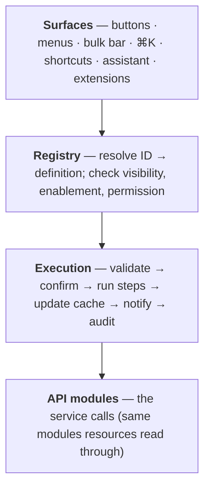

Five rules. **One path**: every surface calls `runCommand`; no component calls a write endpoint. **Stable IDs**: `resource.verb` (`order.cancel`); renaming an ID breaks shortcuts, extensions and assistant history. **Availability is data**: visibility and enablement are functions of context, not `if`s in components. **The assistant gets no special path**: the same permissions, confirmation and audit as a person; it proposes, the person approves. **Commands own orchestration**: multi-call writes are steps inside the command, never sequenced in UI code.

### 7.1 The command contract

```ts
type CommandId = `${string}.${string}`;          // "order.cancel"

interface CommandDefinition<TInput, TResult> {
  // ── Identity ────────────────────────────────────────────
  id: CommandId;
  resource: string;                              // groups commands in ⌘K, permissions, assistant topics
  label: string | ((ctx: CommandContext) => string);
  description: string;                           // one line; ⌘K and assistant
  icon?: IconName;
  keywords?: string[];                           // ⌘K matching
  shortcut?: string;                             // "mod+s"; scoped to screens where the command is visible

  // ── Input ───────────────────────────────────────────────
  input: ZodType<TInput>;                        // validated before every run, from every surface
  fromContext?: (ctx: CommandContext) => Partial<TInput>;   // selected IDs, current record
  form?: InputFormSpec<TInput>;                  // fields the user still has to give (cancel reason, tags)

  // ── Availability ────────────────────────────────────────
  scope: Scope | Scope[];                        // order.archive works on a record and a selection
  visible?: (ctx: CommandContext) => boolean;    // shown at all ("when")
  enabled?: (ctx: CommandContext) => true | string;   // true, or why not (shown as tooltip)
  permission: Permission;
  capability?: string;                           // feature flag; off = command does not exist

  // ── Safety ──────────────────────────────────────────────
  effect: {
    readOnly: boolean;                           // export, view in store: no data change
    destructive: boolean;                        // delete, cancel: can't be undone
    idempotent: boolean;                         // safe to retry with the same input
    external: boolean;                           // reaches customers, money or other systems (refund, notify)
  };
  confirm: 'never' | 'always' | ((input: TInput, ctx: CommandContext) => ConfirmSpec | false);
  preview?: (input: TInput, deps: CommandDeps) => Promise<unknown>;   // server dry run (refund calculate, order-edit preview)

  // ── Execution ───────────────────────────────────────────
  mode?: 'pessimistic' | 'optimistic' | 'undoable';   // required unless effect.readOnly
  steps: Step<TInput>[];                         // one step for most commands
  idempotencyKey?: boolean;                      // a fresh key per attempt, placed by the API module
  timeoutMs?: number;

  // ── After ───────────────────────────────────────────────
  invalidates: (input: TInput, result: TResult) => QueryKey[];
  updates?: (input: TInput, result: TResult) => CacheUpdate[];   // set detail from the response
  optimistic?: (input: TInput) => CacheUpdate[];                 // optimistic | undoable
  undo?: { command: CommandId; input: (input: TInput, result: TResult) => unknown };
  onSuccess?: { toast?: (result: TResult, input: TInput) => string | false; navigate?: (result: TResult, input: TInput) => string };

  // ── Bulk and long-running ───────────────────────────────
  bulk?: BulkSpec<TInput>;
  job?: JobSpec<TResult>;                        // import / export: command returns when the job starts
  poll?: PollPolicy & { query: (result: TResult) => Promise<unknown>; done: (status: unknown) => boolean };

  // ── Exposure ────────────────────────────────────────────
  expose: {
    palette: boolean;
    assistant: false | { topic: string; instructions?: string };
    extensions: false | { targets: ('record' | 'selection')[] };
  };
}

type Scope = 'record' | 'selection' | 'page' | 'global';

interface Step<TInput> {
  id: string;                                    // "createOrder", "redeemDiscount", "markDraftCompleted"
  run: (input: TInput, prev: StepResults, deps: CommandDeps) => Promise<unknown>;
  compensate?: (input: TInput, output: unknown, deps: CommandDeps) => Promise<void>;
  onFailure: 'abort' | 'continue-with-warning';  // abort → compensate earlier steps in reverse
}

interface CommandDeps {
  api: ApiModules;                               // api/<service> modules, injected (tests swap them)
  session: { staff: { id: Id; name: string }; storeId: Id };
  signal: AbortSignal;                           // from timeoutMs and cancel
  idempotencyKey?: string;                       // this attempt's key
}

interface CommandContext {
  storeId: Id;
  staff: { id: Id; name: string };
  can: (scope: Permission) => boolean;           // unmapped scopes pass while enforcement is off
  route: string;
  record?: unknown;
  selection?: { resource: string; ids: Id[]; rows: unknown[] };
  surface: 'button' | 'row' | 'bulk' | 'palette' | 'shortcut' | 'assistant' | 'extension';
  confirmed?: boolean;                           // a flow's review step or an approved proposal already confirmed
}

interface ConfirmSpec { title: string; body?: string; confirmLabel: string; tone: 'default' | 'critical' }

type CommandResult<TResult> =
  | { status: 'success'; data: TResult; warnings?: string[] }
  | { status: 'partial'; data: TResult; failed: { id: Id; reason: string }[] }   // bulk
  | { status: 'invalid'; fieldErrors: Record<string, string> }                   // userErrors
  | { status: 'denied'; reason: string }
  | { status: 'cancelled' }                                                      // user dismissed confirm
  | { status: 'error'; message: string; retryable: boolean };
```

Design notes. `visible` hides what makes no sense here (Unarchive on an open order); `enabled` disables, with a reason, what makes sense but cannot run now (Refund on a COD order). `effect` sets defaults: destructive means a critical confirm; external means confirm and audit; non-idempotent means never retried automatically; and the same four flags become the assistant tool annotations (`readOnlyHint`, `destructiveHint`, `idempotentHint`, `openWorldHint`). If `fromContext` gives complete input, the command runs after any confirm; if not, its form opens, and the assistant fills the same form so the user sees it before approving. Endpoints live only in API modules: steps call their functions through `deps`, and surfaces know IDs and inputs, never URLs. There is one result type for every command, so every surface handles success, field errors, partial bulk results and failures the same way.

### 7.2 Execution: the nine steps of `runCommand`

Every command, from every surface, runs through `runCommand(id, input?, ctx)`.

1. **Resolve**: ID to definition. Ends as not found when the ID is unknown or its capability is off.
2. **Availability**: visible? permitted? enabled? Ends as `denied`, with the reason.
3. **Input**: `fromContext` plus the caller's input; a form if incomplete; schema validation. Ends as `invalid`.
4. **Confirm**: policy from the definition, the effect flags and the surface; a dialog; skipped when the caller passes `confirmed`. Ends as `cancelled` when dismissed.
5. **Optimistic**: apply cache updates in the optimistic and undoable modes.
6. **Run**: steps in order; idempotency key; timeout.
7. **Settle**: on success set the detail cache and invalidate keys; on failure roll back the optimistic update and compensate finished steps in reverse. Ends as `success`, `partial` or `error`.
8. **Feedback**: toast (with Undo when undoable), field errors to the form, navigate.
9. **Audit**: one event with the command, an input summary, the staff member, the surface, the result and the duration.

A sketch of the executor, with the pieces our tracker added (the passbook breadcrumb and the request id, Part 13) in place:

```ts
// commands/runCommand.ts
export async function runCommand<I, R>(id: CommandId, input: Partial<I> | undefined, ctx: CommandContext): Promise<CommandResult<R>> {
  const def = registry.get(id);
  if (!def || (def.capability && !flags.isOn(def.capability))) return { status: 'error', message: 'Unknown command', retryable: false };

  if (def.visible && !def.visible(ctx)) return { status: 'denied', reason: 'Not available here' };
  if (!ctx.can(def.permission)) return { status: 'denied', reason: 'You do not have permission' };
  const enabled = def.enabled?.(ctx) ?? true;
  if (enabled !== true) return { status: 'denied', reason: enabled };

  const merged = { ...def.fromContext?.(ctx), ...input };
  const complete = def.form && !isComplete(merged, def) ? await openForm(def.form, merged) : merged;
  if (complete === undefined) return { status: 'cancelled' };
  const parsed = def.input.safeParse(complete);
  if (!parsed.success) return { status: 'invalid', fieldErrors: toFieldErrors(parsed.error) };

  if (!ctx.confirmed) {
    const spec = confirmSpecFor(def, parsed.data, ctx);           // policy in 7.3
    if (spec && !(await confirm(spec))) return { status: 'cancelled' };
  }

  const key = def.idempotencyKey ? newIdempotencyKey() : undefined;
  const deps: CommandDeps = { api, session: sessionFor(ctx), signal: timeoutSignal(def.timeoutMs), idempotencyKey: key };
  const rollback = def.optimistic ? applyOptimistic(def.optimistic(parsed.data)) : undefined;

  breadcrumb('command.start', { id, surface: ctx.surface, targets: targetIds(parsed.data) });   // passbook
  const done: { step: Step<I>; out: unknown }[] = [];
  try {
    const prev: StepResults = {};
    for (const step of def.steps) {
      try { prev[step.id] = await step.run(parsed.data, prev, deps); done.push({ step, out: prev[step.id] }); }
      catch (e) {
        if (step.onFailure === 'continue-with-warning') { prev[step.id] = { warning: messageOf(e) }; continue; }
        for (const d of done.reverse()) await d.step.compensate?.(parsed.data, d.out, deps);
        throw e;
      }
    }
    const result = toResult<R>(prev);
    applyUpdates(def.updates?.(parsed.data, result.data)); invalidate(def.invalidates(parsed.data, result.data));
    feedback(def, result, parsed.data); audit(def, ctx, result, key);
    return result;
  } catch (e) {
    rollback?.();
    const result = api.errorsFor(def.resource).toResult(e);        // 7.8
    feedback(def, result, parsed.data); audit(def, ctx, result, key);
    return result;
  }
}
```

### 7.3 Availability and confirmation policy

Availability is evaluated per context, cheaply and without network. A capability flag off means the command is not registered. `visible` false means not shown. A missing permission means not shown in menus and `denied` if called directly by the assistant or an extension. An `enabled` reason means shown disabled with that reason. The server remains the final authority; a passed client check is a UX hint, not security.

Confirmation is required when `confirm` is `'always'` or returns a `ConfirmSpec`; when `effect.destructive` (critical tone); when `effect.external` (customer-facing, money, other systems); for bulk above 25 items (proposed default), with the count in the label. When the surface is `assistant` and the command is not read-only, the approved proposal card is the confirm. When the command is run from a flow's review step or its own form (refund review, wizard finish, send invoice, tracking, order edit save), that step or form is the confirm. Everything else runs without a dialog. Confirm labels state the action and count ("Archive 12 orders"), never "OK".

### 7.4 Modes

**Pessimistic** waits for the server, then updates the UI; it is the default and is used for money, stock and status changes with server rules. **Optimistic** updates the UI now and rolls back on failure; it is used for cheap reversible edits such as tags and notes. **Undoable** updates the UI now and shows a toast with Undo that runs the inverse command; no v1 command uses it because none has an inverse.

### 7.5 Steps, compensation, idempotency, retry

Steps run in order and a step's output is available to later steps. On failure in an `abort` step, earlier steps with `compensate` are undone in reverse order and the result is `error` with the failed step named. Steps without compensation (irreversible) are placed as late as possible; if a later step fails, the result says what already happened ("Order created; draft not marked completed") and offers a retry of the remaining steps. `continue-with-warning` steps never fail the command; their failure becomes a warning in the result.

The idempotency key is generated per attempt (when the dialog opens, or per user action) and reused for that attempt's retries; this prevents double refunds on a double click or a flaky network. As today it applies to refunds, bulk archive, draft completion and v3 inventory writes; bulk-ops takes none. Automatic retry happens only for idempotent commands, on network errors and 5xx, two retries with backoff, as for reads. The same command for the same target cannot run twice at once; a second call while the first is running is ignored.

### 7.6 Cache, feedback, audit

`updates` set the detail cache from the response with no refetch; `invalidates` mark lists and related resources stale, and visible queries refetch; optimistic changes are recorded and rolled back exactly on failure.

Feedback by result: `success` shows a toast (or none for silent saves) and navigates if defined; `success` with warnings shows a warning-toned toast listing them; `partial` shows a summary ("10 archived, 2 failed") with the failed items and Retry failed; `invalid` puts errors on the form fields, with a toast only if no field matches; `denied` shows the reason in a toast, the button having already been disabled where possible; `error` shows the server message when meaningful, else a generic one, with Retry if retryable.

Each run emits one PostHog event: command ID, resource, target IDs (not the full input), the actor (`{ type: 'staff' | 'app' | 'assistant' | 'system'; id?; name? }`), the surface, the result status and the duration. Assistant runs also record the conversation ID and the approved proposal. A staff-visible activity log can later use the Audit Service that gk-pages already writes field-level changes to (open question 15).

### 7.7 Bulk operations and background jobs

A bulk command acts on a selection with one API call carrying all IDs. Long work is a page-level job.

```ts
interface BulkSpec<TInput> { maxItems?: number; toItems: (input: TInput) => Id[] }

interface JobSpec<TResult> {
  start: (input: unknown) => Promise<{ jobId: Id }>;
  poll: (jobId: Id) => Promise<JobStatus<TResult>>;
  policy: PollPolicy;
  cancel?: (jobId: Id) => Promise<void>;
}
type JobStatus<TResult> =
  | { state: 'queued' | 'running'; progress?: { done: number; total: number } }
  | { state: 'completed'; result: TResult }
  | { state: 'failed'; error: string; rows?: { row: number; error: string }[] }
  | { state: 'cancelled' };
```

Per-item outcomes are used when the API returns them (bulk cancel, tags, archive, fulfill, draft delete); count-only APIs (product bulk delete and update) succeed or fail as a whole. A bulk command never reports plain success if some items failed: the result is `partial` with each failed ID and reason, the UI shows the summary, keeps failed items selected and offers Retry failed, which runs the same command with only those IDs. Harmless per-item conditions (already archived) are warnings. After the command, the selection clears on success and keeps failed items on partial.

A job runs in the background; the user can leave the page; progress shows in the top-bar jobs indicator and a toast when it ends (the Jobs machine). Bulk-ops jobs have a preview step before they run, as two commands: `*.importPreview` then `*.import` (row errors), `*.exportPreview` then `*.export` (estimate); the Import and Export machines run them for every resource. Export results are emailed for bulk-ops jobs and downloaded for inventory and customer exports. Job history is a read-only resource. Some single commands finish asynchronously (a refund is accepted, then processed): the command returns once accepted and declares `poll`, the flow's machine runs it, and the UI shows initiated, then completed or failed. Only one bulk command or job per resource and selection runs at a time from the same user; lists affected by a running job show a notice and refetch when it completes.

### 7.8 Errors from the server

API modules map `ApiError` and soft failures to the result type. A validation error with a field becomes `invalid` with field paths in domain names. A 403 becomes `denied`. A 409 with a version or `COMPARE_AND_SET_CONFLICT` becomes `error` with "changed elsewhere", and the editor offers reload. Another 409 (a business rule, such as a location having stock) becomes `error` with the server message. A known harmless business code (`ALREADY_ARCHIVED`) becomes `success` with a warning. A 2xx body with `success: false` becomes `error` and is never shown as success. A 401 means session expired and the session machine sends the user to login. 5xx and network become `error`, retryable.

### 7.9 Surfaces: how each finds and runs commands

Every surface asks the registry "which commands apply here?" and calls `runCommand`; none has its own write logic. The **page header** uses the resource's `commands.page` with the route as context, primary action rightmost. The **record header** uses `commands.primary` plus `commands.more` with the record as context; both can change with record status. The **row menu** uses `commands.row` with the row as context, only `scope: 'record'` commands. The **bulk bar** uses `commands.bulk` with the selection, counts in labels, and conditional commands check the whole selection. The **editor save bar** uses `editor.save` with the record and draft, Save and Discard, and `mod+s`. The **command palette** sees all palette-exposed, visible, permitted commands with route, record and selection. **Shortcuts** come from `shortcut` on visible commands, scoped to the current screen and shown in menus and the palette. The **assistant** sees assistant-exposed commands by topic with route, record, selection and filters. **Extensions** see extension-exposed commands with a record or a selection.

The palette orders commands for the current record or selection first, then the current resource, then global navigation and search results; it matches on label, keywords and resource name; disabled commands show with their reason instead of disappearing; a command that needs input opens its form inside the palette or as a dialog; recent commands are remembered per user. Shortcuts are bound to command IDs, scoped to the screens where the command is visible, and never fire inside text inputs unless they use a modifier. The v1 bindings are `mod+k` (open palette), `mod+s` (save the open editor), `j` / `k` (previous and next order on order detail) and `?` (list shortcuts).

### 7.10 The assistant as a surface

Tools are generated from commands with `expose.assistant`:

```
name         command ID ("order.cancel")
description  description + topic instructions
inputSchema  JSON schema from the command's input
annotations  readOnlyHint      ← effect.readOnly
             destructiveHint   ← effect.destructive
             idempotentHint    ← effect.idempotent
             openWorldHint     ← effect.external
```

Read tools come from resources (list, get, search) with their `assistant.readableFields`. Commands are grouped by topic (orders, catalog, inventory, customers, discounts); the assistant gets the tools of the topic in play plus read tools, not every command at once, which keeps choices precise.

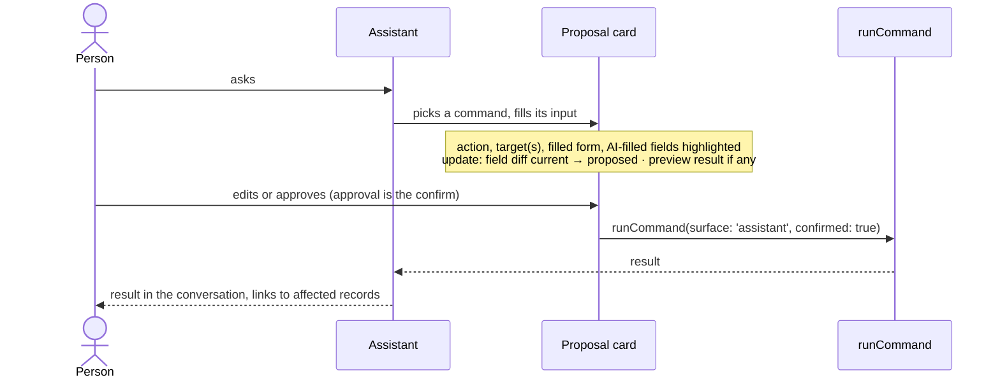

No write runs without the person's approval in that conversation. The assistant can only propose what the person may do (same permissions, enablement and capability). Bulk proposals list the target records before approval. One command per proposal in v1; multi-step plans (approve once, run in order, stop at the first failure) come later. Every assistant run is audited with the conversation and the approved proposal.

Installed apps can add commands and call allowed ones. An app registers commands for a target, `record` (a details page More menu) or `selection` (an index page bulk bar), with a should-render check per record; they appear like built-in commands and run inside the extension sandbox. An app can call built-in commands exposed to extensions through the same `runCommand`, with the app as the actor and the merchant's confirmation for anything not read-only.

### 7.11 The command registry

All v1 commands by resource. Permission is `write_<resource>` for every command except refunds (`write_refunds`); enforcement is off in v1.

```
product        create · update · updateVariant · delete · bulkDelete · setStatus · bulkEdit · duplicate · copyLink
               import · importPreview · export · exportPreview · generateContent
collection     create · update · delete · bulkDelete · setPublished · bulkEdit · copyLink
priceSchedule  create · cancel
fieldDefinition create · update · delete
inventory      adjust · bulkEdit · import · export
location       create · update · activate · deactivate · delete
inventoryLevel connect · disconnect
purchaseOrder  create · update · markOrdered · close · reopen · openReceive · receive · delete · createFromSelection
transfer       create · update · markPending · openReceive · receive · delete · createFromSelection
order          updateNote · comment · addTags · removeTag · bulkTags · updateContact · update · cancel · bulkCancel
               archive · unarchive · duplicate · openStatusPage · fulfill · updateTracking · hold · releaseHold · bulkFulfill
               import · importPreview · export · exportPreview
refund         create
orderEdit      begin · stage · discard                     (internal: run only by the order edit machine)
draftOrder     create · update · complete · sendInvoice · duplicate · delete · bulkDelete · bulkTags · export · createForCustomer
customer       create · update · deleteAddress · setBlocked · delete · comment · export
segment        create · update · delete
discount       create · update · publish · moveToDraft · markInactive · createWithAssistant · aiConfirm
discountSet    create · update · downloadCodes
bulkOps        cancel
```

### 7.12 Worked examples

**A destructive, external command with a form.** `order.cancel` is scoped to a record, visible by `canCancel`, with a form for the reason, staff note, restock, notify and auto-refund (offered only when `autoRefundEligible`), a critical confirm "Cancel order {name}?" with "Keep order" as the dismiss label, and invalidation of the order, timeline, inventory and refunds.

```ts
// commands/order.ts
export const cancel = defineCommand<CancelOrderInput, Order>({
  id: 'order.cancel', resource: 'order',
  label: 'Cancel order', description: 'Cancel this order and optionally restock and refund.',
  input: CancelOrderInput,                                        // { orderId, reason, staffNote?, restock, notify, autoRefund? }
  fromContext: (ctx) => ({ orderId: (ctx.record as Order)?.id, restock: true, notify: true }),
  form: [reasonField, staffNoteField, restockField, notifyField, autoRefundField],
  scope: 'record',
  visible: (ctx) => canCancel(ctx.record as Order),
  permission: 'write_orders',
  effect: { readOnly: false, destructive: true, idempotent: false, external: true },
  confirm: (i, ctx) => ({ title: `Cancel order ${(ctx.record as Order).name}?`, confirmLabel: 'Cancel order', tone: 'critical' }),
  mode: 'pessimistic',
  steps: [{ id: 'cancel', onFailure: 'abort', run: (i, _p, d) => d.api.osOrder.cancelOrder(i, { signal: d.signal }) }],
  invalidates: (i) => [orderKeys.detail(i.orderId), orderKeys.lists(), timelineKeys.for('ORDER', i.orderId), inventoryKeys.all, refundKeys.for(i.orderId)],
  onSuccess: { toast: (_r, i, ctx) => `Order ${(ctx.record as Order).name} has been cancelled` },
  expose: { palette: true, assistant: false, extensions: false },  // money-moving and destructive order commands stay off the assistant in v1
});
```

**A multi-step command with a partial result.** `customer.create` posts the customer, then the default address, then the others. If step 2 fails after step 1, the customer exists; the result reports which addresses failed and offers retry for them, and the customer is never deleted.

```ts
export const create = defineCommand<CustomerInput, Customer>({
  id: 'customer.create', resource: 'customer', /* … */
  steps: [
    { id: 'createCustomer', onFailure: 'abort',
      run: (i, _p, d) => d.api.osCustomer.createCustomer(i, { signal: d.signal }) },
    { id: 'createAddresses', onFailure: 'continue-with-warning',
      run: async (i, prev, d) => {
        const c = prev.createCustomer as Customer;
        const ordered = [...i.addresses].sort((a) => (a.isDefault ? -1 : 1));
        const failed: { id: Id; reason: string }[] = [];
        for (const a of ordered) {
          try { await d.api.osCustomer.createAddress(c.id, a, { signal: d.signal }); }
          catch (e) { failed.push({ id: a.id, reason: messageOf(e) }); }
        }
        return { failed };
      } },
  ],
  onSuccess: { toast: () => 'Customer created', navigate: (c) => `/customers/${c.id}` },
  /* … */
});
```

**A command with a server preview and a poll.** `refund.create` runs inside the refund machine. `preview` is `POST /refunds/calculate`, shown in the review step, which is the confirm. The write is one step with `notify_customer: true` and the `x-idempotency-key` header, followed by a poll of `GET /refunds/:id` every 5 seconds up to 24 times until the status is success or failed.

```ts
export const createRefund = defineCommand<RefundInput, Refund>({
  id: 'refund.create', resource: 'order', permission: 'write_refunds',
  input: RefundInput,                                             // { orderId, lines, includeShipping, reason?, note?, restock }
  scope: 'record',
  visible: (ctx) => (ctx.record as Order).status !== 'cancelled',
  enabled: (ctx) => refundBlockReason(ctx.record as Order) ?? true,
  effect: { readOnly: false, destructive: false, idempotent: true, external: true },
  confirm: 'never',                                               // the review step in the refund machine is the confirm
  preview: (i, d) => d.api.osOrder.calculateRefund(i, { signal: d.signal }),
  idempotencyKey: true,
  mode: 'pessimistic',
  steps: [{ id: 'refund', onFailure: 'abort', run: (i, _p, d) => d.api.osOrder.createRefund(i, { signal: d.signal, idempotencyKey: d.idempotencyKey }) }],
  poll: { intervalMs: 5000, maxAttempts: 24, maxConsecutiveErrors: 5, pauseWhenHidden: true,
          query: (r) => api.osOrder.getRefund(r.id), done: (s) => ['success', 'failed'].includes((s as Refund).status) },
  invalidates: (i) => [orderKeys.detail(i.orderId), refundKeys.for(i.orderId), timelineKeys.for('ORDER', i.orderId), inventoryKeys.all],
  onSuccess: { toast: (r) => `Refund of ${formatMoney(r.amounts.total)} initiated` },
  expose: { palette: true, assistant: false, extensions: false },
});
```

**A command with prechecks and an idempotent server contract.** `draftOrder.complete` requires the draft to be saved and clean ("Save the draft before creating an order."), a customer when a coupon is applied ("Please select customer to redeem discount"), sends COD as `payment_pending` with `payment_method: 'cod'`, uses one `idempotency_key` per mounted button so a retry returns the existing order (`reused: true`), and handles `DRAFT_COMPLETION_DISCOUNT_REMOVED` by re-reading the draft and showing a warning with no order created.

**Status commands on one endpoint.** `discount.publish`, `discount.moveToDraft` and `discount.markInactive` are three commands over one call, `PUT /bulk/update` with a status; each is offered except the current status; publish and mark inactive are external (customer-facing) and confirm; the gateway has no delete route, and delete stays out of v1 because the menu item is disabled in gk-pages today.

**An inventory command that branches on an error code.** `location.deactivate` calls deactivate; on `LOCATION_HAS_STOCK_MOVE_FIRST` it opens a "Move stock and deactivate" form (an active destination different from the source, plus a note) and retries with `drain_to`; it is hidden for the default location; the toast reads either "Location deactivated" or "Moved N units across M SKUs to X. Location deactivated."

**Create with the assistant.** `discount.createWithAssistant` uses the existing os-discount AI session API inside the assistant panel: create a session, send a message, optionally select from offered choices, receive a reply with a draft id and form values that opens the legacy v1 form filled with AI-filled fields highlighted, and save with the v1 create. When the session proposes an action (publish, modify live, bulk action), `POST /sessions/:id/confirm { action_token }` writes on the server, so it runs as `discount.aiConfirm` behind the proposal card; a 410 means "That confirmation expired. Ask again." Bundle and dynamic-tier drafts are refused, as today.

### 7.13 Exposure policy

Which commands each surface may see is itself declared, and the pattern is consistent: create, update and the non-destructive record actions are exposed to the palette, the assistant (by topic) and extension record targets; delete, bulk delete, import, cancel and money-moving commands are palette-only. Commands that change on-hand stock are not exposed to the assistant in v1. Money-moving and destructive order commands (cancel, bulk cancel, refund, draft complete, draft delete) are not exposed to the assistant in v1. `fieldDefinition.create` is the only field-definition command the assistant sees. `priceSchedule.*` is palette-only.

### 7.14 Defects in today's writes

Found while mapping gk-pages. Plumbing defects are fixed in the commands; defects that change the data sent to the backend need product sign-off before the fix ships, and until then the command keeps today's behaviour behind one switch. Fixed in the commands: the discount wizard always showing success because `makeAPICall` soft failures were not checked (the result now checks the success flag); single product and collection delete without confirmation (critical confirm added); price schedule conflicts (`interferingTasks`) not shown (now shown in the error); inventory export errors using `alert()` (standard error result). Needing sign-off because they change data: product bulk edit converting product-level prices to paise twice (prices multiplied by 100; high priority); purchase order close and reopen converting already-paise costs again; purchase order update sending the header `totalCost` in rupees; bulk cancel sending auto-refund without the single-cancel eligibility rule. Not in v1: discount delete (the menu item is disabled today).

---

## Part 8. Layer 5: orchestration (state machines)

XState v5 is used for flows that have steps, not for every screen. A machine is used when the flow has three or more distinct steps, or would otherwise need three or more booleans, or the next step depends on an async result, a timer or a user decision. Lists, records and single commands do not need one; the query cache and `runCommand` cover them. Three booleans give eight combinations, five of them nonsense, and the nonsense states are where double-save bugs live; a machine has one dial, and while the flow is in `saving` there is no transition for SAVE, so a second click is ignored by design.

### 8.1 Rules

- **Events, not watchers.** User actions and actor results are events. What cannot send events (the URL, tab visibility, other tabs) is wrapped in one subscription actor that sends a named event. No `useEffect` chains for async work.
- **One state per distinct outcome.** A state exists only if it allows different events, exits or UI; failures with the same exits share a state.
- **Every async state has a way out:** a timeout (`after`) or a limit, an error state, and RETRY or CLOSE.
- **Ids, not copies.** Context holds ids and flow choices; server data stays in the query cache, form values in the form.
- **Actors call contracts only:** `runCommand` and resource queries, with the actor's `signal`; Session and Login also call platform session. The idempotency key is created on entering the submit state and reused for its retries; changed input gets a new key.
- **Flow-owned confirm.** A review state (refund review, wizard finish, assistant proposal) is the confirm: the machine runs the command with `confirmed: true`.
- **UI reads tags.** One hook per machine returns plain values and senders; components never import XState.
- **Lifetime.** Page machines start with their route, drawer or dialog and stop when it closes, aborting their actors. App-wide machines live at the root with a `systemId`. A store switch stops everything merchant-scoped.
- **Tests:** `createActor(machine.provide({ actors }))` with fake timers, one test per transition. Entering a failure state or abandoning a flow is a PostHog event.

### 8.2 App-wide machines

One instance each, at the app root: Session (the one source of `storeId`), Jobs (a parent with one child per running job) and Assistant (the os-discount AI session runs as its child).

**Session.** `GET /user/details` is both the session check and the user load. Routes render only in Ready. Logout and login reach other tabs; the store stays per tab (open question 21).

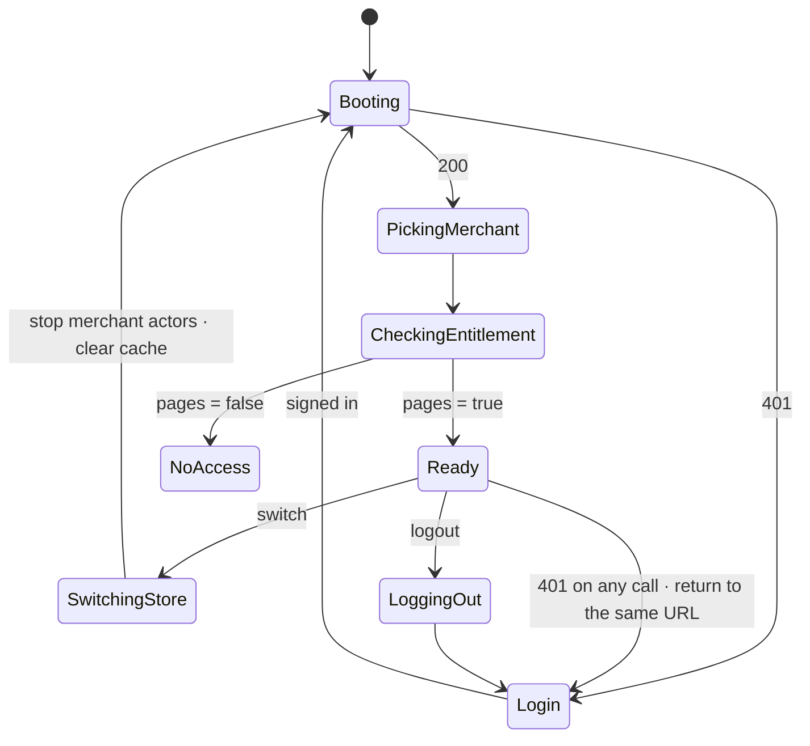

**Jobs.** Import and Export send `TRACK` with the `jobId` and the command's `JobSpec`; the child follows its poll policy. The top-bar jobs indicator reads the children; a toast fires when a job ends because notifications are off; job history stays on the server.

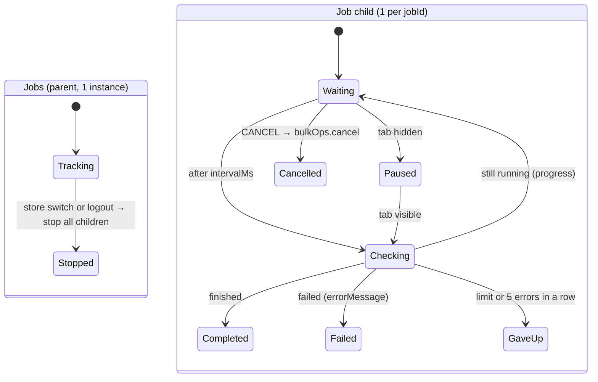

**Assistant.** Each reply carries its session id; a reply for an older session is dropped. Approve is blocked while a turn is in flight. Error replies: 409 still thinking, 429 rate limit with retry-after, 503 unavailable; an expired confirmation (410) asks again.

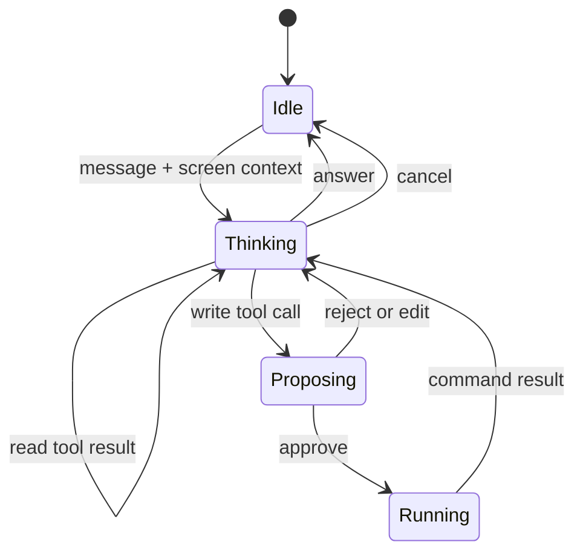

### 8.3 Page machines

Start with their route, drawer or dialog; stop when it closes.

**Login** calls the platform session endpoints; resend is allowed after 30 seconds; a signin 400 "otp already sent" counts as sent.

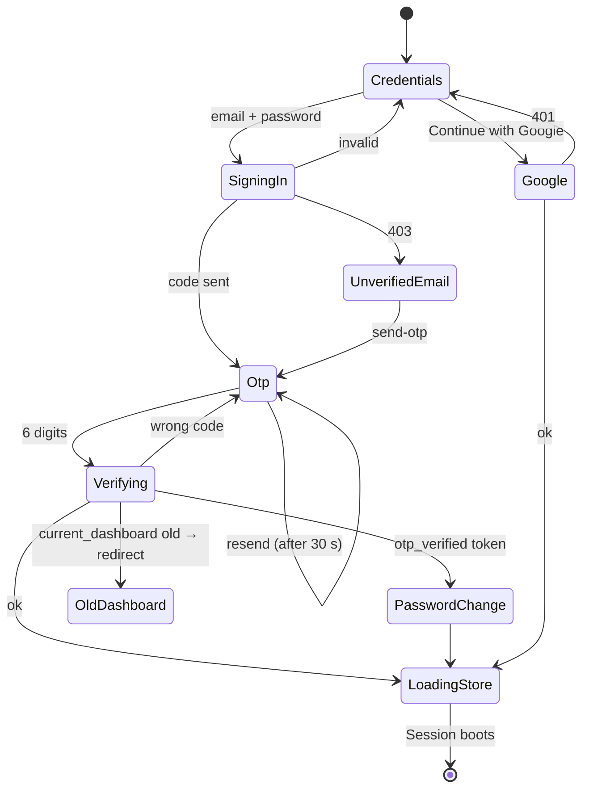

**Record save** runs the editor's `save` command. Dirty and valid stay in the form; the machine only runs the save. A SAVE during Saving queues one follow-up that uses the latest values. Partial comes from steps and compensation. Conflict offers reload only, no force save.

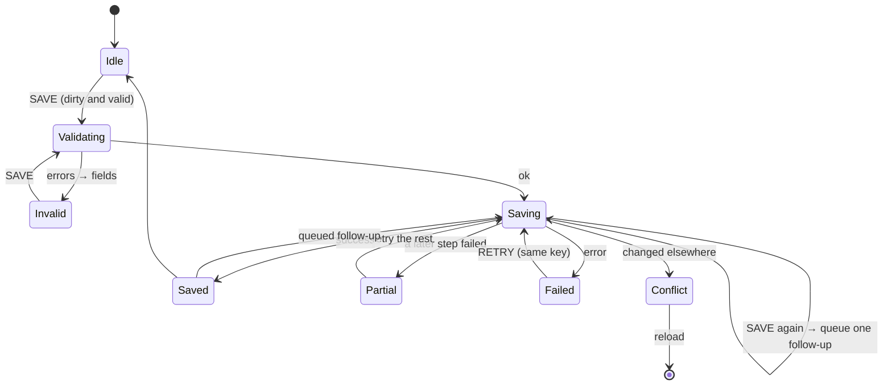

**Refund** runs `refund.create` with calculate as the preview; debounce 300 ms; poll 5 s × 24. StillProcessing says "Refund {id} is being processed… you can close this drawer and check back later" and invalidates the order; closing leaves the refund running on the server.

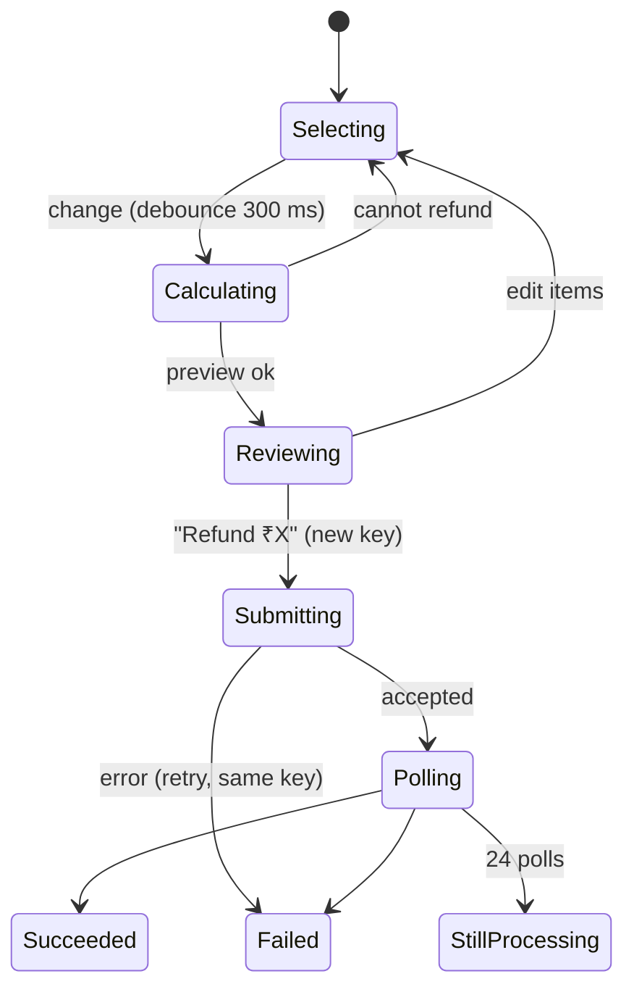

**Order edit session** runs `orderEdit.begin`, `stage` and `discard`, queries `orderEdit.preview` and `orderEdit.session`, and saves with `order.update`. Stage is debounced 500 ms; a stale-session retry runs every 15 s for up to 6 minutes. A version-stale error on stage, preview or commit re-reads the session and retries once. Commit is refused until the preview matches the latest change. Leaving asks first; page close discards with a `keepalive` fetch. The full code list that drives these transitions (`ACTIVE_SESSION_EXISTS`, `STALE_SESSION_COLLISION`, `SESSION_STATE_VERSION_STALE`, `SESSION_EXPIRED`, `ORDER_MODIFIED_SINCE_SESSION_START`, `ORDER_FULFILLMENT_CHANGED_SINCE_SESSION_START`, `SESSION_REAPED_DURING_COMMIT` and the stage rejections) is in the os-order gateway page.

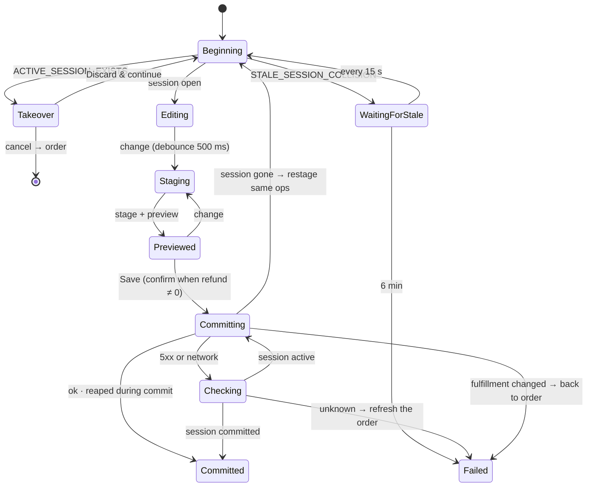

**Discount wizard** queries the discount and `codeUnique`, and runs `discount.create` or `update`. Continue validates that step's fields; Back goes one step back; steps cannot be skipped. LoadFailed never saves defaults over the discount.

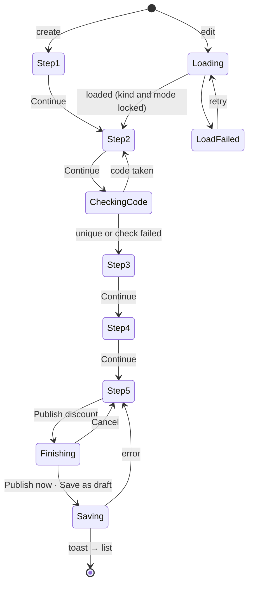

**Draft payment watch** polls the draft order detail every 8 s for up to 30 minutes while the draft has a live payment link, pauses when the tab is hidden and checks at once on return, gives up after 5 consecutive errors, and on conversion shows a banner that opens the order ("Payment received — order created. Your unsaved changes cannot be applied." when there are unsaved edits).

**Import** and **Export** are one machine each, configured by the command's `JobSpec`, for every resource. Import: Choosing, Previewing, Invalid (row errors) or Ready (jobId), Starting on "Start import" (the confirm), then TRACK to Jobs. Export: Configuring (groups, date range, format), Previewing, Ready (jobId plus estimate), Starting, then TRACK to Jobs or a direct file download. A previewed job that is never started stays on the server, because bulk-ops cancels only running jobs. Page-scope exports are built in the browser; customer "all" is a job; inventory "all" is a file download.

### 8.4 Other orchestration

The **leave guard** covers every editor, the order edit and the wizard: a router blocker plus `beforeunload` while the form is dirty or the machine has the tag `unsaved`, asking "Discard unsaved changes?" with Discard and Keep editing. The **save bar** is one bar per page, Save and Discard and `mod+s`, from form state and Record-save tags. The **toast queue** is ordered, deduplicated by key, with Retry where the result is retryable. The **assistant bridge** sends screen context, and an approved proposal runs as `runCommand(…, { surface: 'assistant', confirmed: true })`.

### 8.5 Poll policy

```ts
interface PollPolicy {
  intervalMs: number;
  maxAttempts?: number;
  maxDurationMs?: number;
  maxConsecutiveErrors: number;   // default 5
  pauseWhenHidden: boolean;       // default true; checks at once on return
}
```

These are the rules for asking the server "done yet?", not the job's data; they are used by command `poll` and by `JobSpec`. Running out ends in a state that tells the user, never silently. The v1 polls: refund status every 5 s for 24 attempts; bulk-ops job progress every 5 s with no limit today; customer export every 3 s for 20 attempts; draft payment every 8 s for 30 minutes; order-edit stale session every 15 s for 6 minutes.

### 8.6 File layout and a test

```
machines/refund/
  machine.ts   # states and transitions only
  actors.ts    # async work (resource queries, runCommand), replaceable in tests
  actions.ts   # pure assign helpers
  types.ts     # context and events
  index.ts     # useRefund(): plain values + senders; components never import XState
machines/jobs/
  machine.ts   # parent: spawns one jobMachine per TRACK
  jobMachine.ts
```

```ts
// machines/refund/machine.test.ts
it('moves from Submitting to Polling when the refund is accepted', () => {
  vi.useFakeTimers();
  const actor = createActor(refundMachine.provide({
    actors: { submit: fromPromise(async () => ({ id: 'rf_1', status: 'pending' })), poll: fromPromise(async () => ({ status: 'pending' })) },
  }), { input: { orderId: 'o_1' } }).start();
  actor.send({ type: 'CHANGE', lines: [{ lineItemId: 'li_1', quantity: 1 }] });
  vi.advanceTimersByTime(300);
  actor.send({ type: 'REVIEW_OK' });
  actor.send({ type: 'SUBMIT' });
  return vi.waitFor(() => expect(actor.getSnapshot().matches('Polling')).toBe(true));
});
```

---

## Part 9. Layer 6: surfaces

What the user sees and touches. Pages are built from contracts, not written per resource: a resource's configuration picks the template, and machines drive flows.

### 9.1 Routing (d09, d10)

URLs are `/store/$storeId/…`; the `/gk-pages` prefix only existed for Single-SPA mounting and is dropped. Old dashboard URLs redirect at cutover.

```
/login
/pick-store                            store picker (Session machine)
/no-access
/store/$storeId                        home
/store/$storeId/products               list      ┐ generated from the
/store/$storeId/products/$id           editor    │ resources registry
/store/$storeId/products/new                     ┘
/store/$storeId/orders/$id/edit        flow (hand-written)
/store/$storeId/apps/$handle/*         embedded app
/store/$storeId/…?settings=<tab>       settings sheet over any page
*                                      404
```

Keeping the store in the URL keeps deep links, shared links and one-store-per-tab working. The document title is `{record} · {page} · {store}`. Page views go to PostHog by route template (`/store/$storeId/orders/$id`), never with raw ids. For old URLs, a rule at the dashboard host's edge maps `/gk-pages/*` to the same path on the new origin, keeping query and hash, as a 302 and then a 301 once cutover holds; it stays for a few months and is then removed.

A route-tree sketch with TanStack Router, showing generated routes and a hand-written flow route side by side:

```ts
// routes/store.$storeId.tsx — the merchant-scoped layout
export const Route = createFileRoute('/store/$storeId')({
  beforeLoad: ({ params }) => session.ensureStore(params.storeId),     // switches first if another allowed store
  component: AppFrame,
});

// routes/generated.ts — list, editor and detail routes from the registry
for (const r of resources.all()) {
  routes.push(createRoute({ getParentRoute: () => storeRoute, path: r.routes.list,
    validateSearch: listSearchSchema(r), component: () => <ListPage resource={r} /> }));
  if (r.routes.detail) routes.push(createRoute({ getParentRoute: () => storeRoute, path: r.routes.detail,
    component: () => (r.editor ? <EditorPage resource={r} /> : <DetailPage resource={r} />) }));
  if (r.routes.create) routes.push(createRoute({ getParentRoute: () => storeRoute, path: r.routes.create, component: () => <EditorPage resource={r} create /> }));
}

// routes/store.$storeId.orders.$id.edit.tsx — hand-written flow route
export const Route = createFileRoute('/store/$storeId/orders/$id/edit')({ component: OrderEditPage });   // runs the order edit machine
```

### 9.2 Page templates and states

The **List** template is built from `ListConfig`: header (title, page commands), view tabs, search and filter, table, a bulk bar on selection, pagination. The **Editor** template is built from `EditorConfig`: header, main 65 / aside 35 sections, save bar. The **Detail** template is built from `DetailConfig`: header with previous and next, read sections, record commands (orders). A **Flow** is a machine hook rendered as a dialog for a short decision (import, export), a drawer for a task beside the page (refund), or its own route for anything longer or a create (wizard, order edit).

List, editor and detail routes are generated from the registry; flow and settings routes are written by hand. A section or cell given as a `ComponentId` is resolved in `features/components.ts`, the one map from id to React component; extension targets render there too. The header shows title, status and record commands; Back returns to the list with its URL filters (no breadcrumbs, d13); on detail pages `j` / `k` move to the previous and next record. Money and dates render only through domain formatters.

```ts
// features/components.ts — the one place a ComponentId becomes a component
export const components: Record<ComponentId, React.ComponentType<any>> = {
  variantsCard: VariantsCard,
  inventorySection: InventorySection,
  customFields: CustomFieldsSection,
  productInsights: ProductInsightsStrip,
  // 'extension:<target>' ids resolve to <ExtensionPoint target=…/> by prefix
};
```

Machines on screen: Session is a full-page loader while booting, then `/login`, `/pick-store` or `/no-access`; Login is `/login` with its credentials, code, unverified-email and password-change screens; Jobs is the top-bar indicator and a toast; Assistant is the right panel; Record save is the save bar; Refund is a drawer on order detail; Order edit is `/orders/$id/edit` with a takeover dialog and a waiting banner; the Discount wizard is `/discounts/new` and `/discounts/$id` with a finish dialog; Draft payment watch is a banner on the draft; Import and Export are dialogs opened by the list's page commands.

Page states: Loading shows the template's skeleton and never "not found" while loading; list empty, filtered empty and error follow the list states; a record not found shows a message with a link back to the list; no access (403 or missing permission) shows a permission screen naming what is needed; a store in the URL the user is not allowed shows `/no-access`, and an allowed store switches first; an unknown route shows a 404 with a link home; a crash shows the route error boundary (Part 13.2). On desktop the assistant panel pushes the page and the settings sheet covers it, with one toast region; on mobile the sidebar becomes a drawer, search and the assistant open full screen, pages stay desktop-first and tables scroll sideways.

### 9.3 Chrome (d13–d16)

No breadcrumbs; back and previous/next replace them (d13). Navigation structure is product's call; the sidebar supports exactly two levels (d14). Our own component kit, no antd (d15). The v1 shell is the pieces below; notifications and the support widget come later (d16).

The **sidebar** has two levels, groups from resource `nav`, an Orders count badge, and hides any item whose capability is off or permission missing, as for commands. The **top bar** has search, help, the assistant button and the store menu (switch store, store settings, account, shortcuts, logout); the save bar replaces the search while a form is dirty. **Search (⌘K)** groups Recent, Commands, records (Products, Orders, Customers) and Settings and pages; records come from the list APIs' search parameters, two or three resources in parallel, because there is no backend search service (d41). The **store switcher** lists merchants from user details; the leave guard asks first, then the Session machine switches and lands on the new store's home. The **jobs indicator** shows running jobs from the Jobs machine. The **settings sheet** opens over any page as `?settings=<tab>` with tabs General, Apps and Metafields (field definitions) and search over them; Checkout, Shipping and Domains are capability off. The **assistant panel** is a right-side panel that stays open across pages and is open by default on Home. **Notifications** are capability off until an admin feed API exists.

### 9.4 Design mapping

Logic leads; where the design and the logic differ, the design is asked to change. Design elements land as follows: the products list and product editor in the product resource and catalog commands; inline "Create definition" in `fieldDefinition.create`; quick add in `product.create` via `quickCreate`; import and export in bulk-ops jobs; ⌘K, nav counts, the store switcher, the assistant panel and the settings sheet in chrome; page and table loaders as skeletons; and the insights strip, gift cards, checkout, shipping zones, domains, bank account, notification feed, setup guide, GST rate, return window, marketplaces and Storefront as capability off with no backend. The asks to design are recorded in the spec file: a destructive colour and elevation, dialog and form components, error and toast states, a motion rule, a loader without invented numbers, variant prices and per-location stock shown as saving on their own, a Commands group in ⌘K with disabled rows showing their reason, a jobs indicator, login screens for unverified email and forced password change, a leave-guard dialog, status tabs on the product list, a critical button and the missing tokens, AA contrast fixes, and the components used by v1 screens that are not yet designed.

---

## Part 10. State: where data lives

State has three homes and is not a layer of its own. **Server data** lives in the TanStack Query cache: the product list, an order detail, user details. **View state** lives in URL search parameters: `?view=unfulfilled&q=rahul&financial_status=paid&sort=created_at:desc&page=2`, `?settings=apps`. **UI state** lives in component state, or in a small Zustand store when global: modal open, assistant panel open, row selection. Flow state for multi-step processes lives in a state machine. Form state lives in React Hook Form. Merchant context lives in React Query with a sessionStorage mirror.

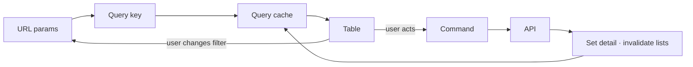

The table loop above is the whole read-and-write story for a list screen: the URL produces a query key, the key produces cached data, the table renders it, a filter change writes the URL, an action runs a command, the command updates the detail and invalidates the lists, and the cache re-renders the table.

```ts
// store/ui.ts — the entire Zustand footprint
export const useUi = create<{ sidebarOpen: boolean; assistantOpen: boolean; toggleSidebar(): void; setAssistant(open: boolean): void }>((set) => ({
  sidebarOpen: true, assistantOpen: false,
  toggleSidebar: () => set((s) => ({ sidebarOpen: !s.sidebarOpen })),
  setAssistant: (assistantOpen) => set({ assistantOpen }),
}));
```

---

## Part 11. The UI kit

Our own components on Radix primitives, styled with Tailwind and design tokens. The source of truth for tokens and visuals is the Ratio design system from the design project. Logic lives in the layers below; the kit only draws.

**Levels.** Tokens: the design-system palette, then the roles components use (accent, critical, success, warning, info, neutral, focus ring, overlay), type, spacing, radius, control heights, motion (120 ms), ring (no shadows), z-layers. Primitives: layout (Stack, Grid, Card, Divider); actions (Button including critical and icon-only, Link, DropdownMenu); form (Field, TextField, Textarea, NumberField with prefix and suffix, Select, Combobox, TagInput, Checkbox, Radio, Switch, DatePicker, RichText, MediaGrid); feedback (Badge, Banner, Spinner, Skeleton, ProgressBar, Toast); overlays (Dialog, ConfirmDialog, Drawer, Popover, Tooltip); data (DataTable on TanStack Table, Pagination, Tabs, Stepper, Timeline, EmptyState, Avatar, Kbd, Icon). Patterns: PageHeader, PageLayout (65/35), FormSection, SaveBar, FilterBar, BulkBar, Picker, ResultSummary. Shell frames only: AppFrame, Sidebar, TopBar, CommandPalette, SidePanel, Sheet. Surfaces fill and wire them: resource pickers, palette sources, nav gating, the assistant panel and proposal card, the jobs indicator, the toast queue, the form adapter from React Hook Form to `Field`, `confirm()` and formatter calls.

**Rules.** Presentational only: props in, events out; the kit imports nothing from the app; interactive state is controlled (`value` / `onChange`, `open` / `onOpenChange`) with internal state only for focus, hover and open. It never formats or decides: money and dates arrive as strings from domain formatters, surfaces map a status to a tone, built-in copy has English defaults overridable by a `labels` prop. Every pattern takes loading, empty, error and disabled states as props. WCAG 2.2 AA and the WAI-ARIA keyboard patterns are part of "done". `/playground`, built only into non-prod, shows every component and variant; axe runs on each and Playwright compares screenshots. Icons are lucide plus one wrapper for brand SVGs; the rich-text library is picked at implementation.

**Governance (d38).** `src/ui/` is read-only for feature work; CODEOWNERS (`@kit-owners`) approves changes, requested by a "UI kit change request" issue and shown in the playground. APIs are closed: a fixed list of variants and no `className` or `style` passthrough, so a new look can only come from a kit change. Lint errors, not warnings: raw hex, raw px, Tailwind arbitrary values (`bg-[#…]`) and fonts other than Inter outside the kit; raw `<button>`, `<input>`, `<select>`; kit-internal imports; look-alike components. The kit stays an in-repo folder until a second app needs it or bypasses keep recurring; it is not published to npm.

```tsx
// ui/primitives/Button.tsx — a closed API: variants are an enum, no className passthrough
type ButtonProps = {
  variant?: 'primary' | 'secondary' | 'ghost' | 'critical';
  size?: 'sm' | 'md';
  icon?: IconName; iconOnly?: boolean; loading?: boolean; disabled?: boolean;
  onClick?: () => void; children?: React.ReactNode;
};
export function Button({ variant = 'secondary', size = 'md', loading, ...p }: ButtonProps) { /* tokens only; no style prop */ }
```

---

## Part 12. Assistant and extensions

### 12.1 The assistant (Arya)

An in-app AI panel, similar to Rovo in Jira: it reads what the user is looking at and can propose actions, and the user confirms every write. The design names it Arya; it is a side panel that stays open while the user moves between pages, and it is another surface over the same contracts. The conversation loop is the assistant machine (Part 8.2).

**Screen context** sent with each message, so that "refund these" works: the current route and resource, the active filters (from the URL), the selected row ids, the open record id. A chip above the input shows what is shared; the user can remove it.

**Results.** Text streams with a Stop button. Records (list, get, search) render as record cards or a table with links; more than a few rows opens the list page with those filters. "Show me…" navigates or sets URL filters with no write and no approval. A write becomes a proposal card. A command result shows the outcome with links to affected records. An error shows a message with Retry. Unknown result types fall back to text.

LLM calls and API keys stay on the backend; the browser streams responses. There is no "auto-approve" in v1. Where the assistant backend lives, the model and cost limits, and whether Arya is a core feature or an installed app, are open questions 5 and 10.

### 12.2 MCP readiness (d43, pending)

Because every write is a command with a name, a JSON-schema input, effect flags and a permission, the command registry is already the shape an MCP server exposes as tools. The in-app assistant (v1) consumes it with human approval per write. An external MCP server (v2) that lets a merchant's own AI client call the same commands is not decided; it needs a per-merchant API token on the backend and the same proposal-and-approve discipline on the client. Nothing in the registry design would need to change; the decision is about the server and its authentication, not about the frontend contracts.

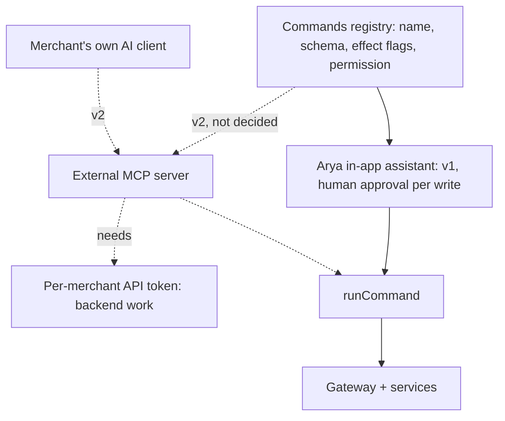

### 12.3 Extensions and embedded apps

Today GK supports two kinds of third-party UI, and both carry over. **UI extensions** are sandboxed worker code (`gokwik-ui-extensions-core/host/rpc`) rendered into an `ExtensionPoint`; the same runtime is kept, and targets are declared on resources. **Embedded apps** are an iframe with an app bridge (title bar, modal messages); the same bridge is kept at `/store/$storeId/apps/$handle/*`, plus toast, save bar (which joins the leave guard), resource picker, redirect and sidebar entries under Apps.

Three changes. Targets come from resources, with today's names (`admin.product-details.block.render`, `.sidebar.render`, `.action.render`); today `ExtensionPoint` is placed by hand and used only in the product form. Actions go through commands: extension-added actions appear in record or selection menus, and calls to built-in commands go through `runCommand` with the app as actor. Context is typed: each target declares the context it passes, validated by its schema. Two rules: one crashing extension never breaks the page (an error boundary per extension), and extensions never get the session token or direct API access. How an embedded app proves who the user is to its own backend (an app-scoped token, as App Bridge does) is open.

---

## Part 13. Decisions layered on top of the architecture

The discovery tracker closed forty-five decisions (d01 to d45, with d43 pending). Most are carried inside the layers above and have been cited where they apply. This part collects the ones that add to the code architecture rather than restate it: the API client's observability duties, the error screen, the bug-intake workflow, the silent-bug checks, and the contribution guardrails. They were reached problem-first, each from a stated problem rather than from a pattern catalogue.

### 13.1 The API client's observability duties: X-Request-Id and the passbook

The gateway generates an `X-Request-Id` for every request and returns it in the response, but today it is not in `Access-Control-Expose-Headers`, so a browser script cannot read it. The CORS change in Part 5.4 adds it to the exposed headers. Once exposed, the client does two things with it: it attaches it to a Sentry breadcrumb for every call, and it carries it on `ApiError.requestId` so that a failed command's toast and the support box (below) can show the last eight characters. The purpose is to settle "frontend or backend?" in one step: a backend engineer can find the exact request in their logs from the id, and a frontend engineer can see from the breadcrumb which call a flow made and in which order.

The **passbook** is the name given to the breadcrumb trail of command runs: `command.start` with the id, surface and target ids, then the API breadcrumbs the client adds, then `command.end` with the result status. It is written to Sentry breadcrumbs (and mirrored to PostHog as the audit event), so that when a later error is reported the preceding writes are visible in order, the way a bank passbook shows the transactions before a disputed one.

### 13.2 Error boundaries and the support box (d26, d44)

Today gk-pages' Single-SPA error boundary returns `null`; a crash makes the section disappear silently. Ratio has three levels. A route or section boundary shows "Something went wrong here" with Retry, keeps the rest of the app working, and reports to Sentry. An app-level boundary shows one crash page with Reload. An extension boundary isolates each extension.

The route boundary's card carries a **support box** (d44), designed so that one screenshot is enough for a report. It shows: the Error ID (the Sentry event id, short form); the page (route template, with the record id when there is one); the active filters; the time; the app version; the store id; the last API call with the last eight characters of its request id; and a "Steps" field the merchant can type into. It never shows a stack trace, request or response bodies, or the full breadcrumb list. It has a Copy button that copies all of it as text, and a "Report a problem" action that opens the same box without a crash, for bugs that do not throw. The reasoning is the user's perspective: the reason for a failure lives at the failure, not in a dashboard the merchant cannot see.

```tsx
// features/errors/RouteErrorBoundary.tsx (excerpt)
export function RouteErrorCard({ error, eventId, reset }: Props) {
  const route = useRouteTemplate(); const params = useSearch(); const store = useMerchant();
  const lastApi = useLastApiBreadcrumb();              // { method, path, status, requestId }
  const box = [
    `Error ID: ${short(eventId)}`, `Page: ${route}${params.id ? ` (${params.id})` : ''}`,
    `Filters: ${describe(params)}`, `Time: ${new Date().toISOString()}`,
    `Version: ${__APP_VERSION__}`, `Store: ${store.id}`,
    lastApi && `Last API: ${lastApi.method} ${lastApi.path} → ${lastApi.status} · req ${lastApi.requestId?.slice(-8)}`,
  ].filter(Boolean).join('\n');
  return (
    <Card tone="critical">
      <h2>Something went wrong here</h2>
      <Button variant="primary" onClick={reset}>Retry</Button>
      <SupportBox text={box} />                           {/* read-only lines + Steps textarea + Copy */}
    </Card>
  );
}
```

### 13.3 The fix-bug workflow and the four buckets

The problem stated was: a product manager hands a Jira ticket to an AI assistant, knows nothing about the code, and the bug should still get fixed. The answer lives in the repository as a committed skill (`.claude/skills/fix-bug/SKILL.md`) and a chapter in the engineering handbook, so that every contributor's assistant follows the same intake.

**Intake.** Required: the Error ID or the support-box text, the page link, and what was expected. Nice to have: steps, a screenshot, the store id. Collected by the assistant itself from the Error ID: the Sentry event with its breadcrumbs and request ids, the release, the route, and the recent commits touching that route. The assistant asks for anything missing in **one** Jira comment with all its questions, never one at a time, and never guesses.

**Four buckets.** A **frontend bug**: the assistant writes a failing test first, fixes it, opens a small PR with a preview link; a developer reviews the code and the reporter checks the preview. A **backend bug**: the assistant comments on the ticket with the request id, the endpoint and the observed response, and reassigns. **Not a bug**: the assistant explains the behaviour with the rule's source and changes nothing. **Information missing**: one comment with every question.

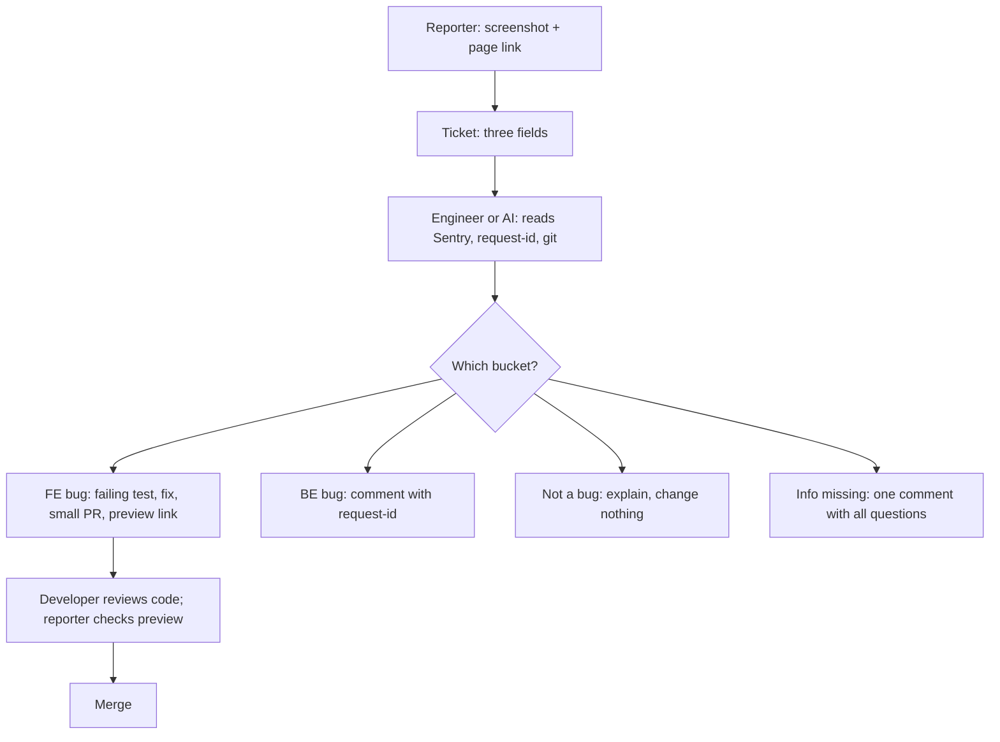

### 13.4 Silent bugs: prevent, catch, see (d45)

A crash is the easy case; the hard case is a flow that completes with the wrong call, such as a save that hits the wrong endpoint or sends rupees where paise were expected. Three layers address it. **Prevent, before production:** command tests that assert the exact endpoint and payload for each command (recorded gk-pages payloads compared byte for byte); outgoing Zod validation of every write payload, not only incoming responses; and XState maps that make an impossible transition unrepresentable. **Catch, while it happens:** the passbook breadcrumb; invariant checks at the boundaries (money never negative where it cannot be, ids present, counts matching); and handled errors reported to Sentry at warning level rather than swallowed. **See, afterwards:** session replay with inputs masked and sampled, and the "Report a problem" box for anything a merchant notices that the code did not.

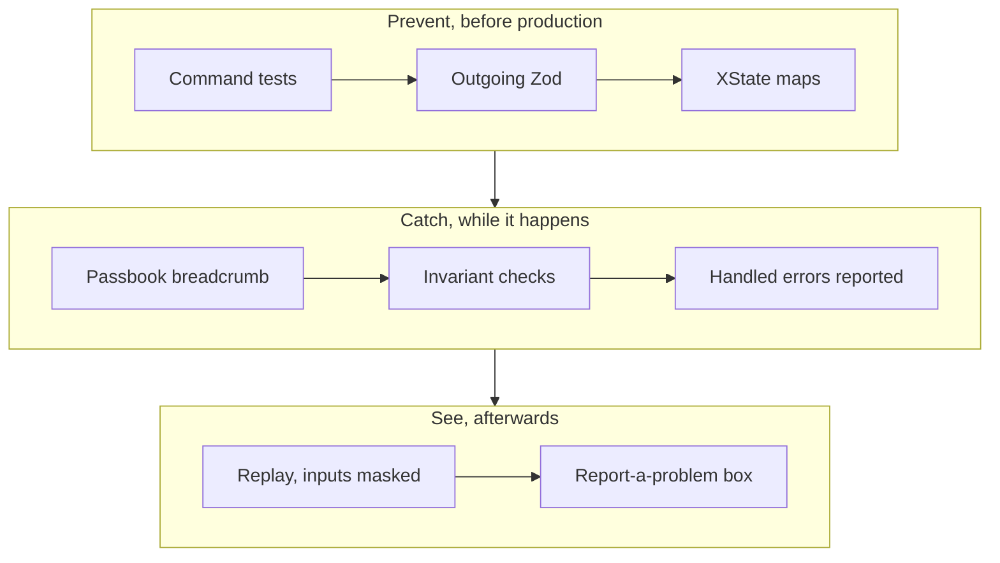

Three tools, each with one job: Sentry for errors, breadcrumbs and alerts to OpsGuard; PostHog for product events, feature flags, Web Vitals and the command audit; Microsoft Clarity for session replay. Replay is in one tool only, masked and sampled, never on login or payment screens.

### 13.5 Headers policy, in one place

The client sends exactly: the cookie (by the browser), `merchant-mid`, `gk-merchant-id`, `content-type`, and an idempotency header when a command declares one. It does not send the five request "security headers" the current utilities bundle adds (they are not read by anything), does not send `merchant-mid` twice, does not read a `mode` parameter from localStorage, does not block writes client-side for internal users (the server decides), does not fire a global loader event, does not return errors instead of throwing, and does not inline build environment keys. Each of these was found in the live bundle and each is a reason the client is written fresh rather than copied.

### 13.6 Guardrails for contributors and their assistants (d37, d39)

Outside and AI-assisted contributors must produce our code by default: recipes teach, the scaffolder makes the right way the fastest, and machines enforce.

**Recipes.** `CLAUDE.md` holds recipes, not prose ("New entity screen? 1. run the scaffolder 2. copy `resources/product.ts` …") plus a forbidden list, with nested copies in `src/ui/` and `src/resources/` and an `AGENTS.md` for other tools. The UI kit and one polished exemplar (products) come first, and every recipe points at them.

**Scaffolder.** `npm run new:resource <name>` generates the resource and command definitions, the `api/<service>` wire schema, transformer and fixtures, the domain schema, the registry entry and the tests; the cache class is required; pages come from the registry so none are generated. A second generator, `new:command`, adds one command with its test.

**Lint and CI.** Import boundaries (Part 2.4); the bans listed there; the kit rules (Part 11). A red CI locks the merge.

**CODEOWNERS.** `/src/` is the frontend team; `/src/ui/` is the kit owners.

**AI-native repository.** `.claude/skills/` is committed with `new-resource`, `add-command`, `review-pr` and `fix-bug`, so every contributor's assistant runs the same workflows. `mistakes.md` is committed with the mistake, the correct way and how it was caught, and every assistant session reads it first. `.claude/settings.json` is committed with safe commands allowed, `.env` and secret reads denied, and lint after edits. The PR template carries the checklist. The AI-PR contract: small PRs, tests in the same PR, the author states "I ran it" (screenshots for UI); reviewers ask "is this our pattern?", and "does it work?" is CI's job.

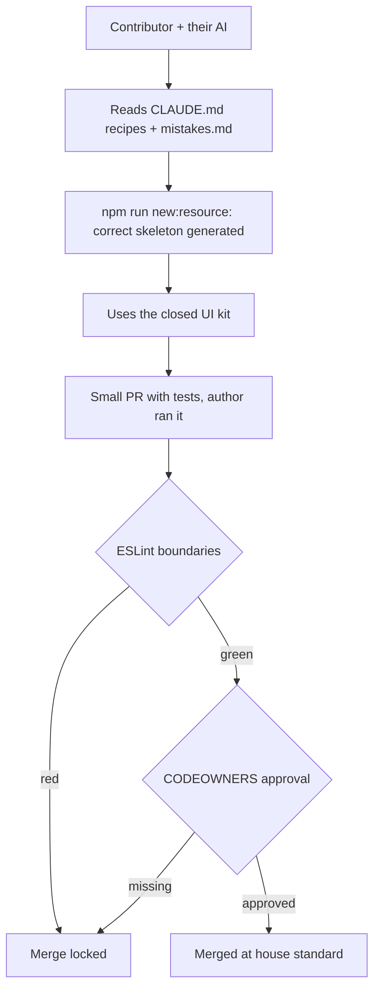

### 13.7 The decision index, by layer

For traceability, where each tracker decision lives in this document: d01 to d04, d08 and d36 in Part 3.5; d05 to d07 and d12 in Part 3.4; d11 and d31 in Part 3.2 and 6.2; d09 and d10 in Part 9.1; d13 to d16 in Part 9.3; d17 and d18 in Part 5.4; d19 to d21, d32 and d34 in Part 14.1; d22 to d30, d33 and d35 in Parts 3.7, 13.2 and 14; d37 and d39 in Part 13.6; d38 in Part 11; d40 in Part 2.5; d41 in Parts 6 and 9.3; d42 in Part 6.3; d43 in Part 12.2; d44 in Part 13.2; d45 in Part 13.4.

---

## Part 14. How the code is built, tested and shipped

### 14.1 Pipeline (d19, d28, d32, d34)

```mermaid
flowchart LR
  subgraph pr["Pull request"]
    direction LR
    PR([PR]) --> Gates["lint · tsc --noEmit · unit + integration<br/>Playwright on MSW fixtures · axe<br/>initial-bundle budget · audit (prod deps)<br/>(all blocking)"]
    Gates --> Prev["Preview deploy<br/>QA backend · non-prod badge"]
  end
  subgraph rel["Merge to main"]
    direction LR
    MG([merge]) --> Build["Build<br/>contenthash"] --> S3[(S3)] --> CDN["CDN: invalidate index.html"]
    CDN --> Smoke["Playwright smoke on staging<br/>login → pick merchant → products list → one save<br/>(deploy gate)"] --> Rel(["Release: tag → prod with approval"])
  end
```

Hosting is a real SPA: our own `index.html` on S3 behind CloudFront with every extensionless path falling back to it and a missing `.js` staying a 404. The git tag is the source of truth for the version, stamped into the bundle as `__APP_VERSION__`, the Sentry release and the GitHub release. Hashed assets are cached for a year and kept for previous releases; `index.html` is never cached; the CDN is invalidated on deploy; a failed chunk load or a newer version prompts a reload, and nobody is asked to hard-refresh. Rollback is repointing to the previous version. Environment config is build-time or runtime (open question 8), public keys only by allowlist, and previews use the QA backend. `main` is protected and changes go through pull requests. Renovate runs weekly, the audit gate covers production dependencies, the lockfile is committed, and a browser-support matrix is declared.

### 14.2 Tests

Unit tests cover pure logic: rules, money, transformers. Integration tests use MSW serving the recorded fixtures. Machines get one test per transition. One Playwright flow per main flow runs on PRs, plus the staging smoke after deploy. Rules are pinned to gk-pages behaviour with characterisation tests. The code is colocated: a component's styles, tests, hooks and schema sit together and move to shared only on the third use.

### 14.3 Build order and "done means"

The resource and command definitions are the target specification. Steps 2 and 3 build products and orders by hand against it and adjust the contracts where real code disagrees, before the rest is ported.

1. **Platform shell**: login and session machines, the entitlement guard, the merchant picker, the API client, chrome, CI and previews, Sentry, security headers, UI primitives. Output: an empty app a merchant can log into on staging.
2. **Products**: product and collection list and editor. Output: a confirmed resource contract; the record save, import, export and jobs machines.
3. **Orders**: list and detail, notes, tags, archive, cancel, refund, edit session, fulfillment and holds, drafts. Output: a confirmed command contract; the refund, order-edit-session and draft-payment-watch machines.
4. **Assistant**: panel, screen context, read tools, the proposal flow over v1 topics.
5. **Remaining resources**: inventory, purchase orders, transfers, customers, segments, discounts; the discount wizard machine.
6. **Extensions**: extension targets on resources, the app bridge in the new chrome.

The UI kit, the scaffolder and the recipes are ready before step 3, because the products exemplar is what every recipe points at. Steps 4 and 6 can move earlier if business priority demands, once step 3 is done.

A resource is done when its schema parses real sandbox responses (list and detail); its write payloads match what gk-pages sends today (recorded and compared); it is typed end to end with no `any` at boundaries; it ships loading, empty and error states; its permission keys are declared; and its tests follow the contribution rules with rules pinned to gk-pages behaviour.

```mermaid
flowchart TB
  A[1. Platform shell: apiClient, session, guard, chrome] --> B[2. Products: golden exemplar, resource contract confirmed]
  K[UI kit + scaffolder + CLAUDE.md] -. ready before 3 .-> B
  B --> C[3. Orders: command contract confirmed, refund + edit machines] --> D[4. Assistant] --> E[5. Remaining resources] --> F[6. Extensions]
```

### 14.4 Security, flags and the UX baseline in code

One CloudFront response-headers policy sets `Strict-Transport-Security`, `Content-Security-Policy: frame-ancestors 'none'` with `X-Frame-Options: DENY`, `Referrer-Policy: strict-origin-when-cross-origin`, a `Permissions-Policy` turning camera, microphone and geolocation off, and `X-Content-Type-Options: nosniff` (d24). No secrets reach the bundle (a public-env allowlist in the build config) and no public source maps. A full CSP rolls out in report-only mode after launch, reporting to Sentry, then is enforced. Embedded apps run in iframes inside Ratio; `frame-ancestors 'none'` applies to Ratio being framed, not to the apps it frames.

Feature flags are of two kinds (d27). A **release flag** in PostHog, percentage or per merchant (group `storeId`), is a kill switch where rollback is a toggle, and is removed once stable at 100%. A **capability** marks a feature without a backend in the resource and command contracts, and lasts until the API exists. Flags load at boot before routes, every flag has a safe default for when PostHog is blocked (calls go through a proxy), and entitlement stays `selected_products.pages`, never a flag.

Every screen ships loading, empty and error states with keyboard support, focus management and AA contrast (d29). Route-level code splitting with an initial-bundle budget enforced in CI (d23). CDN image transforms, native lazy loading, `font-display: swap` with preconnect, and skeleton-first loading with no layout shift (d33). Web Vitals through PostHog autocapture only (d30). One synthetic uptime check per minute, CDN alarms and alerts to OpsGuard (d25). A runbook, a tracking plan with `object_verb` snake_case event names and a PII masking policy before launch (d35).

---

## Part 15. Architecture decision records

One file per settled decision in `docs/architecture/adr/`, with Status, Context, Decision (with options considered) and Consequences. After team review an ADR is never edited; it is superseded.

**ADR 0001, resources and commands** (accepted 2026-10-14). Reads are resources; writes are commands; the assistant proposes and a person approves. Prior art drawn on: CQRS (writes as explicit typed commands separate from reads); VS Code commands (stable string IDs, `when` conditions, enablement separate from visibility, shortcuts bound to IDs); React-Admin mutation modes (pessimistic, optimistic and undoable as a per-command choice); Linear and Raycast palettes (context-aware ⌘K with record commands first, keywords, shortcuts shown); Shopify Admin GraphQL (field-level `userErrors`); Shopify admin action extensions (separate record and selection targets, a should-render check); Shopify bulk operations (long writes as background jobs with status polling); Medusa workflows (multi-step writes with compensation run in reverse); MCP tools (name, description, JSON-schema input, the four risk annotations); Shopify Sidekick (AI proposes, highlights filled fields, never saves without approval, limited to the staff member's permissions); Atlassian Rovo agents (confirmation before any non-read action); Salesforce Agentforce (actions grouped by topic, a per-action confirmation flag). Consequences: every write endpoint is called from exactly one command; confirmation, permissions, cache refresh, audit and error display behave the same on every surface; adding a surface needs no new write code; the cost is an upfront registry and execution layer, mitigated by building products and orders first.

**ADR 0002, new codebase** (accepted 2026-10-15). Ratio is built in this repository as a new codebase on this architecture; gk-pages is the behaviour reference; the tracker's decisions carry over unchanged except where they assumed in-place conversion (the API client keeps no `makeAPICall` signature, and response validation covers every response). Docs live in this repository, one home per document, and the folder can move later as a whole. Consequences: no compatibility layer for `@gokwik/utilities`, Redux slices or antd; gk-pages keeps running until cutover, and fixes landing there must be checked against these docs.

**ADR 0003, naming and data flow** (accepted 2026-10-15). One name per concept (Shopify vocabulary where open; `storeId`; `resource.create` / `update` / `delete`; scopes `read_products`); transform once at the boundary into a new object, read-only above it, display formats derived at render time. Consequence: a backend rename touches one transformer; lint forbids assignment to query data.

**ADR 0004, validate every response** (accepted 2026-10-15). Every response is parsed with its schema in the API module the same way: `safeParse`, drift logged to Sentry with endpoint and field path, data still rendered, money strict. Consequence: one code path, no list of critical endpoints, drift visible before it is a bug.

**ADR 0005, cache freshness is one switch** (accepted 2026-10-15, amended 2026-10-16). Queries declare a cache class, never a number; one policy object maps classes to `staleTime` with `fresh` and `balanced` presets and one `ACTIVE_POLICY` constant; start with `balanced`; `refetchOnWindowFocus` on globally. Consequence: changing the policy is a one-line diff; per-resource overrides need a comment.

Decided in the docs with no ADR of their own: logic leads and the design is asked to change; permissions declared on every command with enforcement off in v1; a flow's review step, a command's own form or an approved proposal is the confirm; list, editor and detail routes generated from the registry, with a mobile shell and desktop-first pages; the store in the URL, one store per tab.

---

## Part 16. Open questions that affect the code

- **2** The final subdomain (the name is Ratio); the cookie must be first-party to the page.
- **3** Gateway CORS for the new origin with credentials; blocks login and every API call; preview deploys need a `*.gokwik.in` host on the allowlist.
- **5** Where the assistant backend lives, the model, cost limits.
- **6** The permission list for commands; keys declared, enforcement off.
- **8** Deploy process: one build promoted through environments with runtime config, or a build per environment (per-env builds break "the build staging tested is the one prod runs").
- **9** Which APIs bypass the gateway today (uploads, direct hosts); needed before step 1.
- **10** Arya as core feature or installed app.
- **11** to **14** Sales channels per product, APIs for the onboarding checklist and settings, the notifications source, and the business-logic changes the design implies.
- **15** Where command audit events are stored and shown; v1 sends them to PostHog only.
- **16** Fixing the data-affecting defects in today's writes; the product bulk-edit price bug first.
- **20** OpenAPI specs for os-order, item, inventory, os-customer, discount V2 and bulk-ops, which would upgrade the wire schemas from inferred to confirmed.
- **21** Whether the server needs `POST /team/switch-merchant` when every call carries `merchant-mid`, and whether it breaks two tabs on different stores.
- **22** What `makeAPICall` does exactly (headers, envelope unwrapping, swallowed errors); the bundle analysis in the TRD answers most of it.
- **23** Tracker defaults never ratified: PR at most 400 lines, components around 150 lines, kit change SLA of one to two days, uptime check per minute, MSW and no snapshot tests, bulk confirm above 25 items.
- **24** Phased rollout while `selected_products.pages` stays the single source of entitlement.

Decided since the questions were raised: login and session are callable from the new origin and `GET /user/details` is the check; new codebase rather than in-place conversion; every response validated; the `balanced` cache policy behind the switch; team docs in this repository for now.

---

## Appendix A. Glossary

**Resource**: one entity as the admin presents it, defined once and consumed by lists, editors, search, the assistant and extensions. **Command**: one action that changes data, defined once and run through `runCommand` from every surface. **runCommand**: the single execution path for writes. **Surface**: any place a user can trigger a command (button, menu, bulk bar, palette, shortcut, assistant, extension). **Wire schema**: the Zod schema of what one backend service actually sends. **Domain schema**: the Zod schema of what the app means by an entity. **Transformer**: the pure function that turns a wire shape into a domain object, or domain input into a wire payload. **Cache class**: `list`, `detail`, `lookup` or `calc`; the only way a query gets a `staleTime`. **Capability**: a flag on a resource or command that hides it everywhere while its backend does not exist. **Machine**: an XState v5 state machine for a multi-step flow. **Actor**: a machine's async worker, replaceable in tests. **Poll policy**: the rules for asking the server "done yet?". **Passbook**: the breadcrumb trail of command runs. **Support box**: the copyable block of context on the route error card. **Entitlement**: `selected_products.pages`, the per-merchant flag that decides who gets Ratio. **storeId**: the merchant's `m_id`, the tenant key in URLs, query keys and headers. **Gateway**: the Envoy behind Cloudflare that terminates auth and CORS for every service. **Proposal card**: the assistant's rendering of a write it wants to run, whose approval is the confirm.

## Appendix B. Index of the specification files

The consolidated material above comes from the following files under `docs/architecture/` on this branch, and each remains the detailed reference for its topic.

- `README.md` (the map and the seven principles); `docs/context.md`, `docs/stack.md`, `docs/structure.md`, `docs/state.md`, `docs/design-mapping.md`, `docs/build-order.md`, `docs/open-questions.md`.
- `adr/0001` to `adr/0005`.
- `platform/README.md`, `platform/api-client.md`, `platform/auth-session.md`, `platform/identity-access.md`.
- `domain/README.md`, `conventions.md`, `catalog.md`, `orders.md`, `inventory.md`, `customers.md`, `discounts.md`, `custom-fields.md`, `pricing-tax.md`, `store.md`, `deferred.md`.
- `service-api/README.md`; `gateway/README.md`, `access.md`, `dashboard.md`, `os-order.md`, `item.md`, `inventory.md`, `os-customer.md`, `discount.md`, `bulk-ops.md`, `media-apps.md` (every endpoint, 295 in all).
- `resources/README.md`, `contract.md`, `data-access.md`, `list.md`, `editor.md`, `registry.md`, and `defs/` for order, draft-order, product, collection, inventory, purchase-order, transfer, customer, segment, discount.
- `commands/README.md`, `contract.md`, `execution.md`, `surfaces.md`, `bulk-and-jobs.md`, `registry.md`, and `defs/` for catalog, inventory, orders, customers, discounts, bulk-ops.
- `docs/machines.md`; `surfaces/README.md`, `routing.md`, `chrome.md`, `pages.md`; `docs/ui-kit.md`, `docs/assistant.md`, `docs/extensions.md`.
- `operations/README.md`, `delivery.md`, `quality.md`, `contribution.md`.

The decision tracker that produced d01 to d45, the engineering handbook chapter on bugs and debugging (`docs/engineering/08-bugs-and-debugging.md`) and the `fix-bug` skill complete the set.
